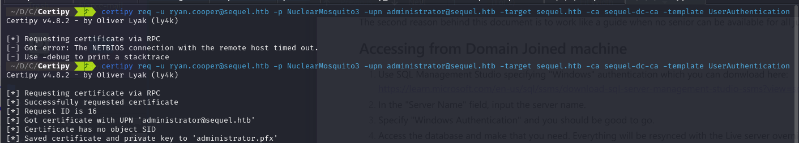

<section class="journal-hero">
<h1>HTB  Writeups</h1>
Follow the evidence, the dead ends, and the decisions behind the commands. Retired-machine investigations from first signal to final privilege.
<a class="collection-link" href="#machine-library"><svg viewBox="0 0 24 24" aria-hidden="true"><path d="M14 3H5v18h14V8l-5-5Z"/><path d="M14 3v5h5M8 12h8m-8 4h5"/></svg> Browse all 11 investigations</a>
<section class="case-feature" aria-labelledby="featured-case">

<svg viewBox="0 0 24 24" aria-hidden="true"><path d="M14 3H5v18h14V8l-5-5Z"/><path d="M14 3v5h5M8 12h8m-8 4h5"/></svg>Featured investigation<h2 id="featured-case"><a href="active-directory/escape/">Escape</a></h2>
An exposed document opens the door. A vulnerable certificate template takes it all the way to Administrator.

Windows / Active DirectoryMedium

<a class="feature-open" href="active-directory/escape/">Read Escape</a>

SMB document<svg viewBox="0 0 24 24" aria-hidden="true"><path d="M4 12h15m-5-5 5 5-5 5"/></svg>MSSQL access<svg viewBox="0 0 24 24" aria-hidden="true"><path d="M4 12h15m-5-5 5 5-5 5"/></svg>ADCS ESC1
<button class="feature-evidence" type="button" data-evidence="assets/images/machines/escape-certificate-issued.png" data-caption="Escape: Certipy successfully requests a certificate for the Administrator UPN.">Actual evidence from the writeup · Expand</button></section></section><section class="library" id="machine-library" aria-labelledby="library-title">
<h2 id="library-title">Machine library</h2>
Every path has something to teach.

<svg viewBox="0 0 24 24" aria-hidden="true"><circle cx="10.8" cy="10.8" r="6.5"/><path d="m16 16 4.5 4.5"/></svg><label class="sr-only" for="machine-search">Search machines or techniques</label><input id="machine-search" type="search" placeholder="Search machines or techniques" value="" autocomplete="off">

<label for="platform-filter">Platform</label><select id="platform-filter"><option selected>All platforms</option><option >Active Directory</option><option >Windows</option><option >Linux</option></select>

<label for="difficulty-filter">Difficulty</label><select id="difficulty-filter"><option selected>Any difficulty</option><option >Easy</option><option >Medium</option></select>

<button class="clear-filters" id="clear-filters" type="button">Reset filters</button>

<a class="machine-card" data-platform="Active Directory" href="active-directory/administrator/" aria-label="Read Administrator, Medium, Active Directory">
<svg viewBox="0 0 24 24" aria-hidden="true"><rect x="8" y="3" width="8" height="6" rx="1"/><path d="M12 9v5M5 14h14M5 14v3m14-3v3"/><rect x="2" y="17" width="6" height="4" rx="1"/><rect x="16" y="17" width="6" height="4" rx="1"/></svg>Medium
<h3>Administrator</h3>Windows / Active Directory
An ACL reset chain to Kerberoasting and DCSync.

ACL abuse / DCSyncRead writeup
</a><a class="machine-card" data-platform="Active Directory" href="active-directory/escape/" aria-label="Read Escape, Medium, Active Directory">
<svg viewBox="0 0 24 24" aria-hidden="true"><rect x="8" y="3" width="8" height="6" rx="1"/><path d="M12 9v5M5 14h14M5 14v3m14-3v3"/><rect x="2" y="17" width="6" height="4" rx="1"/><rect x="16" y="17" width="6" height="4" rx="1"/></svg>Medium
<h3>Escape</h3>Windows / Active Directory
An exposed document, a SQL foothold, and a vulnerable certificate template.

MSSQL / ADCS ESC1Read writeup
</a><a class="machine-card" data-platform="Active Directory" href="active-directory/cicada/" aria-label="Read Cicada, Easy, Active Directory">
<svg viewBox="0 0 24 24" aria-hidden="true"><rect x="8" y="3" width="8" height="6" rx="1"/><path d="M12 9v5M5 14h14M5 14v3m14-3v3"/><rect x="2" y="17" width="6" height="4" rx="1"/><rect x="16" y="17" width="6" height="4" rx="1"/></svg>Easy
<h3>Cicada</h3>Windows / Active Directory
Patient SMB and LDAP enumeration leads to backup privileges.

SMB / SeBackupPrivilegeRead writeup
</a><a class="machine-card" data-platform="Windows" href="windows/access/" aria-label="Read Access, Easy, Windows">
<svg viewBox="0 0 24 24" aria-hidden="true"><path d="m3 5 8-1v7H3V5Zm10-1 8-1v8h-8V4ZM3 13h8v7l-8-1v-6Zm10 0h8v8l-8-1v-7Z"/></svg>Easy
<h3>Access</h3>Windows
Recover credentials from FTP artifacts and follow the cached access.

FTP / Credential recoveryRead writeup
</a><a class="machine-card" data-platform="Windows" href="windows/jeeves/" aria-label="Read Jeeves, Medium, Windows">
<svg viewBox="0 0 24 24" aria-hidden="true"><path d="m3 5 8-1v7H3V5Zm10-1 8-1v8h-8V4ZM3 13h8v7l-8-1v-6Zm10 0h8v8l-8-1v-7Z"/></svg>Medium
<h3>Jeeves</h3>Windows
Jenkins execution, token impersonation, and a hidden NTFS stream.

Jenkins / ImpersonationRead writeup
</a><a class="machine-card" data-platform="Linux" href="linux/broker/" aria-label="Read Broker, Easy, Linux">
<svg viewBox="0 0 24 24" aria-hidden="true"><path d="m8 8-5 4 5 4m8-8 5 4-5 4M14 4l-4 16"/></svg>Easy
<h3>Broker</h3>Linux
ActiveMQ execution and a dangerous sudo rule for nginx.

ActiveMQ / nginxRead writeup
</a><a class="machine-card" data-platform="Linux" href="linux/busqueda/" aria-label="Read Busqueda, Easy, Linux">
<svg viewBox="0 0 24 24" aria-hidden="true"><path d="m8 8-5 4 5 4m8-8 5 4-5 4M14 4l-4 16"/></svg>Easy
<h3>Busqueda</h3>Linux
Searchor injection, Git secrets, and relative-path abuse.

Searchor / DockerRead writeup
</a><a class="machine-card" data-platform="Linux" href="linux/chemistry/" aria-label="Read Chemistry, Easy, Linux">
<svg viewBox="0 0 24 24" aria-hidden="true"><path d="m8 8-5 4 5 4m8-8 5 4-5 4M14 4l-4 16"/></svg>Easy
<h3>Chemistry</h3>Linux
Chain two Python CVEs from file upload to root SSH access.

pymatgen / aiohttpRead writeup
</a><a class="machine-card" data-platform="Linux" href="linux/linkvortex/" aria-label="Read LinkVortex, Easy, Linux">
<svg viewBox="0 0 24 24" aria-hidden="true"><path d="m8 8-5 4 5 4m8-8 5 4-5 4M14 4l-4 16"/></svg>Easy
<h3>LinkVortex</h3>Linux
Exposed Git history and symlink primitives from web access to root.

Ghost / SymlinksRead writeup
</a><a class="machine-card" data-platform="Linux" href="linux/titanic/" aria-label="Read Titanic, Easy, Linux">
<svg viewBox="0 0 24 24" aria-hidden="true"><path d="m8 8-5 4 5 4m8-8 5 4-5 4M14 4l-4 16"/></svg>Easy
<h3>Titanic</h3>Linux
Follow a file-read primitive through Gitea to ImageMagick execution.

Gitea / ImageMagickRead writeup
</a><a class="machine-card" data-platform="Linux" href="linux/updown/" aria-label="Read UpDown, Medium, Linux">
<svg viewBox="0 0 24 24" aria-hidden="true"><path d="m8 8-5 4 5 4m8-8 5 4-5 4M14 4l-4 16"/></svg>Medium
<h3>UpDown</h3>Linux
A layered web chain through Git disclosure, PHAR, and sudo.

PHAR / GTFOBinsRead writeup
</a>
</section>

